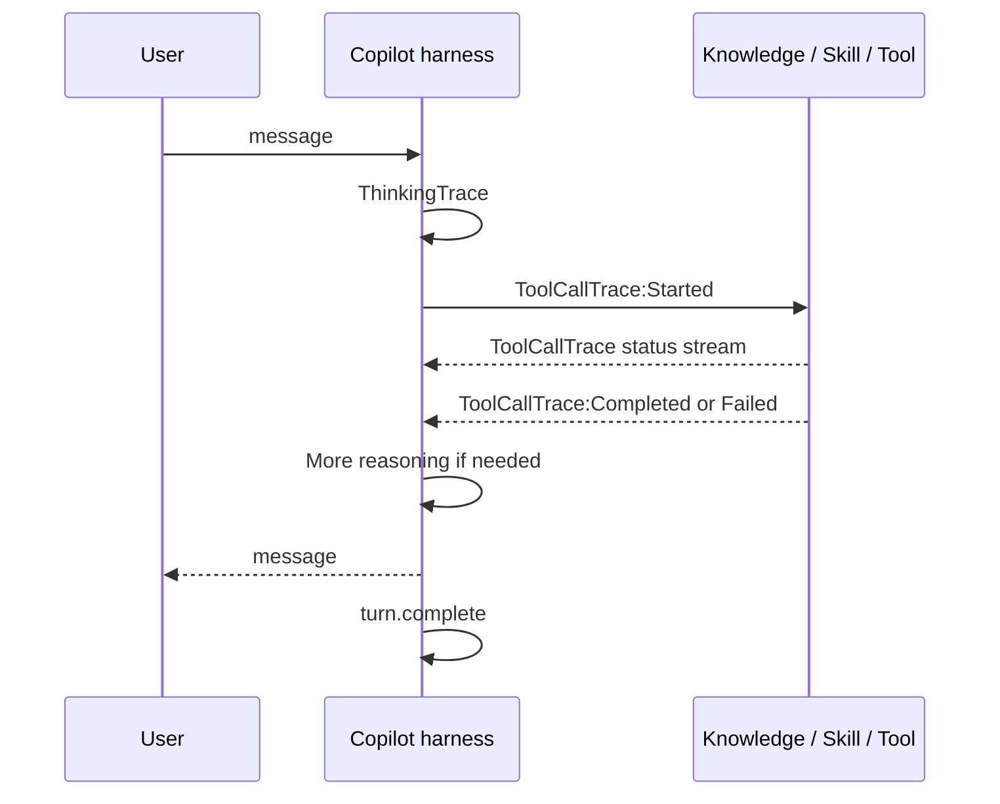

A user tells you the agent gave them the wrong answer yesterday. You ask the same question today and get a perfectly good response.

Reproducing the question is useful, but it doesn't tell you what happened in that earlier exchange. Which tool did the agent pick? What came back? Did it stop because something failed, or because it needed the user's permission?

Agents powered by the [Microsoft Copilot harness](https://learn.microsoft.com/microsoft-copilot-studio/agents-experience/overview) use a different set of transcript events. These events let you read the recorded reasoning text, see which tools the agent called, and inspect what those tools returned. This post explains how to find those events and interpret what happened.

## Start with the tools, not the JSON

For a conversation available in **Preview**, start with [**Preview > History**](https://learn.microsoft.com/microsoft-copilot-studio/agents-experience/preview-history). Select the conversation, or use **Find by ID**, and turn **End user preview** off to see the activity trace for each message. You can review past interactions there; the trace isn't limited to the conversation currently running.

The [Copilot Agent Kit overview]({{ site.url }}) introduces another useful starting point. Two tools are worth distinguishing:

- **[Agent Debugger](https://learn.microsoft.com/en-us/microsoft-copilot-studio/guidance/kit-agent-debugger)** helps you inspect a recorded conversation's execution path, reasoning, tool arguments, and results when those details are available in the transcript.
- **[Conversation Analyzer](https://learn.microsoft.com/microsoft-copilot-studio/guidance/kit-conversation-analyzer)** is for message-level questions such as sentiment, personal data, or a custom analysis prompt, rather than reasoning and tool traces. Check speaker labels and batch completeness, especially for connected-agent conversations.

Raw JSON is the next step when you need to investigate a particular payload, correlate parent and child conversations, or write your own analysis. You don't need to start there.

> **Check availability before looking in Dataverse.** The [transcript access guidance](https://learn.microsoft.com/microsoft-copilot-studio/admin-transcript-controls) lists Microsoft Copilot agents among the exclusions from Dataverse transcript recording. Check the current guidance and your environment's recording settings; use Preview history where available. Neither the Kit nor a manual export can retrieve a record that wasn't stored.
{: .prompt-warning }

## What to look for in an available transcript

[Open the Hood]({{ site.url }}) covers topic and routing events such as `IntentRecognition`, `DialogRedirect`, and `nodeTraceData`. Here the useful questions are what the agent was reasoning about, which capability it selected, what arguments it supplied, what came back, and whether the turn finished.

An agent on the Copilot harness can choose [knowledge](https://learn.microsoft.com/microsoft-copilot-studio/agents-experience/knowledge-copilot-studio) and [tools](https://learn.microsoft.com/microsoft-copilot-studio/agents-experience/tools-overview), activate [skills](https://learn.microsoft.com/microsoft-copilot-studio/agents-experience/skills-overview), and adapt to the results. Follow that sequence rather than expecting an authored topic path.

Look for `ToolCallTrace` and `ThinkingTrace` in both `name` and `valueType`. They identify the event family covered here. `DynamicPlan` events call for the topic-and-plan analysis described in the earlier post. A message-only or mixed transcript needs closer inspection; one missing marker doesn't establish which harness produced it.

## Finding the record

Ask the user to type `/debug conversationid` in the chat. That returns a GUID, and it is by far the fastest route to a specific conversation (see [How to Get Your Conversation ID]({{ site.url }})). Declarative agents use plain `/debug` instead.

You can export available transcripts using the **Export data** functionality in Power Apps. Follow the [transcript export instructions](https://learn.microsoft.com/en-us/microsoft-copilot-studio/analytics-transcripts-powerapps#view-and-export-conversation-transcripts-from-the-power-apps-portal), and treat the exported content as sensitive conversation data.

You need the **Bot Transcript Viewer** role to view transcripts in Power Apps; **Environment maker** alone doesn't grant access. Check the environment's [recording and download settings](https://learn.microsoft.com/microsoft-copilot-studio/admin-transcript-controls#configure-transcript-recording-and-download), retention, and the harness availability limitation above before treating a missing row as a timing issue.

The [`conversationtranscript`](https://learn.microsoft.com/power-apps/developer/data-platform/reference/entities/conversationtranscript) columns that matter are `Name`, which holds the conversation ID joined to the agent ID, `Content`, which holds the activity JSON, `Metadata`, which carries agent details and `BatchId`, and `ConversationStartTime`. Use the conversation ID to locate matching `Name` values in the export. The examples below use `AgentId` for the agent identifier; its literal key in `Metadata` is `BotId`.

For conversations eligible for Dataverse recording, the [documented save behavior](https://learn.microsoft.com/microsoft-copilot-studio/analytics-transcripts-powerapps#understand-conversation-transcripts) is a record after 30 minutes of inactivity. For agents published to the Telephony channel, the timeout is three minutes after an *End Conversation* event. Those timings don't override recording settings or make an unsupported conversation appear.

### One conversation, several rows

Before interpreting a record, check whether you have the whole conversation. Rows sharing the same `Name` arise for two independent reasons:

- After 30 minutes of inactivity, resumed activity is written to a new row with the same `Name` and a new `ConversationStartTime`.
- `Content` is capped at 1 MB. When one session exceeds that limit, the platform splits it across rows with the same `Name` and `ConversationStartTime` but different `BatchId` values.

File operations and skill execution can produce long streams of status events, so one session can span several batches.

Merge before you analyze anything. Group by `Name`, order the sessions by `ConversationStartTime`, then order each session's batches by `BatchId`:

```text
Name = {ConversationId}_{AgentId}
  ├── ConversationStartTime T1
  │   ├── BatchId 0   ← activities part 1
  │   ├── BatchId 1   ← activities part 2
  │   └── BatchId 2   ← activities part 3
  └── ConversationStartTime T2   ← resumed after inactivity
      └── BatchId 0
```

Read just one batch and you can mistake a missing piece for a failed operation.

> **Do not parse `Name` by splitting on `_`.** That works only when the conversation ID is a plain GUID. Teams and Direct Line conversation IDs contain underscores of their own, so values like `19:…@thread.v2_{AgentId}` are normal and a naive split misidentifies the agent. Match on the whole value, or split from the right using the known `AgentId`.
{: .prompt-warning }

### Connected agents write their own rows

A connected agent can have separate transcript rows, with `Name` values containing the parent conversation ID plus a child segment. The parent records the handoff and result, not the child's complete activity history.

Read the child row's `Name` as:

```text
Name = {ChildConversationIdAsStored}_{AgentId}
```

For the connected-agent pattern described here, `ChildConversationIdAsStored` begins with `{ParentConversationId}_{ChildConversationId}`. The child ID is returned as `conversation_id` in the correlated agent tool call's result. Match that prefix and preserve any remaining conversation segments rather than assuming a fixed number of underscore-separated parts.

You can spot that delegation in the parent transcript through `ConnectedAgentInitializeTraceData` and `ConnectedAgentCompletedTraceData`. Those markers confirm that a connected agent was invoked, but the child's reasoning and tool calls still live in the child transcript row.

That has a practical consequence during triage. Pull the parent row alone and the delegated work looks like a gap: the parent hands off, some time passes, and an answer comes back with nothing in between to explain it. The reasoning and tool calls that produced that answer are sitting in a row you have not fetched. When a conversation involves connected agents, search for rows whose `Name` starts with the parent conversation ID, then verify the child identifiers against the delegation events or the agent tool call's result.

Check speaker attribution in those child records too. The numeric role alone can be misleading, as the example below shows.

### Identify test-pane conversations

Use [`ConversationInfo.isDesignMode`](https://learn.microsoft.com/microsoft-copilot-studio/analytics-transcripts-powerapps#common-activity-value-types) to distinguish test-pane conversations (`true`) from non-test-pane traffic (`false`). Merge batches before checking the flag, and keep a missing value as **unknown**, not production. The channel alone doesn't establish test status; `pva-autonomous` can carry production activity.

## Key fields to focus on

Start with the activity envelope. These fields let you find the diagnostic events, order them, and connect them to the messages around them.

| Field | What to know |
| --- | --- |
| `type` | `message` for user and agent turns, `trace` or `event` for everything diagnostic |
| `name` / `valueType` | The event marker. Some events populate only one of the two, so always check both |
| `value` | The payload, and where nearly all diagnostic detail lives |
| `timestamp` | Can be epoch seconds or an ISO string; prefer `timestampMs` when present for finer timing, otherwise parse the supplied format |
| `channelId` | Real values include `pva-studio`, `pva-autonomous`, `pva-published-engine-direct`, `directline`, `msteams`, and other channel-specific names |
| `replyToId` | Ties a trace event back to the message that triggered it |
| `from.role` | Commonly `0` for the agent and `1` for the user in these records; check the speaker pattern before relying on numeric roles |

The `name` and `valueType` split is easy to miss. Look for the `ToolCallTrace` family and `ThinkingTrace` in `name`, and `SessionInfo` and `ConversationInfo` in `valueType`. A scan that checks only one field misses events recorded in the other.

### Check who is speaking

Connected-agent transcripts can use `role: 1` for both sides. One pattern distinguishes them by `from.aadObjectId`: the user message has it, while the agent message doesn't. Here's an illustrative, sanitized pair; the identifiers and message text are placeholders:

```json
[
  { "type": "message",
    "from": { "role": 1, "id": "speaker-a",
              "aadObjectId": "11111111-1111-1111-1111-111111111111" },
    "text": "Check the order status." },
  { "type": "message",
    "from": { "role": 1, "id": "speaker-b" },
    "text": "The order has shipped." }
]
```

In this example, the identity field helps distinguish the user from the agent even though the numeric roles match. It doesn't mean every message without `aadObjectId` is an agent message: anonymous users or channels that omit identity can leave it out too.

Treat the identity-field distinction as a heuristic, not a role contract. First merge all batches, honor explicit string roles such as `user` and `bot` where present, and compare sender IDs with known conversation context. If identity is missing on both sides, present on both, or inconsistent, preserve the sender fields and label the speaker **unknown** rather than guessing. You don't need to resolve or publish the person's identity to group messages by speaker.

## Anatomy of a turn

The typical shape of a turn looks like this.



The diagram is a reading guide, not a fixed sequence. Reasoning can arrive in several chunks, and calls can fire back to back, immediately after a failure, or at the very start of a turn. Some calls include an intermediate status stream. A skill can produce a great many sandbox events, and a completion can land in a later split row.

## The events that matter

### `ThinkingTrace`

`ThinkingTrace` carries the reasoning text that the [activity trace](https://learn.microsoft.com/microsoft-copilot-studio/agents-experience/authoring-activity-trace) surfaces, in a `thinkingText` field.

The text can arrive as delta fragments, followed by a cumulative snapshot equal to those fragments combined. A later segment can follow in the same turn. To read that pattern correctly, buffer the deltas, recognize the snapshot rather than appending it a second time, and flush any incomplete buffer before the next tool call so the reasoning does not drift out of order.

Reasoning is narrative rather than a timed operation, so it reads best as inline text next to the steps it preceded. It is also not a complete record of every internal model operation. It is the trace the product exposes for debugging, and its granularity varies.

### The `ToolCallTrace` family

Four distinct events share this prefix, and the difference between them matters.

The generic `ToolCallTrace` carries incremental `status` strings such as `Running Bash...`, `Reading a file...`, `Loading skill...`, and `Calling KnowledgeSearch`. In file-heavy turns these can dominate the record. Use them to understand progress, and use the lifecycle markers to reconstruct the calls.

`ToolCallTrace:Started` is the most valuable event in the transcript. It records what the harness chose and what it prepared:

| Field | Meaning |
| --- | --- |
| `toolCallId` | Correlation ID shared by the start, completion, and failure |
| `toolName` | Internal tool identifier |
| `toolDisplayName` | Human readable name shown in the activity trace |
| `toolKind` | Capability category: `search`, `tool`, or `agent` |
| `filledParameters` | Inputs the agent supplied |
| `unfilledParameters` | Inputs still missing |
| `hiddenFilledParameters` | Runtime supplied values not shown as user inputs |

Skills need special handling. Recognize a loaded skill by `toolName: "skill"` and use `toolDisplayName` for its name. Don't rely on `toolKind` being present, or group every skill under the generic name `skill`.

`ToolCallTrace:Completed` closes a call successfully, carrying the same `toolCallId`, a `durationMs`, and a `result` that may be text or JSON. The `result` is where the step's observation lives.

`ToolCallTrace:Failed` is the first place to look for connector authentication problems, invalid parameters, timeouts, and MCP or sandbox errors. Check both `status` and `errorMessage`. A `status` string can include the diagnosis directly, as in this illustrative example:

```text
list_records_with_organization failed: Connector returned 403:
{"error":{"code":"0x80072560","message":"The user is not a member of the organization."}}
```

Here, the HTTP status and connector message are visible without opening a separate error field. Other failures may put the useful detail in `errorMessage`.

### `turn.complete` and `turn.awaitConsent`

`turn.complete` marks the end of the harness work for a turn. Its payload is empty, so the marker itself is the whole signal. It can follow the agent's reply, but isn't present on every turn. Treat it as positive confirmation that a turn closed, never as a required boundary, and do not read its absence as a failure.

`turn.awaitConsent` appears when a tool needs the user to authorize it, for example a connector action that surfaces a consent card. Its payload carries `requestId`, `toolName`, and the `connectors` awaiting authorization. A turn sitting on this event is waiting on the user rather than the agent, which is worth knowing before you go hunting for a performance problem that does not exist.

### `SessionInfo`

`SessionInfo` is a useful first stop when you're triaging several sessions. Start with `startTimeUtc`, `endTimeUtc`, `turnCount`, `type`, `outcome`, and `outcomeReason`. Additional fields can include `impliedSuccess`, `csatScore`, and `lastUserIntentId`; don't assume every record has them.

Keep **session type** and **session outcome** in separate columns, as described in the [`SessionInfo` reference](https://learn.microsoft.com/microsoft-copilot-studio/analytics-transcripts-powerapps#common-activity-value-types). Types include `Engaged` and `Unengaged`. Outcome spellings vary across transcript families, so keep values such as `Resolved`, `Abandoned`, `HandOff`, and the literal string `None` distinct rather than assuming every family uses the same set.

Case-insensitive comparison handles `engaged` versus `Engaged`, but not differently named values. For reporting, the following labels normalize capitalization without combining distinct outcomes:

| Field | Raw value, matched case-insensitively | Reporting label |
| --- | --- | --- |
| `type` | `engaged` | `engaged` |
| `type` | `unengaged` | `unengaged` |
| `outcome` | `Resolved` | `resolved` |
| `outcome` | `Escalated` | `escalated` |
| `outcome` | `Abandoned` | `abandoned` |
| `outcome` | `HandOff` | `handoff`, kept separate from `escalated` |
| `outcome` | Literal string `None` | `none`, kept separate from a missing field |
| Either | Missing or unfamiliar value | `unknown`, with the original value retained |

These are reporting labels for the documented and observed spellings, not replacement values to write back into the transcript. Store the raw value alongside the label. In particular, don't silently turn `HandOff` into `Escalated`, or treat `None` as proof that the conversation succeeded.

The companion `outcomeReason` explains why a session ended and is usually more useful than the outcome by itself. Example values include `NoError`, `UserExit`, `Resolved`, `UserError`, `SystemError`, `AgentTransferConfiguredByAuthor`, `AgentTransferRequestedByUser`, and `AgentTransferFromQuestionMaxAttempts`.

## A trimmed turn

This illustrative turn leaves out the status stream and uses invented messages and identifiers:

```json
[
  { "type": "message", "from": { "role": 1 }, "text": "Any open orders for Contoso?" },
  { "type": "trace", "name": "ThinkingTrace",
    "value": { "thinkingText": "I need to look up open orders for this account." } },
  { "type": "trace", "name": "ToolCallTrace:Started",
    "value": { "toolCallId": "call_01", "toolName": "list_records",
               "toolKind": "tool", "filledParameters": { "table": "orders" } } },
  { "type": "trace", "name": "ToolCallTrace:Completed",
    "value": { "toolCallId": "call_01", "durationMs": 812, "result": "{\"count\":3}" } },
  { "type": "message", "from": { "role": 0 }, "text": "Contoso has 3 open orders." },
  { "type": "trace", "name": "turn.complete", "value": {} }
]
```

Read it as a loop rather than a script. Reasoning sets up a call, the call returns an observation, and the observation either produces an answer or feeds the next round of reasoning.

## What to trust

A few habits keep this from going wrong.

Merge split rows before counting anything, because a missing completion can be a completion that landed in the next row. Match `name` and `valueType` on every scan. Correlate tool calls by `toolCallId` rather than by adjacency. Read `SessionInfo` first when triaging in bulk, and use `outcomeReason` to help distinguish failures from ordinary handoffs.

Be careful about inferring order from the diagram. A call with no reasoning in front of it isn't evidence that the agent skipped a step. A completion can also be present without its start in the records you retrieved; retain it rather than discarding it.

And treat the absence of a lifecycle marker as weak evidence. Completions trail their triggers, `turn.complete` is optional, and reasoning appears only where the product chose to expose it. A recorded completion is useful evidence of what the platform reported, not proof that the user's goal was met. Missing or redacted content needs context too.

## Wrapping up

Start with Preview history or Agent Debugger when the conversation is available there. When you need to go deeper into a Copilot harness transcript, get all the records first, check who is speaking, then follow the tool-call IDs through arguments and results. That is usually more useful than reading thousands of status lines from top to bottom.

Before calling a gap a failure, check for another batch, a child conversation, or a pending consent request. Those are different things to fix, even when the chat looks the same.
