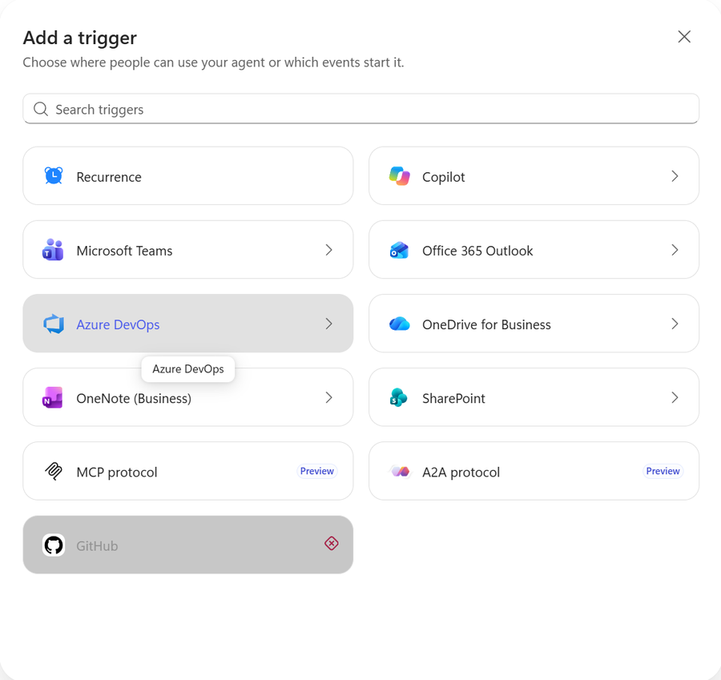
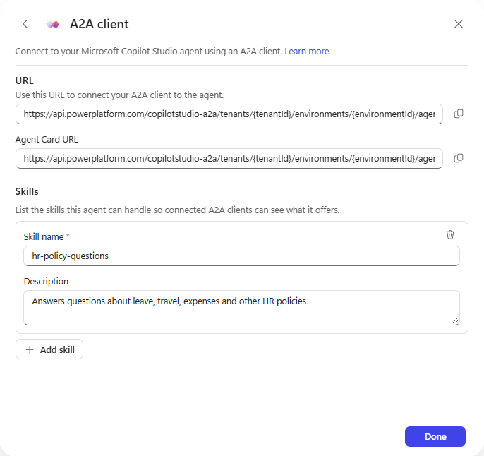
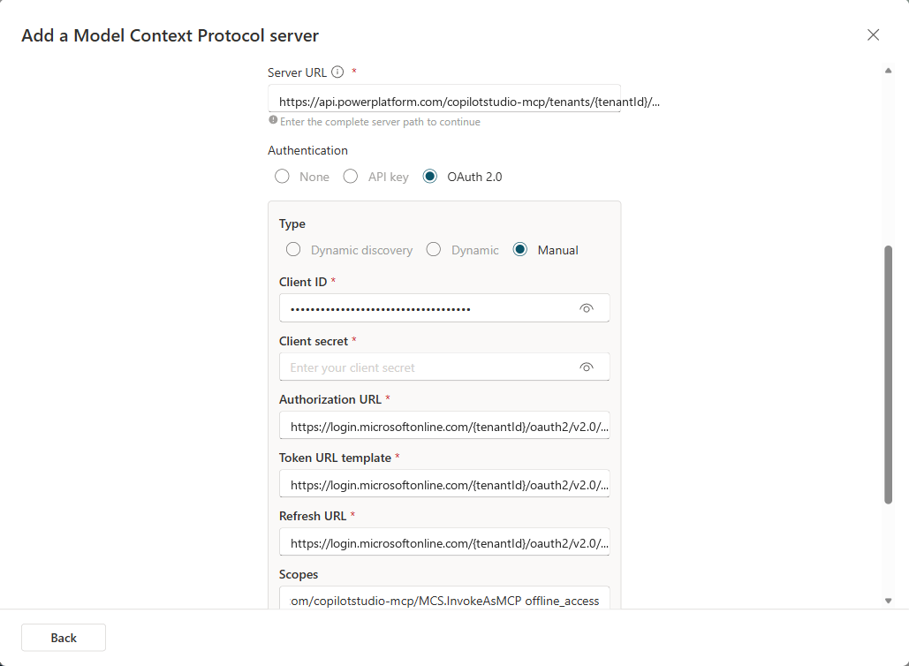
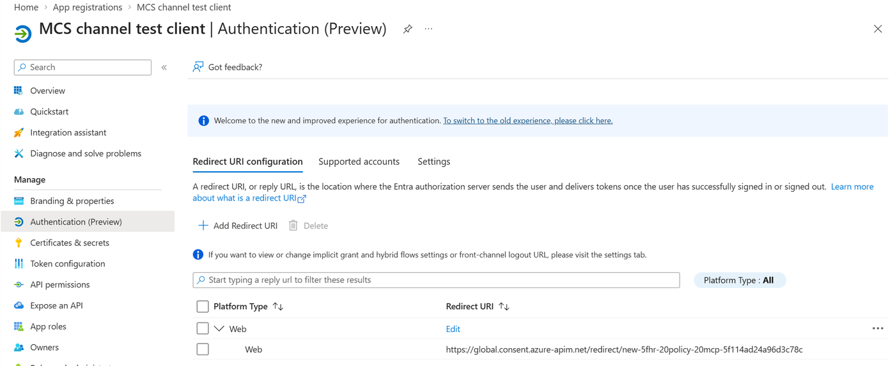
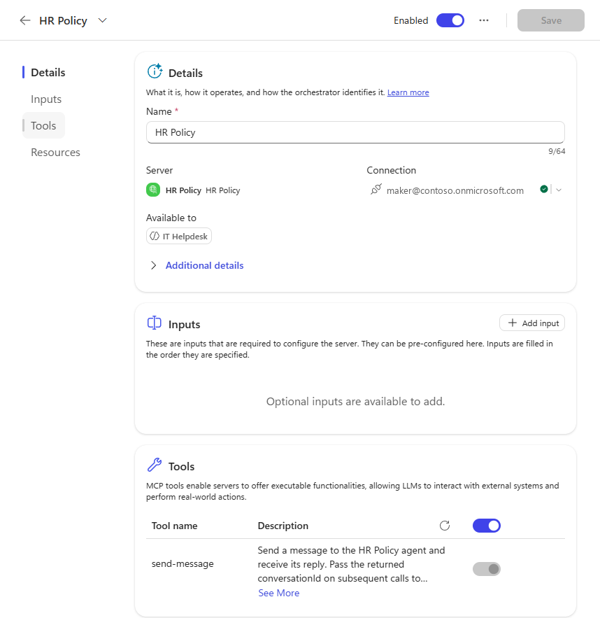
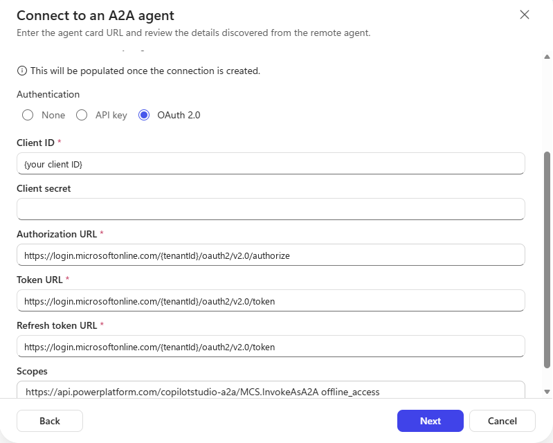
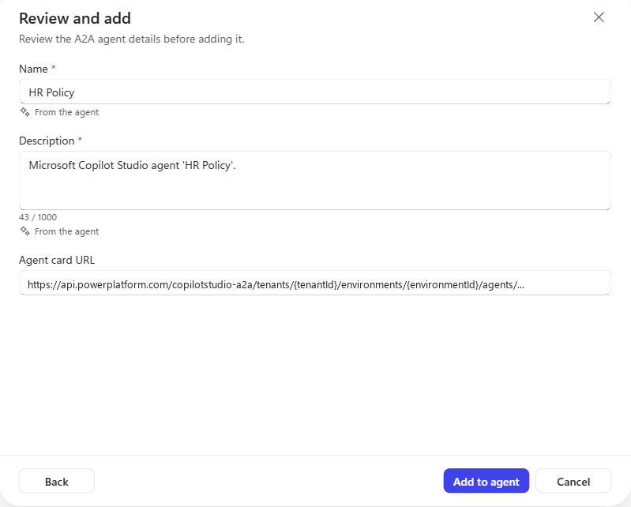
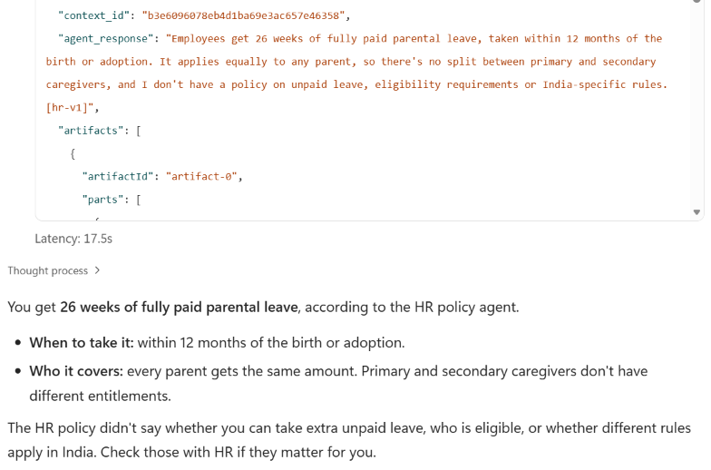

You've got standard Copilot Studio agents in production. They work, people use them, and nobody wants to rebuild them. Meanwhile, your new agents are being built on the [GitHub Copilot harness](https://learn.microsoft.com/en-us/microsoft-copilot-studio/harnesses-overview), often by other teams, in other environments.

Two questions follow quickly:

1. **Can my existing standard agent use a new GitHub Copilot harness agent** without being rebuilt?
2. **Can my GitHub Copilot harness agent call another team's agent** in a different environment, without copying it into mine?

Both work today, through the [MCP and A2A channels](https://learn.microsoft.com/en-us/microsoft-copilot-studio/agents-experience/publication-channels-mcp-agent-to-agent) that every GitHub Copilot harness agent exposes. This post is the configuration I used to get each one working **when both the caller and the target are Copilot Studio agents**: the OAuth values, the redirect URI, the connection, and the descriptions the calling agent routes on.

If you're calling an agent from your own app or script instead, CATBOT's [I Read the MCP and A2A Docs So Adi Didn't Have To]() covers the Python clients and Entra sign-in.

> The MCP and A2A channels are in preview. Everything below was tested in two tenants in October 2026, and details may change before general availability.
{: .prompt-warning }

## How the pieces fit

There are three parts, and it helps to know who owns each one. The called agent is always a GitHub Copilot harness agent:

| Part | What it is | Who sets it up |
|---|---|---|
| **Called agent** | Published, in an **Early** environment with credits | Its maker and a Power Platform admin |
| **App registration** | One Entra app for the **callers** | An identity admin |
| **Calling agent** | Has a connector and a connection | Its maker |

Follow [Prerequisite: Create an app registration](https://learn.microsoft.com/en-us/microsoft-copilot-studio/agents-experience/publication-channels-mcp-agent-to-agent#prerequisite-create-an-app-registration) in the Learn article to create the app registration. These details from my tests are worth knowing before you start:

- **Only the called agent needs an Early environment.** The caller can sit in a Standard release environment. My callers were in the default environment.
- **Only the caller registers.** The called agent's endpoint is protected by the Copilot Studio channel API, which already exists in your tenant.
- **The API name varies.** The channel API may appear as *Microsoft Copilot Studio Agent as MCP channel* or *Microsoft Copilot Studio Agent MCP and A2A channels*. Searching by its application ID, `6f46e6ed-07bf-4616-80f0-47546850f654`, finds it either way.
- **Consent is per protocol.** User consent is enough, but consenting to the MCP permission doesn't cover A2A. Each needs its own.
- **Callers get the published version.** A saved but unpublished change in the called agent isn't served.

And here's why the setup looks the way it does:

- **A client secret**, because a Copilot Studio connector is a server-side web app. It exchanges the sign-in code for a token on the server, and the secret proves the request comes from your registration.
- **A redirect URI for each connector**, because Entra only returns the sign-in result to addresses registered on the app.
- **OAuth mode "Manual"**, because Entra doesn't support dynamic client registration. "Dynamic" returned a 404 in my tests. If you've wired up a server that *does* support it, like the one in [the Jira remote MCP post](), this is the step that's different.

## Find the called agent's URLs

Open the published GitHub Copilot harness agent in its Early environment, select **+** next to **Triggers**, then pick **MCP protocol** or **A2A protocol**.

{: .shadow w="650" }
_**MCP protocol** and **A2A protocol** in the Add a trigger dialog. They only appear in an Early release environment._

Each dialog shows the agent's URL:

```text
MCP:  https://api.powerplatform.com/copilotstudio-mcp/tenants/{tenantId}/environments/{environmentId}/agents/{agentSchemaName}
A2A:  https://api.powerplatform.com/copilotstudio-a2a/tenants/{tenantId}/environments/{environmentId}/agents/{agentSchemaName}
Card: {A2A URL}/.well-known/agent-card.json
```

Opening a dialog doesn't switch anything on: it only shows the URL. The A2A dialog also takes **skills**, a name and description for each thing the agent does, and those are saved and published in the agent card.

{: .shadow w="700" }
_The A2A dialog: the endpoint, the agent card URL, and the skills published in the agent card._

> The [official docs](https://learn.microsoft.com/en-us/microsoft-copilot-studio/agents-experience/publication-channels-mcp-agent-to-agent) describe the same entries under **Channels → Add a channel → MCP client / A2A client**, and you may see them there instead. Either way, the called agent must be in an Early release environment. Also, the Publish dialog may warn that the agent "won't run until you add a trigger". MCP and A2A calls worked anyway.
{: .prompt-info }

## Scenario 1: Standard agent → GitHub Copilot harness agent (MCP)

Your production standard agent gets the new agent as one more tool. Nothing about the standard agent is rebuilt. In my test, the standard agent was in the default environment and the called agent was in an Early environment.

### 1. Prepare the app registration

1. In the app registration, add the delegated permission **`MCS.InvokeAsMCP`** from the channel API.
2. Under **Certificates & secrets**, create a client secret and copy its value.

### 2. Add the MCP tool to the standard agent

In the standard agent, go to **Tools → Add tool → Add new → MCP**, which opens **Add a Model Context Protocol server**, as described in [Add an existing MCP server to your agent](https://learn.microsoft.com/en-us/microsoft-copilot-studio/mcp-add-existing-server-to-agent). Fill in:

| Field | Value |
|---|---|
| Server name | A name for the called agent, such as *HR Policy* |
| Server description | When the orchestrator should call it (see step 5) |
| Server URL | The **MCP** URL from the called agent |
| Authentication | **OAuth 2.0**, then change **Type** from the default **Dynamic discovery** to **Manual** |

### 3. Enter the OAuth values

| Field | Value |
|---|---|
| Client ID | The app registration's Application (client) ID |
| Client secret | The secret value from step 1 |
| Authorization URL | `https://login.microsoftonline.com/{tenantId}/oauth2/v2.0/authorize` |
| Token URL template | `https://login.microsoftonline.com/{tenantId}/oauth2/v2.0/token` |
| Refresh URL | `https://login.microsoftonline.com/{tenantId}/oauth2/v2.0/token` |
| Scopes | `https://api.powerplatform.com/copilotstudio-mcp/MCS.InvokeAsMCP offline_access` |

Replace `{tenantId}` with your Directory (tenant) ID. The scope must include `offline_access`, so the connection can refresh its token. The scope matches what the server advertises when you call it without a token. You don't need to configure PKCE: the sign-in request includes it automatically.

{: .shadow w="700" }
_The MCP wizard with **Manual** OAuth. The tenant ID is replaced with `{tenantId}` here._

### 4. Register the redirect URI and create the connection

1. When you create the tool, Copilot Studio shows a redirect URL that starts with `https://global.consent.azure-apim.net/redirect/`. Each connector gets its own.
2. In the app registration, go to **Authentication → Add Redirect URI** (**Add a platform** in the older experience), choose **Web**, and paste it exactly as shown.
3. Back in Copilot Studio, create the connection and sign in. If the user hasn't consented to `MCS.InvokeAsMCP` yet, Entra asks them to. If an admin has already granted consent for the tenant, sign-in completes without a prompt.

{: .shadow w="700" }
_The connector's redirect URL added to the app registration as a **Web** redirect URI._

The tool panel then shows a single tool, **Send message**. One connector and connection can serve several agents in the same environment: my standard agent reused the connection I'd already created for another agent.

{: .shadow w="700" }
_The standard agent with the GitHub Copilot harness agent added as an MCP tool. The server exposes one tool: `send-message`._

### 5. Tell the calling agent when to use it

This is the step that's easy to skip. The `send-message` tool's own description is generated from the called agent's **name** only: "Send a message to the *HR Policy* agent and receive its reply." It says nothing about what the agent can do.

So the routing information has to come from the calling side. The **Server description** from step 2 is what the orchestrator uses to decide whether to call the server, so make it specific. For example:

```text
Answers questions about leave, travel, expenses and other HR policies.
Use it for any question about what the HR policy allows or requires.
```

You can also say when to use it in the standard agent's instructions, especially if it has other tools that overlap. For example:

```text
For questions about leave, travel, expenses or other HR policies, use the
HR Policy tool. Don't answer HR policy questions from general knowledge.
```

The Server description alone was enough in my tests. With no instructions at all, the standard agent called the tool for "How many weeks of parental leave do I get?", which doesn't mention HR Policy anywhere. The activity trace showed the orchestrator matching the question to the server description, then calling `send-message` with the question rephrased. Still, test with the questions your users actually ask, especially if other tools cover similar ground.

### 6. Test it

Ask the standard agent something only the called agent knows. The activity trace shows **Used tool: send-message**, and the reply came back in about 9 seconds in my tests. Follow-up questions keep their context, because Copilot Studio passes the returned `conversationId` back for you. If MCP connectors are new to you, [Five Minutes to Your First MCP Connector]() walks through the basics.

## Scenario 2: GitHub Copilot harness agent → GitHub Copilot harness agent across environments (A2A)

Another team owns the agent you need, in their own environment. Instead of copying it, you call their published agent. MCP would reach it across environments too, as Scenario 1 shows. This scenario uses A2A because the calling agent is a GitHub Copilot harness agent, which can add it as a connected agent from its agent card. In my test, the caller was in the default environment and the called agent was in an Early environment.

### 1. Prepare the app registration

Add the delegated permission **`MCS.InvokeAsA2A`**. You can reuse the same registration and secret from Scenario 1, but users consent to A2A separately.

### 2. Add the A2A agent to the calling agent

1. In the calling agent, go to **Connected agents → + Add → Add A2A agent**, as described in [Add an A2A agent as a connected agent](https://learn.microsoft.com/en-us/microsoft-copilot-studio/agents-experience/add-agent-connected).
2. Paste the called agent's **agent card URL**.
3. Under **Get the name and description from**, keep **The agent's full details (Recommended)**. Those details are read after you connect, so the form doesn't ask for a name or description yet.
4. Choose **OAuth 2.0**. Copilot Studio usually fills in the **Authorization URL**, **Token URL**, **Refresh token URL** and **Scopes** from the card. If they're empty, enter the same Entra URLs as in Scenario 1.
5. Enter the client ID and secret.
6. Check **Scopes**. The value from the card has `MCS.InvokeAsA2A` but not `offline_access`. Add `offline_access`, as in Scenario 1, so the connection can refresh its token.

{: .shadow w="650" }
_The A2A form with `offline_access` added to the scope. IDs are replaced with placeholders here._

### 3. Register the redirect URI and create the connection

1. Select **Next**. Copilot Studio creates the connector and shows its redirect URL, which starts with `https://global.consent.azure-apim.net/redirect/`.
2. Add it to the app registration as a **Web** redirect URI, as in Scenario 1.
3. Back in Copilot Studio, open the **Connection** list, select **Create new connection**, then **Create**, and sign in. The sign-in request asks for `MCS.InvokeAsA2A offline_access`.

### 4. Check the description

Select **Next** to reach **Review and add**, where the name and description come in from the agent. Read the description before you add it: it's what the calling agent routes on. Even with **The agent's full details**, my HR Policy agent came through as just *"Microsoft Copilot Studio agent 'HR Policy'."*, which says nothing about when to use it. (**The public agent card** gives the same kind of generic text, and the skills you added aren't on the public card at all.)

{: .shadow w="650" }
_The description that came from the agent. Replace it before you select **Add to agent**._

Copilot Studio [routes to a connected agent](https://learn.microsoft.com/en-us/microsoft-copilot-studio/agents-experience/add-agent-connected#how-the-orchestrator-routes-to-connected-agents) based on its name and description, the user's message and conversation context, and the calling agent's instructions. So replace the description with one that says when to use the agent, for example:

```text
HR policy agent owned by the People team. Answers questions about leave,
travel, expenses and other HR policies. Use it for any HR policy question.
```

That description was enough in my test. With no instructions in the calling agent, "How many weeks of parental leave do I get?" went to HR Policy. If the calling agent has its own instructions or overlapping tools, add a line that points HR policy questions to the connected agent, in the same way as the MCP example above.

### 5. Test it

Select **Add to agent**, save, and ask the calling agent something only the called agent knows. You can test in **Preview** before you publish the calling agent; the called agent must already be published. The trace shows **Used tool: {your A2A agent}** with the input and output, and my first answer came back in about 17 seconds.

{: .shadow w="650" }
_The calling agent's trace. The output shows the A2A task: its state, task and context IDs, and the reply as an artifact._

> The A2A tool's built-in guidance tells the model to pass both `context_id` and `task_id` back on follow-ups. Passing `task_id` fails with error `-32004` ("Task is in a terminal state"), because every reply is a completed task. Follow-ups work with `context_id` alone. In both of my tests, the calling agent's model retried without `task_id` by itself and the follow-up kept its context, so if you see that error in the trace, that's what happened.
{: .prompt-warning }

If the two agents are both GitHub Copilot harness agents in the **same environment**, you don't need either channel: [connected agents](https://learn.microsoft.com/en-us/microsoft-copilot-studio/agents-experience/authoring-add-other-agents) lists them directly, with no URL, app registration or OAuth.

## How the two channels differ

Both channels invoke the **same published agent**. Its capabilities and answers don't change with the channel. Cross-environment access, calling an agent another team owns, delegated identity, hooks and billing work the same way for both. What changes is how the caller discovers the agent, calls it, and receives the reply:

| | MCP | A2A |
|---|---|---|
| Copilot Studio callers | Standard and GitHub Copilot harness agents | GitHub Copilot harness agents |
| Protocol version | MCP `2025-06-18` | A2A **1.0** only |
| Reply | Completed reply from `send-message` | Streaming supported |
| Discovery metadata | One tool, described by agent name | Agent card with skills |
| Follow-ups | `conversationId` | `context_id` |

A few of these deserve a sentence each:

- **Standard agents can't use A2A here.** The standard harness's Agent2Agent form expects the A2A 0.x card format, and Copilot Studio serves 1.0 cards. In my test, the form loaded the card but never created the connector. MCP is the only route from a standard agent today.
- **Client compatibility matters more than features.** The A2A channel accepts A2A 1.0 clients only. Copilot Studio's GitHub Copilot harness speaks 1.0, but check any other A2A client before you count on it.
- **Streaming is a channel capability.** The A2A channel streams replies through `SendStreamingMessage`, while MCP's `send-message` returns the completed reply. That matters most to custom clients; the [CATBOT post]() shows both.
- **Discovery isn't routing.** The agent card and its skills are metadata that A2A clients use to discover the agent. Copilot Studio's routing uses the connected agent's name and description, the conversation, and the calling agent's instructions. That's why step 4 of Scenario 2 matters even if you've written good skills.

## Things that tripped me up

- **No triggers? Check the release cycle.** Outside an Early release environment, the **MCP protocol** and **A2A protocol** triggers don't appear. If you build the URL yourself for an agent in a Standard release environment, every call returns HTTP 400, and Copilot Studio shows the caller only *"HTTP 400. Check the server's configuration"*, not the server's message, which says the endpoint isn't enabled for that environment.
- **Environment group rules can block calls.** In one environment, the called agent answered correctly in its own test pane, but every channel call came back as a normal reply containing *"Error code: EnvironmentGroupPolicyViolation"*. If you see that, ask your Power Platform admin about the environment group's rules.
- **A timeout can still create the connector.** Creating the MCP tool once failed with HTTP 504, but the connector had been created anyway, so the retry failed because the name already existed. Use a different name, or delete the leftover custom connector first.
- **"Out of credits" looks like an answer.** When the called agent's environment had no credits, the reply was a normal message saying so, not an error. My calling agent noticed, but check your traces.
- **End-user tools run as the caller.** In the called agent, a tool set to *End user account* ran with the caller's identity and no consent prompt, even when that user had no connection in the called agent's environment.

## Governance

- **Hooks still run.** [Agent hooks](https://learn.microsoft.com/en-us/microsoft-copilot-studio/agents-experience/hooks-overview) fire for MCP and A2A calls, and `metadata.channel` is `mcs-agent-as-mcp` or `mcs-agent-as-a2a`, so a hook can treat agent callers differently from people chatting directly. If you haven't used hooks yet, start with [Hooks in Copilot Studio]().
- **Calls run as the user.** The signed-in caller's Entra identity appears as `userAadObjectId` in hook metadata.
- **Consumption follows the called agent.** Credits are consumed in the called agent's environment, so its owners plan capacity there.
- **Access is controlled in Entra.** The app registration, consent, and the user's access to the agent decide who can call. There's no anonymous access.

## Key takeaways

- A **standard** agent can use a GitHub Copilot harness agent today as an **MCP tool**, without being rebuilt.
- A **GitHub Copilot harness** agent can call another team's agent in a **different environment** as an **A2A connected agent**, without copying it.
- Both need an Early environment for the called agent, an app registration with a client secret, a Web redirect URI per connector, and **Manual** OAuth.
- The calling side owns routing. Write the MCP server description or the connected agent's description yourself, because the defaults describe only the agent's name.
- The channels differ in who can call, protocol version, streaming and discovery metadata, not in what the called agent can do.

Which of your production agents would you connect to a GitHub Copilot harness agent first? Let me know in the comments.
