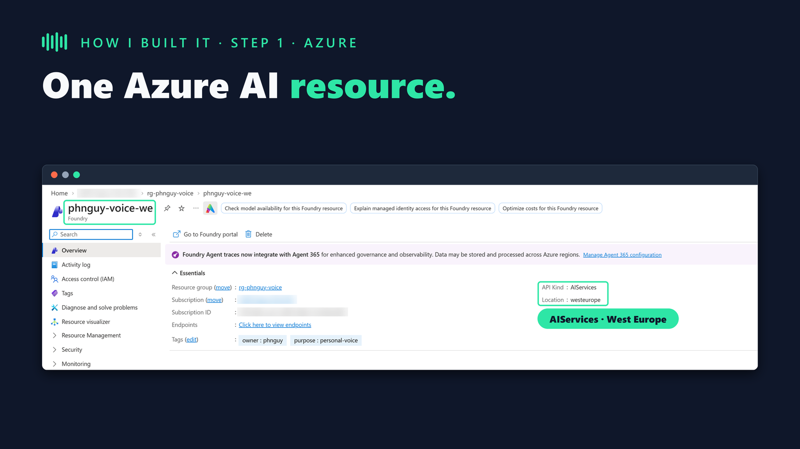
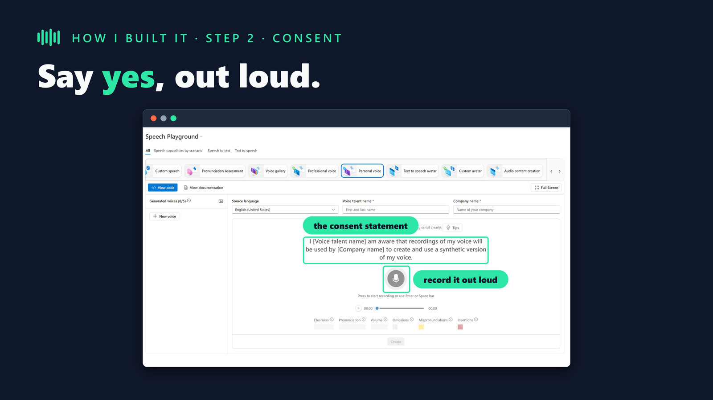
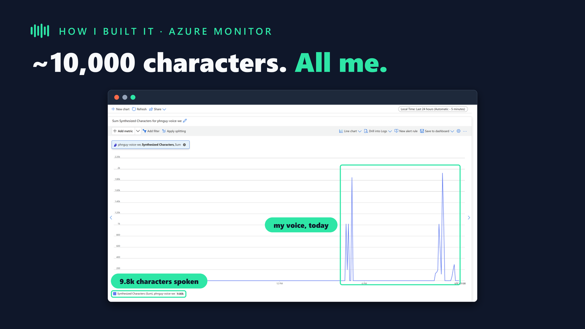
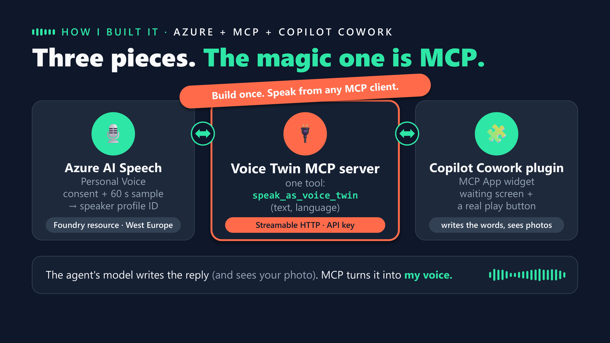
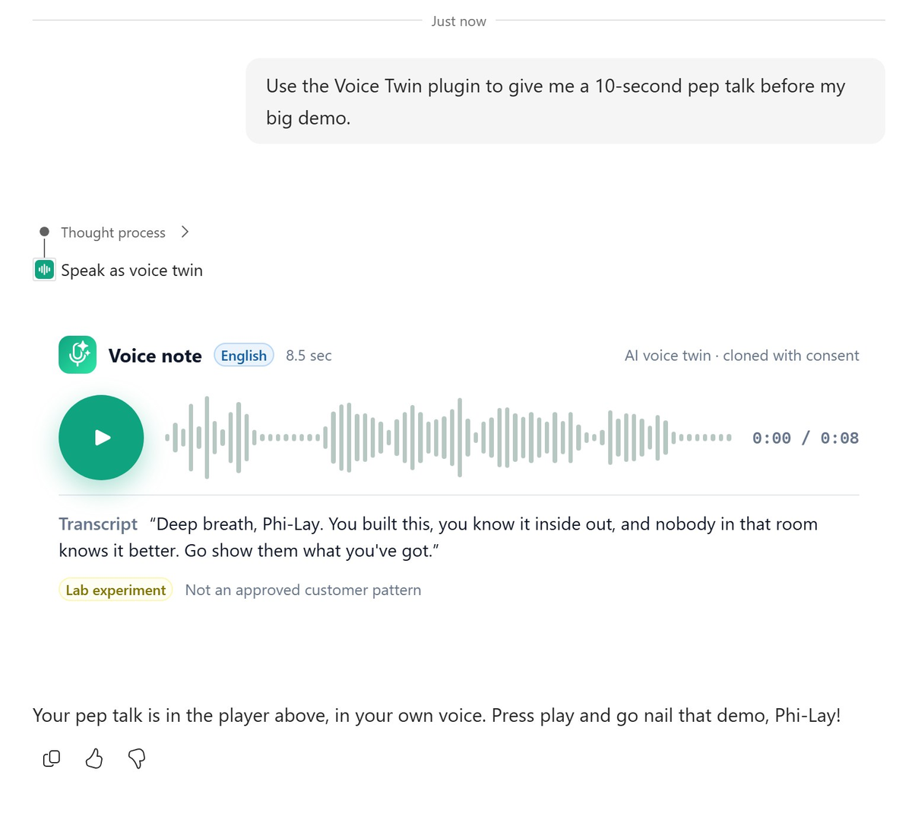
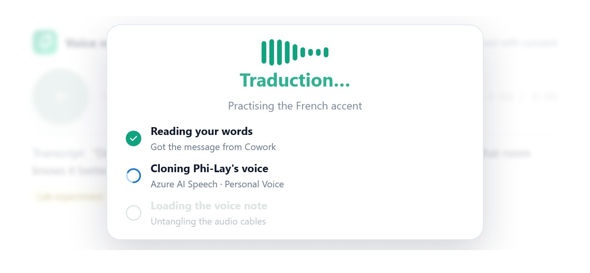
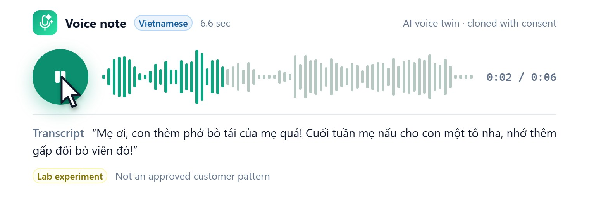
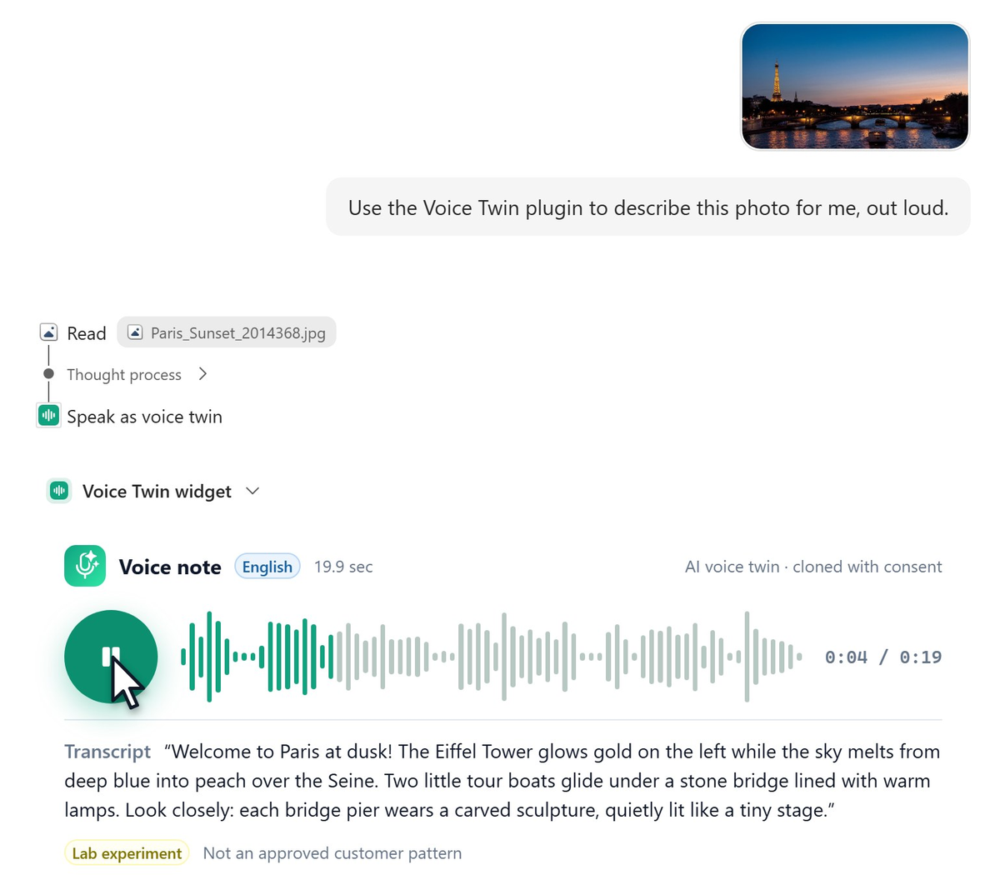
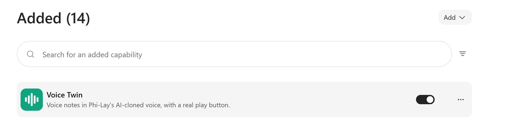
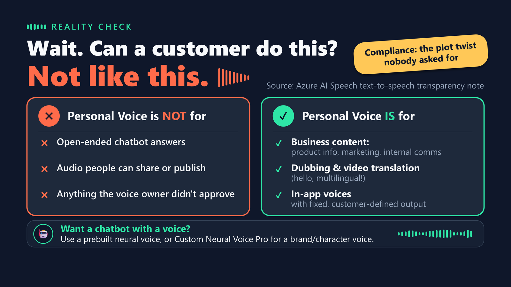

We record a lot of demo videos. The screen part is solved: the [Clipchamp Narrated Demo Video skill](https://microsoft.github.io/cat-agent-skills/skills/clipchamp-video/) drives a real browser against your agent, records the actual flow in 4K and assembles the MP4 for you. The voiceover is where it still hurts.

You either record it yourself, which means a quiet room, ten retakes and redoing everything when the product changes next sprint, or you use a stock neural voice. Stock voices are good, but every demo ends up sounding like the same narrator, and your audience never hears the person who actually built the thing.

So I tried a third option: **write the narration as a script and have it spoken in my own voice**, with [Azure AI Speech Personal Voice](https://learn.microsoft.com/en-us/azure/ai-services/speech-service/personal-voice-overview). Changing a sentence becomes a text edit, the same voice speaks close to 100 languages, and it still sounds like me (French accent included).

Then, because I couldn't help myself, I wrapped that voice in an MCP server and plugged it into Copilot Cowork, with a widget that has a real play button.

> **Heads up:** every word of narration in the video below is a synthetic version of my voice, created with my recorded consent. Personal Voice is a [Limited Access](https://learn.microsoft.com/en-us/azure/foundry/responsible-ai/speech-service/text-to-speech/transparency-note) feature with a short list of approved use cases, covered at the end of this post.
{: .prompt-info }

## Watch the result



The video is six minutes and covers three things:

1. **The Azure side:** one Speech resource, a recorded consent, a short voice sample, and three REST calls.
2. **The narration:** every slide and every demo beat is voiced by the personal voice, generated from a script.
3. **The live demo:** a Copilot Cowork plugin that answers in my voice, in English, French, Vietnamese and Spanish, and describes a photo out loud.

## Step 1: Create your personal voice

### What you need

- An Azure AI Speech (or Foundry) resource in a [region that supports Personal Voice](https://learn.microsoft.com/en-us/azure/ai-services/speech-service/regions?tabs=tts). Not the Free tier.
- **Limited Access approval.** Eligibility is limited to Microsoft managed customers and partners. You apply through the [registration form](https://aka.ms/customneural) and describe your use case. Mine took a few business days.
- **A consent recording.** The voice talent (you) reads a fixed statement out loud: *"I [name] am aware that recordings of my voice will be used by [company] to create and use a synthetic version of my voice."* It must be in the same language as the sample.
- **A 5 to 90 second voice sample** with one speaker and no background music. I used a clean minute from an old webcast.

On the Azure side, that is the whole footprint: one Foundry resource of kind AIServices, in West Europe for me.

{: .shadow }
_One resource is all you need. Everything else is a call against its endpoint._

The consent statement is the heart of the process. The Speech playground in Foundry shows exactly what the voice talent has to say, and you can record it there instead of uploading a file.

{: .shadow }
_The consent statement in the Foundry Speech playground. No matching consent, no voice._

### Three calls, one voice

You can do this in the [Foundry portal](https://learn.microsoft.com/en-us/azure/ai-services/speech-service/personal-voice-create-project), but I used the custom voice REST API so it fits in a script. A project, the consent, then the voice:

```bash
EP="https://<your-resource>.cognitiveservices.azure.com/customvoice"
AUTH="Authorization: Bearer $(az account get-access-token --resource https://cognitiveservices.azure.com --query accessToken -o tsv)"
V="api-version=2026-01-01"

# 1. A project of kind PersonalVoice
curl -X PUT "$EP/projects/my-personal-voice?$V" -H "$AUTH" -H "Content-Type: application/json" \
  -d '{"kind": "PersonalVoice", "description": "My personal voice"}'

# 2. The consent statement, read out loud by the voice talent
curl -X POST "$EP/consents/my-consent?$V" -H "$AUTH" \
  -F projectId=my-personal-voice -F voiceTalentName="Your Name" -F companyName="Contoso" \
  -F locale=fr-FR -F audiodata=@consent.wav

# 3. The voice itself, from the sample
curl -X POST "$EP/personalvoices/my-voice?$V" -H "$AUTH" \
  -F projectId=my-personal-voice -F consentId=my-consent -F audiodata=@sample.wav
```
{: .nolineno }

Both POST calls are asynchronous: poll `GET consents/my-consent` and `GET personalvoices/my-voice` until `status` is `Succeeded`. In my case the voice was ready **12 seconds** after the consent was accepted. The voice response contains a `speakerProfileId`. Treat it like a password: anyone who has it, plus access to your resource, can speak as you.

> The consent check is strict. If the recorded statement doesn't match the expected text (wrong name, wrong company, different language than the sample), the consent fails and no voice is created. Transcribe your recording before uploading it.
{: .prompt-tip }

## Step 2: Use it as the voiceover of your demo videos

Synthesizing with a personal voice is plain SSML. The only difference from a stock voice is the `mstts:ttsembedding` element ([how to use personal voice](https://learn.microsoft.com/en-us/azure/ai-services/speech-service/personal-voice-how-to-use)):

```xml
<speak version="1.0" xmlns="http://www.w3.org/2001/10/synthesis"
       xmlns:mstts="http://www.w3.org/2001/mstts" xml:lang="en-US">
  <voice name="DragonLatestNeural">
    <mstts:ttsembedding speakerProfileId="<your-speaker-profile-id>">
      Hi, I'm Phi-Lay. Well... technically, I'm Phi-Lay's voice.
      The real one is getting coffee.
    </mstts:ttsembedding>
  </voice>
</speak>
```
{: .nolineno }

`DragonLatestNeural` gave me the closest match to my real voice. The [docs list the other base models](https://learn.microsoft.com/en-us/azure/ai-services/speech-service/personal-voice-how-to-use#integrate-personal-voice-in-your-application) if you need lower latency or exact phoneme control.

### Plug it into the video skill

The [Clipchamp Narrated Demo Video skill](https://microsoft.github.io/cat-agent-skills/skills/clipchamp-video/) from the CAT agent skills catalog does the heavy lifting: it drives your logged-in browser, records the real screen flow, trims the dead time and lays the narration over the visible beats. Out of the box it narrates with a stock neural voice. To use yours, give it a small helper that turns a line of script into an MP3, and ask it to use that helper for every narration line.

<details>
<summary>tts_personal.py: narrate one line in your personal voice</summary>
<pre><code class="language-python">"""python tts_personal.py --text "Hello" --out line.mp3"""
import argparse, html, os, subprocess
import requests

ENDPOINT = os.environ["SPEECH_ENDPOINT"]          # https://&lt;resource&gt;.cognitiveservices.azure.com
PROFILE = os.environ["SPEAKER_PROFILE_ID"]        # never commit it

def token():
    return subprocess.run(
        "az account get-access-token --resource https://cognitiveservices.azure.com --query accessToken -o tsv",
        shell=True, capture_output=True, text=True, check=True).stdout.strip()

def ssml(text, model="DragonLatestNeural"):
    return ("&lt;speak version='1.0' xmlns='http://www.w3.org/2001/10/synthesis' "
            "xmlns:mstts='http://www.w3.org/2001/mstts' xml:lang='en-US'&gt;"
            f"&lt;voice name='{model}'&gt;&lt;mstts:ttsembedding speakerProfileId='{PROFILE}'&gt;"
            f"{html.escape(text)}&lt;/mstts:ttsembedding&gt;&lt;/voice&gt;&lt;/speak&gt;")

if __name__ == "__main__":
    ap = argparse.ArgumentParser()
    ap.add_argument("--text", required=True)
    ap.add_argument("--out", required=True)
    a = ap.parse_args()
    r = requests.post(f"{ENDPOINT}/tts/cognitiveservices/v1", data=ssml(a.text).encode("utf-8"), timeout=180,
                      headers={"Authorization": f"Bearer {token()}", "Content-Type": "application/ssml+xml",
                               "X-Microsoft-OutputFormat": "audio-48khz-192kbitrate-mono-mp3"})
    r.raise_for_status()
    open(a.out, "wb").write(r.content)
</code></pre>
</details>

Then the request to the skill reads like this:

```text
Record a 4K demo of my Voice Twin plugin in Copilot Cowork, headless path.
For the voiceover, don't use the stock voice: synthesize each narration line
with tts_personal.py (my personal voice), and keep my accent.
Show every prompt fully sent, speed up the waits instead of cutting them.
```
{: .nolineno }

### What I learned narrating six minutes in my own voice

- **Leave the language tag out.** With no `<lang>` element, the service detects the language per sentence and keeps your own accent. Wrap the text in `<lang xml:lang="en-US">` and you instantly sound American. Use `<lang>` on purpose for foreign words: my narration says *phở bò tái* with a Vietnamese pronunciation inside an English sentence.
- **Names need help.** The model read my name as "FAI-lay" instead of "fi-LAI", and "my mom" came out as "mi mom". Dragon models don't support `<phoneme>`, but they do support `<sub alias="...">`, so for the next video I'm respelling the tricky words phonetically. Whatever you try, listen before you build.
- **Write for the ear.** Short sentences, no symbols, no parentheses. The same rules as the [podcast script skill]() apply here.
- **Re-rendering is the superpower.** When I moved the live demo from Copilot Studio to Cowork, I edited a handful of script lines and rebuilt the whole video. No microphone, no retake.
- **Disclose it.** The video carries a permanent "AI voice, cloned with consent" badge, and the first slide says it out loud.

Azure Monitor keeps you honest about usage. The **Synthesized Characters** metric on the resource shows every narration run: a full rebuild of the video plus the live demo came to roughly 10,000 characters in a day.

{: .shadow }
_Each spike is a narration run. Around 10,000 characters, all in my voice._

## Step 3 (bonus): let Copilot Cowork talk back in your voice

The narration is the practical part. This one is the fun part, and it's a lab experiment, not a pattern to ship (more on that below).

The idea: if my voice is just an API, I can make it a tool. One small [MCP server]() exposes it, and any MCP client can call it.

> **Why Cowork and not a Copilot Studio agent?** The play button. Cowork renders [MCP Apps](https://github.com/modelcontextprotocol/ext-apps) widgets inside the conversation. Copilot Studio agents don't render MCP widgets yet, so today a real player in the chat means Cowork. The same server still works as a regular tool in Copilot Studio, as shown at the end of this section.
{: .prompt-info }

{: .shadow }
_Three pieces: the voice lives in Azure, MCP turns it into a tool, Cowork renders it with a widget._

### One tool for the model, two for the widget

The server follows the [MCP Apps](https://github.com/modelcontextprotocol/ext-apps) extension. The model sees a single tool. Its `_meta.ui.resourceUri` points to an HTML widget that Cowork renders in the conversation:

```json
{
  "name": "speak_as_voice_twin",
  "description": "Turns words into a voice note spoken in Phi-Lay's AI-cloned voice ...",
  "inputSchema": {
    "type": "object",
    "properties": {
      "text": { "type": "string" },
      "language": { "type": "string" }
    },
    "required": ["text", "language"]
  },
  "_meta": { "ui": { "resourceUri": "ui://voice-twin/voice-note.html" } }
}
```
{: .nolineno }

The model tool returns immediately with a job ID. The widget then calls two more tools that are declared with `"visibility": ["app"]`, so the model never sees them: one synthesizes the voice note, the other returns the audio. That split is what makes the waiting screen honest. Each step turns green when the real event happens: words received, voice synthesized, audio loaded.

In the conversation, you only see the tool call and the widget. The model writes the words, the tool speaks them, and Cowork adds one line of its own.

{: .shadow }
_A pep talk in Cowork: one tool call, one widget, one play button._

While it works, the headline says "Translating..." in a new language every second. Spoiler: it isn't translating anything. It's just nervous.

{: .shadow }
_The waiting overlay: each step completes on a real server event, the jokes rotate on their own._

When the audio is ready, the overlay fades out and a real play button appears. The waveform is drawn from the decoded audio, and the progress follows the actual playback inside Cowork.

{: .shadow }
_A real click, real playback: my voice asking my mom for phở bò tái, with double bò viên._

True story: I played that one to my mom. She didn't believe it was me. Apparently my Vietnamese has never been this good.

Because Cowork's model reads attachments, the same tool also describes photos. Upload a picture, ask for a description, and it comes back as a voice note. The tool itself doesn't know anything about images: the model looks at the photo, writes the description, and passes the words to the voice.

{: .shadow }
_A photo described out loud, four seconds into playback, with the transcript below the player._

### Packaging it for Cowork

The plugin is a regular app package with an `agentConnectors` entry pointing at the remote MCP server, plus the tool descriptions file:

```json
"agentConnectors": [{
  "id": "voice-twin",
  "displayName": "Voice Twin",
  "toolSource": { "remoteMcpServer": {
    "mcpServerUrl": "https://<your-host>/mcp",
    "mcpToolDescription": { "file": "tools/voice-twin-tools.json" },
    "authorization": { "type": "OAuthPluginVault", "referenceId": "<your-registration>" }
  }}
}]
```
{: .nolineno }

A few things that cost me time:

- **Name the plugin in the prompt.** I also had a Copilot Studio agent called Voice Twin. Without "Use the Voice Twin plugin", Cowork picked the agent and politely gave up.
- **Re-enable it before a demo.** Custom plugins can come back disabled in a fresh browser session. Check **Agents & Plugins** first; my recorder also checks that the plugin answers off camera before it starts recording.
- **Publish the frame size yourself.** Cowork keeps the widget hidden until it knows its height, so send the size without waiting for an animation frame.
- **Protect the endpoint.** Anyone who can call this tool can speak as you. Use Entra authentication (`OAuthPluginVault`) and keep the speaker profile ID on the server.

{: .shadow }
_Voice Twin in Agents & Plugins. Check the switch before every demo._

In Copilot Studio, I added the same MCP server as a tool to an agent in the GitHub Copilot harness. Without widget support, the tool falls back to a voice-note image that links to a private player page, signed and valid for ten minutes. It works, but you leave the chat to press play.

## The rules of the road

Can a customer build a chatbot that answers in a cloned voice like this? Honestly, not like this. The [transparency note](https://learn.microsoft.com/en-us/azure/foundry/responsible-ai/speech-service/text-to-speech/transparency-note) draws a clear line, and I put it on a slide so I'd stop forgetting it:

{: .shadow }
_What Personal Voice is and isn't for, from the transparency note._

One nuance the slide compresses: the "no sharing, no publishing" rule applies to voices that live inside an application. Business content (product information, marketing, internal communications) is meant to be shared, and narrating your own product demos sits comfortably there. That's why this video can exist. A live agent improvising open-ended answers in your voice is the opposite case, which is why the Cowork plugin stays in my lab.

And whatever you build:

1. **Get consent.** Always, recorded, from the person whose voice it is.
2. **Tell people it's AI.** On screen and out loud.
3. **Stick to approved use cases.** Yes, really.
4. **Guard your speaker profile ID** like a password.

Also, do not use it to call your mom. She will know.

## Try it yourself

- Personal Voice: [overview](https://learn.microsoft.com/en-us/azure/ai-services/speech-service/personal-voice-overview), [create the voice](https://learn.microsoft.com/en-us/azure/ai-services/speech-service/personal-voice-create-voice), [use it in your application](https://learn.microsoft.com/en-us/azure/ai-services/speech-service/personal-voice-how-to-use).
- Recording: the [Clipchamp Narrated Demo Video skill](https://microsoft.github.io/cat-agent-skills/skills/clipchamp-video/) in the CAT agent skills catalog.
- Widgets: the [MCP Apps extension](https://github.com/modelcontextprotocol/ext-apps) and the [Copilot Cowork documentation](https://learn.microsoft.com/en-us/copilot/cowork/).

If you've watched a [video demo on this blog]() before, you know how much of the effort goes into the voiceover. One consent clip, one short sample, and one existential crisis when you hear it play back. Worth it.

Which demo would you narrate first in your own voice, and in which language?
