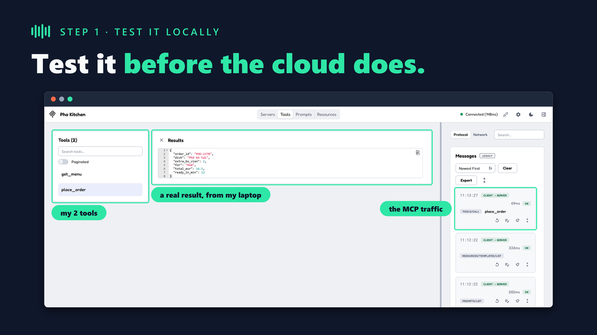
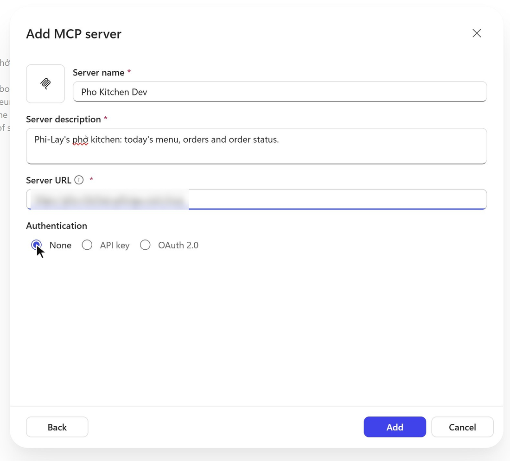
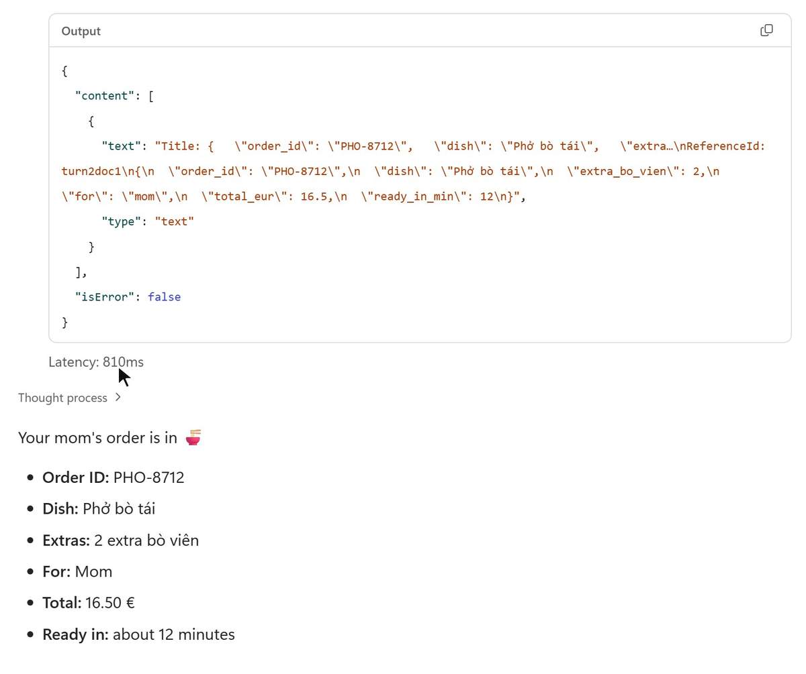
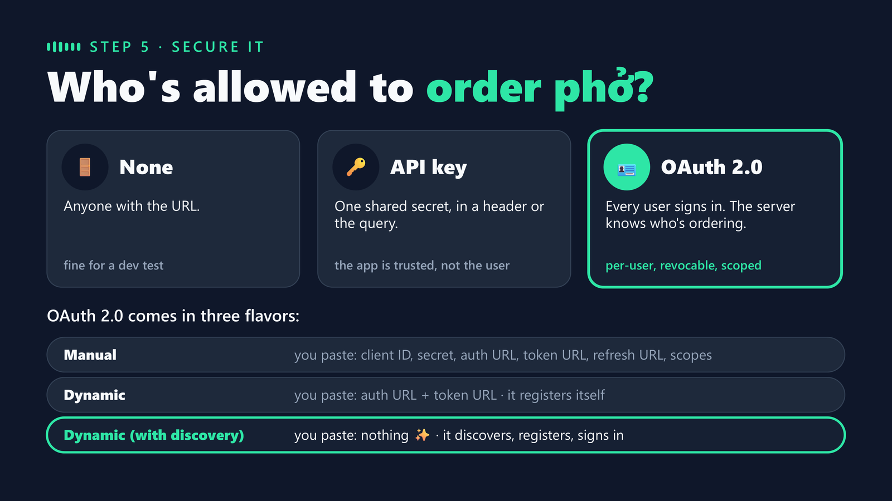
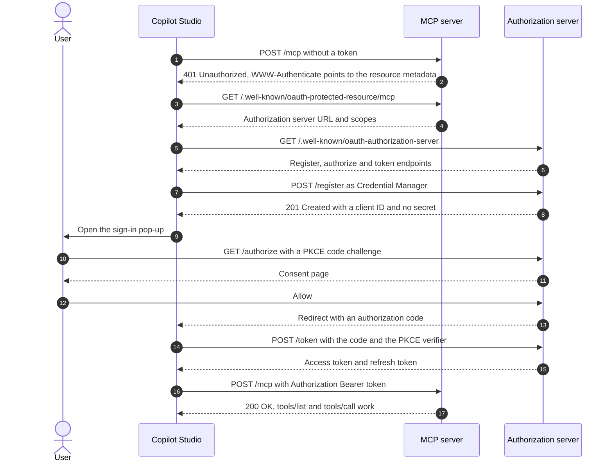
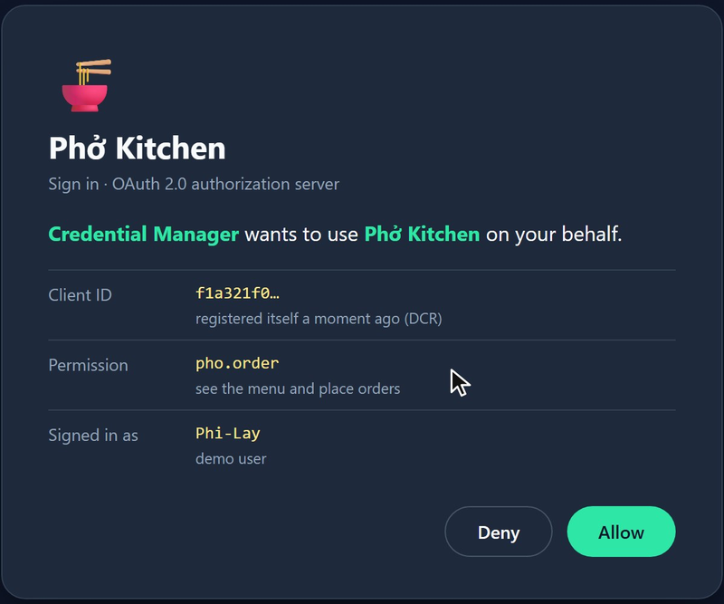
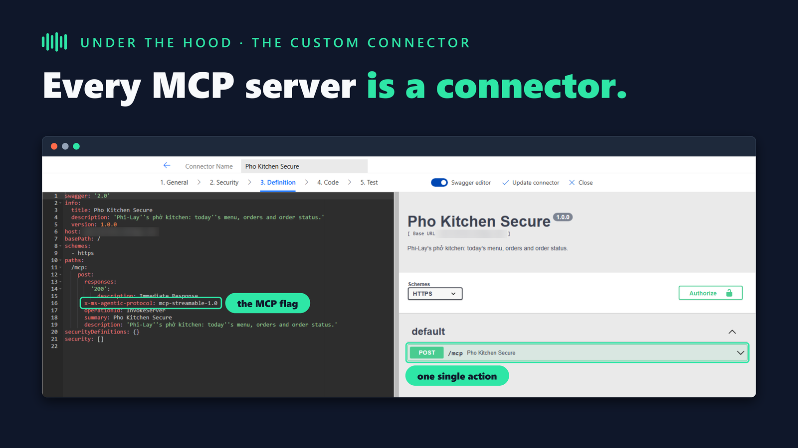
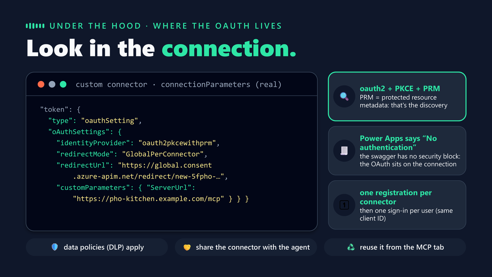
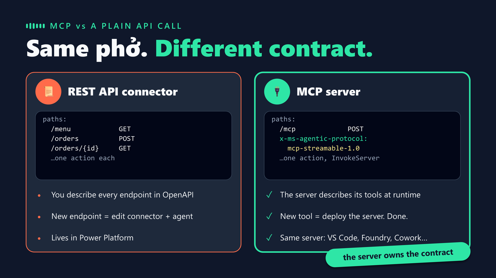
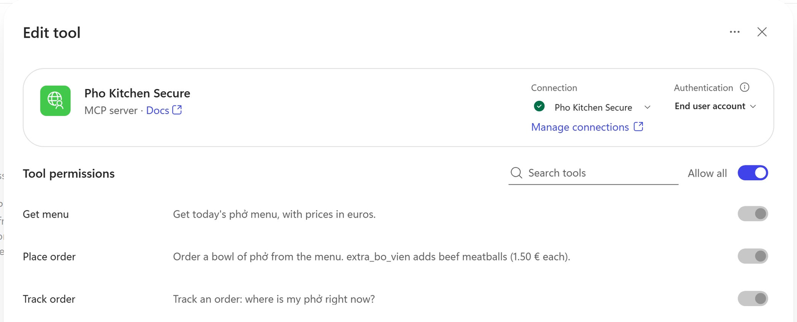

Adding an MCP server to a Copilot Studio agent takes one form. That's great until something doesn't work: the sign-in pop-up fails, a new tool never shows up, or someone asks what Copilot Studio actually stores about your server. At that point the form doesn't help you. You need to know what goes over the wire.

Earlier posts on this blog show the [first connection in five minutes]() and how to [wire up a vendor's remote MCP server with dynamic discovery](). Both look at it from the Copilot Studio side. This post looks from the other side: I built a tiny MCP server on my laptop, logged every request it received, and connected it to an agent. Once without authentication, then with OAuth.

The demo is a phở kitchen. The agent reads the menu and places orders, including one for my mom with double bò viên (beef meatballs).

> **Heads up:** the narration in the video below is a synthetic version of my own voice ([Azure AI Speech Personal Voice](https://learn.microsoft.com/en-us/azure/ai-services/speech-service/personal-voice-overview)), created with my recorded consent. Everything on screen is a real recording.
{: .prompt-info }

## Watch the walkthrough



The video is eight minutes. The server log runs in the corner of every demo scene, so you can watch each request arrive while Copilot Studio works. The rest of this post follows the same six steps.

## Step 1: Build a tiny MCP server

The server uses the official [MCP Python SDK](https://github.com/modelcontextprotocol/python-sdk) and exposes two tools. Each tool is a plain function: the docstring becomes the description the model reads, and the type hints become the input schema.

```python
@mcp.tool()
def get_menu() -> list[dict]:
    """Get today's phở menu, with prices in euros."""
    return MENU


@mcp.tool()
def place_order(dish: str, extra_bo_vien: int = 0, for_who: str = "me") -> dict:
    """Order a bowl of phở from the menu. extra_bo_vien adds beef meatballs (1.50 € each)."""
    ...
```
{: .nolineno }

Write the docstrings as if you were explaining the tool to a colleague. The orchestrator uses them to decide which tool to call and how to fill in the arguments.

<details>
<summary>server.py: the complete server (about 50 lines)</summary>
<pre><code class="language-python">"""Phở Kitchen: a minimal MCP server (Streamable HTTP) that a Copilot Studio agent can call.

  pip install "mcp&gt;=2"
  python server.py            -&gt; http://127.0.0.1:8765/mcp
"""
import json
import random
import unicodedata
from pathlib import Path

import uvicorn
from mcp.server.mcpserver import MCPServer
from mcp.server.transport_security import TransportSecuritySettings

PUBLIC_HOST = "pho-kitchen.example.com"  # your tunnel hostname, without https://

mcp = MCPServer("Pho Kitchen", instructions="Phi-Lay's phở kitchen: today's menu and orders.")

MENU = [
    {"dish": "Phở bò tái", "price_eur": 13.5, "what": "rare beef, cooked by the hot broth"},
    {"dish": "Phở bò viên", "price_eur": 12.5, "what": "beef meatballs"},
    {"dish": "Phở đặc biệt", "price_eur": 15.0, "what": "the special: a bit of everything"},
]
ORDERS = Path(__file__).with_name("orders.json")


def plain(s: str) -&gt; str:
    return unicodedata.normalize("NFKD", s.replace("đ", "d").replace("Đ", "D")).encode("ascii", "ignore").decode().lower()


@mcp.tool()
def get_menu() -&gt; list[dict]:
    """Get today's phở menu, with prices in euros."""
    return MENU


@mcp.tool()
def place_order(dish: str, extra_bo_vien: int = 0, for_who: str = "me") -&gt; dict:
    """Order a bowl of phở from the menu. extra_bo_vien adds beef meatballs (1.50 € each)."""
    item = next((m for m in MENU if plain(m["dish"]) in plain(dish)), None)
    if item is None:
        return {"error": f"'{dish}' is not on the menu", "menu": [m["dish"] for m in MENU]}
    orders = json.loads(ORDERS.read_text(encoding="utf-8")) if ORDERS.exists() else {}
    order = {"order_id": f"PHO-{random.randint(1000, 9999)}", "dish": item["dish"], "extra_bo_vien": extra_bo_vien,
             "for": for_who, "total_eur": item["price_eur"] + 1.5 * extra_bo_vien, "ready_in_min": 12}
    orders[order["order_id"]] = order
    ORDERS.write_text(json.dumps(orders, ensure_ascii=False, indent=1), encoding="utf-8")
    return order


if __name__ == "__main__":
    # The SDK protects localhost servers against DNS rebinding: allow your tunnel hostname too,
    # or requests that arrive through the tunnel are rejected.
    app = mcp.streamable_http_app(transport_security=TransportSecuritySettings(
        allowed_hosts=["127.0.0.1:*", "localhost:*", PUBLIC_HOST]))
    uvicorn.run(app, host="127.0.0.1", port=8765)
</code></pre>
</details>

Before Copilot Studio sees it, test it locally with the [MCP Inspector](https://github.com/modelcontextprotocol/inspector) (`npx @modelcontextprotocol/inspector`). Connect to `http://127.0.0.1:8765/mcp` with the Streamable HTTP transport, list the tools and call one. If it works here, any problem later is about the network or authentication, not your code.

{: .shadow }
_The MCP Inspector: two tools, a real order and the raw MCP traffic, all on localhost._

## Step 2: Make it reachable

Copilot Studio runs in the cloud, so it can't reach `localhost`. Put an HTTPS tunnel in front of the server, for example [Dev Tunnels](https://learn.microsoft.com/en-us/azure/developer/dev-tunnels/overview) or Cloudflare Tunnel:

```bash
devtunnel host -p 8765 --allow-anonymous
```
{: .nolineno }

Two things to know:

- **Allow the tunnel hostname in the server.** The Python SDK rejects requests whose `Host` header isn't on its allow list, to protect local servers against DNS rebinding. Without `PUBLIC_HOST` in `allowed_hosts`, every call through the tunnel gets `421 Invalid Host header`.
- **Use Streamable HTTP.** Copilot Studio [no longer supports the SSE transport](https://learn.microsoft.com/en-us/microsoft-copilot-studio/mcp-add-existing-server-to-agent#supported-transports).

A tunnel is fine for a demo, but once the server needs to stay up, move it to Azure instead. The server is a plain ASGI app, so an [Azure App Service](https://learn.microsoft.com/en-us/azure/app-service/overview) Linux web app (Python runtime, `uvicorn` or `gunicorn` as the start command) hosts it with a stable HTTPS endpoint and no tunnel to babysit. Keep `allowed_hosts` pointed at the App Service's `*.azurewebsites.net` hostname (or your custom domain) the same way you did for the tunnel.

## Step 3: Add it to an agent

I recorded this in an agent built with the GitHub Copilot harness. The Standard harness has the same [MCP onboarding wizard](https://learn.microsoft.com/en-us/microsoft-copilot-studio/mcp-add-existing-server-to-agent) with the same options.

1. In the agent, next to **Tools**, select **+**.
2. In **Add a tool**, select **+ Add** > **Model Context Protocol (MCP)**.
3. Enter a server name, a description and the tunnel URL ending in `/mcp`. Choose **None** for authentication for now.
4. Select **Add**, create a connection, and select **Add** again.

The description matters: the orchestrator reads it to decide when to use this server.

{: .shadow w="700" }
_The whole configuration: a name, a description, a URL. The tools come from the server._

As soon as the connection exists, the server log shows `initialize` and `tools/list`. Copilot Studio asked the server what it can do, and `get_menu` and `place_order` appear in the agent without anyone typing them.

In **Preview**, I asked for a phở bò tái with two extra bò viên for my mom. The orchestrator picked `place_order` and filled in the arguments by itself. With debug mode on, you can open the tool call and read the raw MCP response.

{: .shadow w="700" }
_The raw MCP response above, the agent's answer below. Mom gets double bò viên._

## Step 4: Secure it with OAuth

Right now anyone with the URL can order phở on my behalf. The wizard offers three choices: **None**, **API key** (one shared secret, so the server trusts the app but not the user) and **OAuth 2.0** (every user signs in, so the server knows who is ordering). OAuth itself comes in three flavors that differ in how much you type.

{: .shadow }
_Manual: you paste everything. Dynamic: you paste two URLs. Dynamic with discovery: you paste nothing._

I added the same server a second time as **Pho Kitchen Secure**, with **OAuth 2.0** > **Dynamic (with discovery)**. No client ID, no secret, no URL. So where does Copilot Studio get everything it needs?

### How dynamic discovery works

The short version: Copilot Studio shows up without a badge. The server tells it where the badge office is. Copilot Studio registers itself there, asks the user to approve, gets a badge, and shows it on every call after that.

Three parties take part. **Copilot Studio** is the OAuth client; on the server it shows up under the name *Credential Manager*. The **MCP server** is the resource server that holds the tools. The **authorization server** registers clients and issues tokens. In my demo the authorization server runs in the same Python process as the MCP server; in production it's usually a separate identity provider.



Here are the same steps as they arrived in my server's log when I created the connection:

```text
11:41:59  GET  /mcp                                        401  no token
11:42:00  GET  /.well-known/oauth-protected-resource/mcp   200  discovery 1/2
11:42:00  GET  /.well-known/oauth-authorization-server     200  discovery 2/2
11:42:00  POST /register   client_name=Credential Manager  201  dynamic client registration
11:42:03  GET  /authorize  code_challenge_method=S256      302  sign-in pop-up
11:42:08  POST /consent    decision=allow                  302  the user approves
11:42:10  POST /token      authorization_code + verifier   200  access and refresh tokens
11:42:20  POST /mcp        Authorization: Bearer ...       200  initialize, tools/list
```
{: .nolineno }

Step by step, in plain words:

1. **The knock (1-2).** Copilot Studio calls the server without a token. The server answers `401` with a `WWW-Authenticate` header that contains a `resource_metadata` URL. That header is the starting point of everything; the [MCP authorization spec](https://modelcontextprotocol.io/specification/2025-06-18/basic/authorization) requires it.
2. **Discovery (3-6).** Copilot Studio reads two well-known documents. The first ([Protected Resource Metadata, RFC 9728](https://datatracker.ietf.org/doc/html/rfc9728)) answers *who protects this server?* The second ([Authorization Server Metadata, RFC 8414](https://datatracker.ietf.org/doc/html/rfc8414)) answers *where do I register, sign in and get tokens?* This is the "discovery" in **Dynamic (with discovery)**. With plain **Dynamic**, you type those URLs yourself.
3. **Registration (7-8).** Copilot Studio registers itself as a new OAuth client with [Dynamic Client Registration, RFC 7591](https://datatracker.ietf.org/doc/html/rfc7591). It sends its name and its redirect URI on `global.consent.azure-apim.net`, and asks for no secret. The server returns a client ID. This is why the form has no client ID field: Copilot Studio creates one for itself. It happens once per connector; a second connection to the same connector reused the same client ID.
4. **Sign-in (9-15).** The pop-up opens the server's `/authorize` endpoint. Because there's no client secret, the request carries a [PKCE](https://datatracker.ietf.org/doc/html/rfc7636) code challenge. The user approves, the browser goes back to Copilot Studio with a short-lived code, and Copilot Studio swaps that code plus the PKCE verifier for an access token and a refresh token. The verifier proves that whoever redeems the code is whoever started the sign-in.
5. **Every call after that (16-17).** Each MCP request carries `Authorization: Bearer <token>` for the signed-in user. In my log, these calls come with the user agent `MicrosoftCopilotStudio-AgenticLoop/1.0`. When the access token expired an hour later, the log showed a `refresh_token` grant, with no new sign-in.

The pop-up in step 4 is the authorization server's own page, not Copilot Studio's. Mine shows the client that just registered itself:

{: .shadow w="450" }
_Credential Manager registered itself a few seconds earlier. Allow, and the token is issued._

Two practical consequences:

- **Your identity provider has to support dynamic client registration.** If it doesn't, use **Manual** and register a client yourself. That's a common case with enterprise identity providers.
- **You don't write most of this.** In Python, the MCP SDK provides the 401 challenge, both metadata documents and the `/register`, `/authorize` and `/token` endpoints. You plug in a provider that stores clients, codes and tokens and shows a consent page:

```python
# Excerpt: KitchenAuth is my demo provider (about 150 lines). Use a real identity provider in production.
mcp = MCPServer(
    "Pho Kitchen",
    auth_server_provider=KitchenAuth("https://pho-kitchen.example.com"),
    auth=AuthSettings(
        issuer_url="https://pho-kitchen.example.com",
        resource_server_url="https://pho-kitchen.example.com/mcp",
        client_registration_options=ClientRegistrationOptions(enabled=True, default_scopes=["pho.order"]),
        required_scopes=["pho.order"],
    ),
)
```
{: .nolineno }

Back in Preview, I ordered a phở đặc biệt. Same tools, same answers, but now every call in the log carries a bearer token for a signed-in user.

## Step 5: Open the hood

Every MCP server you add in Copilot Studio becomes a [custom connector](https://learn.microsoft.com/en-us/connectors/custom-connectors/) in Power Platform. Open it in Power Apps and the whole API definition is one action: `POST /mcp`, marked with `x-ms-agentic-protocol: mcp-streamable-1.0`. That flag tells Copilot Studio not to treat this as a REST API but to speak MCP to it.

{: .shadow }
_One action, one flag. The tools aren't in the connector; the server lists them at runtime._

Look for the OAuth settings in that definition and you won't find them: Power Apps shows "No authentication". They live in the connector's connection parameters, with the identity provider `oauth2pkcewithprm`: OAuth 2.0 with PKCE and Protected Resource Metadata, the same discovery as above.

{: .shadow }
_The OAuth sits on the connection, not in the swagger._

Because it's a connector, Power Platform rules apply: data policies (DLP) cover it, you share the connector when you share the agent, and other agents in the environment can reuse it from the **MCP** tab. The [five-minute post]() goes deeper into the connector, the connection reference and the solution components.

## Step 6: MCP versus a plain API call

So why not call the same backend with a regular REST connector? With REST, each endpoint is an action you describe in OpenAPI. Add an endpoint, and you edit the connector, then the agent. With MCP, the connector has one action and the server describes its tools at runtime. The server owns the contract.

{: .shadow }
_Same phở, different contract. For a broader comparison, see [MCP servers or connectors]()._

To test it, I added a third function to the server, `track_order`, and restarted it. I didn't touch the connector or the agent. When I reopened the tool in Copilot Studio, it was already listed.

{: .shadow }
_Track order appeared after a server restart. No connector edit, no new action._

> **Give new tools time.** The tool dialog showed `track_order` right away, but Preview kept using the old tool list for more than an hour. My server log confirmed that the runtime didn't call `tools/list` again during that time, even after a new connection. If a new tool doesn't get called, check the log before you blame your code. The [MCP troubleshooting guide](https://learn.microsoft.com/en-us/microsoft-copilot-studio/mcp-troubleshooting) covers other common issues.
{: .prompt-warning }

## Checklist before you ship

- **Streamable HTTP over HTTPS**, with the URL ending in `/mcp`.
- **Clear tool names and docstrings**, and simple input schemas. They're your prompt.
- **A unique server name.** It becomes the connector name in the environment.
- **OAuth for anything that acts for a user.** Prefer **Dynamic (with discovery)** if your identity provider supports dynamic client registration, and **Manual** if it doesn't.
- **Share the connector with the agent**, and check your data policies.
- **Log requests on the server** while you develop. It's the fastest way to see what Copilot Studio actually does.

Forty lines of Python, one tunnel, one form, and OAuth with nothing to paste. What's the first tool you'd put behind your own MCP server?
