You've got standard Copilot Studio agents in production. They work, people use them, and nobody wants to rebuild them. Meanwhile, your new agents are being built on the [Microsoft Copilot harness](https://learn.microsoft.com/en-us/microsoft-copilot-studio/harnesses-overview) (formerly the GitHub Copilot harness), often by other teams, in other environments.

Two questions follow quickly:

1. **Can my existing standard agent use a new Microsoft Copilot harness agent** without being rebuilt?
2. **Can my Microsoft Copilot harness agent call another team's agent** in a different environment, without copying it into mine?

Both work today, through the [MCP and A2A channels](https://learn.microsoft.com/en-us/microsoft-copilot-studio/agents-experience/publication-channels-mcp-agent-to-agent) that every Microsoft Copilot harness agent exposes. This post is the configuration I used to get each one working **when both the caller and the target are Copilot Studio agents**: the OAuth values, the redirect URI, the connection, routing, and what other users need before they can use it.

If you're calling an agent from your own app or script instead, CATBOT's [I Read the MCP and A2A Docs So Adi Didn't Have To]() covers the Python clients and Entra sign-in.

> The MCP and A2A channels are in preview. I tested these walkthroughs in three tenants. Details may change before general availability.
{: .prompt-warning }

## How the pieces fit

There are three parts, and it helps to know who owns each one. The called agent is always a Microsoft Copilot harness agent:

| Part | What it is | Who sets it up |
|---|---|---|
| **Called agent** | Published, in an **Early** environment with credits | Its maker and a Power Platform admin |
| **App registration** | One Entra app for the **callers** | An identity admin |
| **Calling agent** | Has a connector and a connection | Its maker |

Follow [Prerequisite: Create an app registration](https://learn.microsoft.com/en-us/microsoft-copilot-studio/agents-experience/publication-channels-mcp-agent-to-agent#prerequisite-create-an-app-registration) in the Learn article to create the app registration. These details from my tests are worth knowing before you start:

- **Only the called agent needs an Early environment.** The caller can sit in a Standard release environment, such as the default environment.
- **Only the caller registers.** The called agent's endpoint is protected by the Copilot Studio channel API, which usually already exists in your tenant. If searching by its application ID finds nothing, open the called agent's MCP or A2A dialog once, which adds it to your tenant.
- **The API name varies.** The channel API may appear as *Microsoft Copilot Studio Agent as MCP channel* or *Microsoft Copilot Studio Agent MCP and A2A channels*. Searching by its application ID, `6f46e6ed-07bf-4616-80f0-47546850f654`, finds it either way.
- **Consent is per protocol.** User consent is enough when someone creates a connection and signs in; the on-behalf-of setup in Scenario 1, step 7 needs admin consent. Consenting to the MCP permission doesn't cover A2A; each needs its own.
- **Callers get the published version.** A saved but unpublished change in the called agent isn't served.

And here's why the setup looks the way it does:

- **A client secret**, because a Copilot Studio connector is a server-side web app. It exchanges the sign-in code for a token on the server, and the secret proves the request comes from your registration.
- **A redirect URI for each connector**, because Entra only returns the sign-in result to addresses registered on the app.
- **OAuth mode "Manual"**, because Entra doesn't support dynamic client registration. "Dynamic" returned a 404 in my tests. If you've wired up a server that *does* support it, like the one in [the Jira remote MCP post](), this is the step that's different.

## Find the called agent's URLs

Open the published Microsoft Copilot harness agent in its Early environment, select **+** next to **Triggers**, then pick **MCP protocol** or **A2A protocol**.

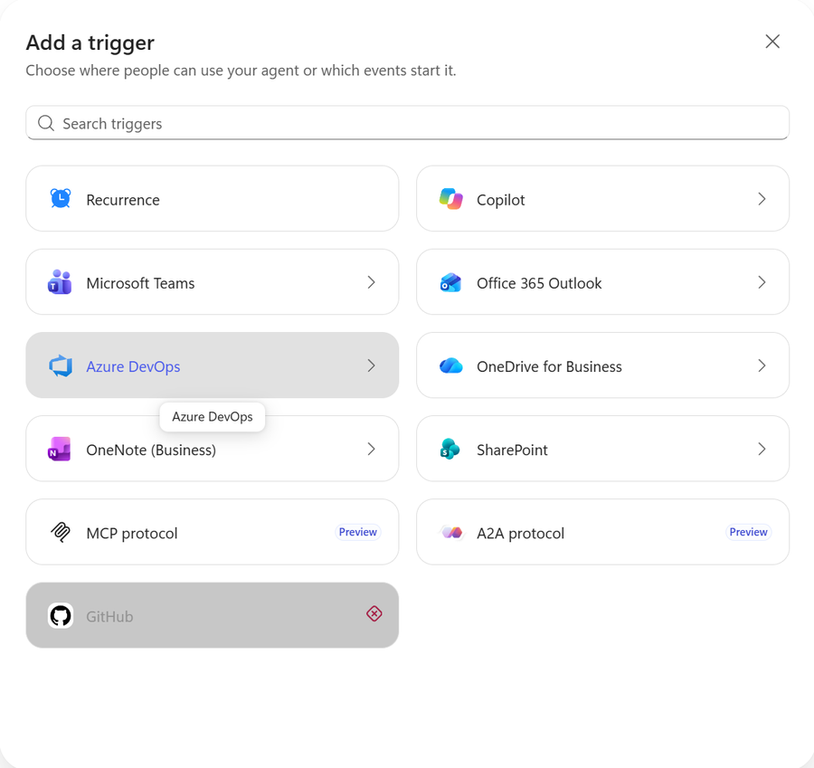{: .shadow w="650" }
_**MCP protocol** and **A2A protocol** in the Add a trigger dialog. They only appear in an Early release environment._

Each dialog shows the agent's URL:

```text
MCP:  https://api.powerplatform.com/copilotstudio-mcp/tenants/{tenantId}/environments/{environmentId}/agents/{agentSchemaName}
A2A:  https://api.powerplatform.com/copilotstudio-a2a/tenants/{tenantId}/environments/{environmentId}/agents/{agentSchemaName}
Card: {A2A URL}/.well-known/agent-card.json
```

Opening a dialog doesn't change the agent: it shows the URL. The A2A dialog also takes **skills**, a name and description for each thing the agent does, and those are saved with the agent. In my tests they appeared in the full agent details that signed-in clients read, not on the public agent card.

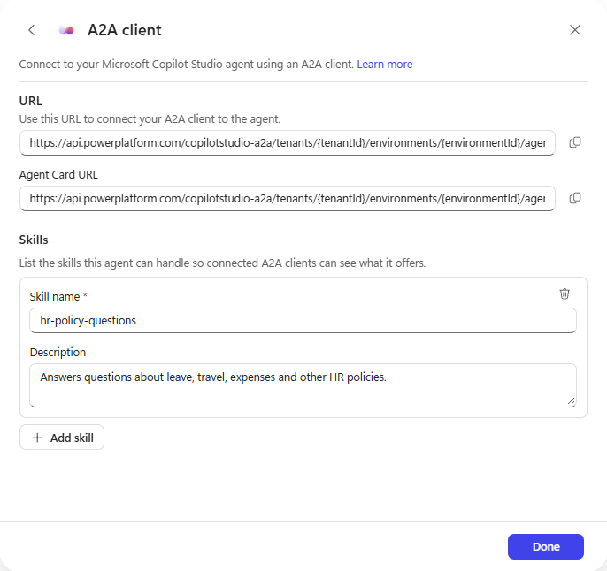{: .shadow w="700" }
_The A2A dialog: the endpoint, the agent card URL, and the agent's skills._

> The [official docs](https://learn.microsoft.com/en-us/microsoft-copilot-studio/agents-experience/publication-channels-mcp-agent-to-agent) describe the same entries under **Channels → Add a channel → MCP client / A2A client**, and you may see them there instead. Either way, the called agent must be in an Early release environment. Also, the Publish dialog may warn that the agent "won't run until you add a trigger". MCP and A2A calls worked anyway.
{: .prompt-info }

## Scenario 1: Standard agent → Microsoft Copilot harness agent (MCP)

Your production standard agent gets the new agent as one more tool. Nothing about the standard agent is rebuilt.

### 1. Prepare the app registration

1. In the app registration, add the delegated permission **`MCS.InvokeAsMCP`** from the channel API.
2. Under **Certificates & secrets**, create a client secret and copy its value.

### 2. Add the MCP tool to the standard agent

In the standard agent, go to **Tools → Add a tool**, and under **Create new** choose **Model Context Protocol**. That opens **Add a Model Context Protocol server**, as described in [Add an existing MCP server to your agent](https://learn.microsoft.com/en-us/microsoft-copilot-studio/mcp-add-existing-server-to-agent). Fill in:

| Field | Value |
|---|---|
| Server name | A name for the called agent, such as *HR Policy* |
| Server description | What the called agent does (see step 5) |
| Server URL | The **MCP** URL from the called agent |
| Authentication | **OAuth 2.0**, then change **Type** from the default **Dynamic discovery** to **Manual** |

### 3. Enter the OAuth values

| Field | Value |
|---|---|
| Client ID | The app registration's Application (client) ID |
| Client secret | The secret value from step 1 |
| Authorization URL | `https://login.microsoftonline.com/{tenantId}/oauth2/v2.0/authorize` |
| Token URL template | `https://login.microsoftonline.com/{tenantId}/oauth2/v2.0/token` |
| Refresh URL | `https://login.microsoftonline.com/{tenantId}/oauth2/v2.0/token` |
| Scopes | `https://api.powerplatform.com/copilotstudio-mcp/MCS.InvokeAsMCP offline_access` |

Replace `{tenantId}` with your Directory (tenant) ID. The scope must include `offline_access`, so the connection can refresh its token. The scope matches what the server advertises when you call it without a token. You don't need to configure PKCE: the sign-in request includes it automatically.

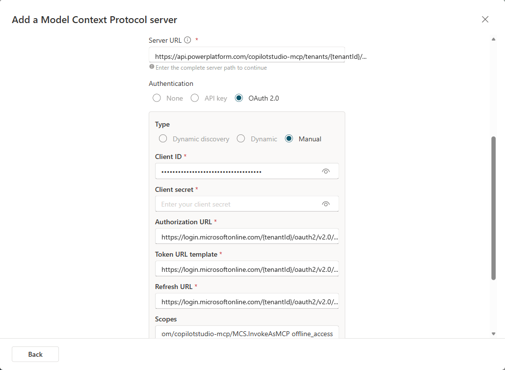{: .shadow w="700" }
_The MCP wizard with **Manual** OAuth. The tenant ID is replaced with `{tenantId}` here._

### 4. Register the redirect URI and create the connection

1. When you create the tool, Copilot Studio shows a redirect URL that starts with `https://global.consent.azure-apim.net/redirect/`. Each connector gets its own.
2. In the app registration, go to **Authentication → Add Redirect URI** (**Add a platform** in the older experience), choose **Web**, and paste it exactly as shown.
3. Back in Copilot Studio, create the connection and sign in. If the user hasn't consented to `MCS.InvokeAsMCP` yet, Entra asks them to. If an admin has already granted tenant-wide consent, users don't see that permission-consent prompt.

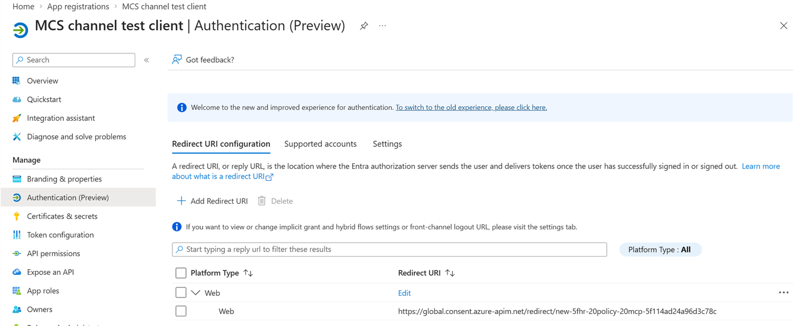{: .shadow w="700" }
_The connector's redirect URL added to the app registration as a **Web** redirect URI._

The tool panel then shows a single tool, `send-message`. One connector and connection can serve several agents in the same environment: my standard agent reused the connection I'd already created for another agent.

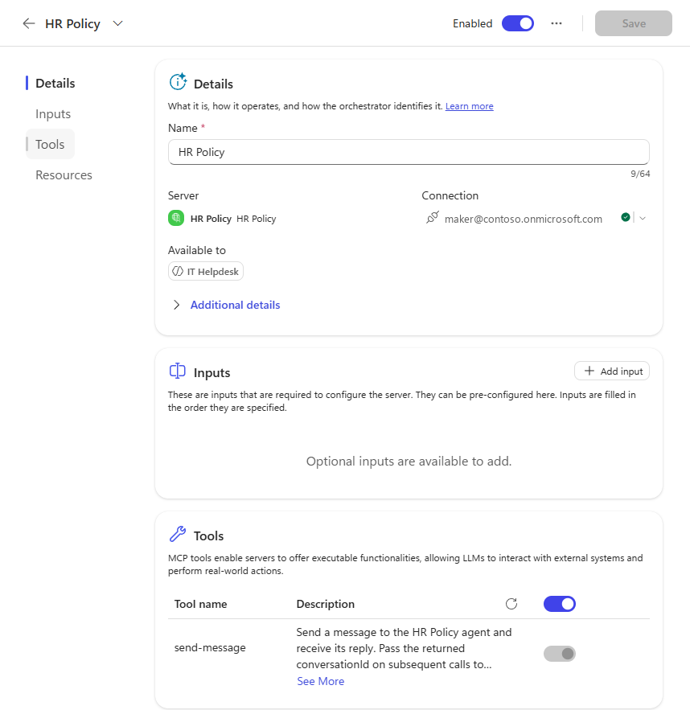{: .shadow w="700" }
_The standard agent with the Microsoft Copilot harness agent added as an MCP tool. The server exposes one tool: `send-message`. The connection's account is replaced with a placeholder here._

### 5. Tell the calling agent when to use it

The `send-message` tool's own description is generated from the called agent's name: "Send a message to the *HR Policy* agent and receive its reply." It doesn't say what the agent covers, so it's tempting to assume the **Server description** is what routing depends on. I compared the two:

- **Specific description** ("Answers questions about leave, travel, expenses and other HR policies…"), server name *HR Policy*.
- **Generic description** ("Model Context Protocol server endpoint."), server name *HR Policy MCP*, because the old name was still reserved after I deleted the first tool.

Everything else was the same: same standard agent with no instructions, same called agent, same `send-message` tool, and a new test session for each question in the generic run. With either description, "How many weeks of parental leave do I get?" and "How many days of annual leave can I carry over?" invoked the tool. The activity trace showed whichever description was configured, and a detailed description wasn't required for either question.

Routing isn't guaranteed, though. In one run, "Can I book premium economy for a 7-hour flight?" went to the agent's default web search instead of the tool. If your agent has web search, knowledge or other tools that overlap, say when to use the called agent in the standard agent's instructions:

```text
For questions about leave, travel, expenses or other HR policies, use the
HR Policy tool. Don't answer HR policy questions from general knowledge
or web search.
```

Still write a **Server description** that says what the agent covers. Get it right the first time: it's copied into the agent when you add the tool, and editing the connector afterwards doesn't change it. To change it, you remove the tool and add it again.

### 6. Test it as the maker

Ask the standard agent something only the called agent knows. The activity trace shows **Used tool: send-message**, and the reply came back in about 9 to 17 seconds in my tests. Follow-up questions keep their context, because Copilot Studio passes the returned `conversationId` back for you. If MCP connectors are new to you, [Five Minutes to Your First MCP Connector]() walks through the basics.

### 7. Switch the connector to on-behalf-of (OBO) sign-in

The tool uses **End user credentials** by default, so each person who chats with the standard agent calls the Microsoft Copilot harness agent as themselves. With **Manual** OAuth, the MCP wizard creates the connector with a generic OAuth 2 identity provider, and with that, every user has to sign in a second time on a separate connection manager page. Switching the connector to on-behalf-of (OBO) sign-in reuses the sign-in they already have, so they only select **Allow** once in the conversation. [Seamless SSO with Custom Connectors]() covers OBO for connectors in general. The steps here are the standard OBO setup for a custom connector; what's specific to the MCP channel is the **Resource URL** and the `MCS.InvokeAsMCP` permission.

{: .shadow w="900" }
_Every hop runs as the signed-in user. The connector's secret only proves it's allowed to swap the user's token._

First, add OBO to the app registration from step 1, as described in [Configure OBO authentication for custom connectors](https://learn.microsoft.com/en-us/microsoft-copilot-studio/advanced-custom-connector-on-behalf-of):

1. **Expose an API → Add a scope.** Accept the default Application ID URI (`api://{client-id}`), name the scope `access_as_user`, set **Who can consent** to **Admins and users**, and keep it **Enabled**.
2. **Authorized client applications → Add a client application.** Enter `fe053c5f-3692-4f14-aef2-ee34fc081cae` (Azure API Connections) and tick `access_as_user`. This lets Power Platform get a token for the connector on the user's behalf without a sign-in page.
3. **API permissions → Grant admin consent** for `MCS.InvokeAsMCP`. The token swap happens in the background, so there's no moment to ask the user for that permission.

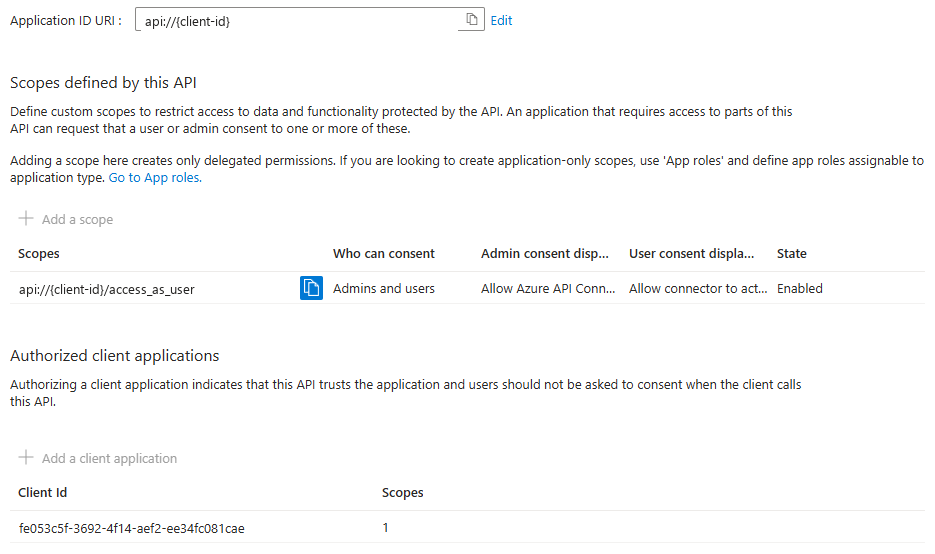{: .shadow w="700" }
_The client ID is replaced with `{client-id}` here._

Then, in Power Apps, go to **Custom connectors**, select the pencil icon on the connector the MCP wizard created, open **2. Security**, select **Edit** under **OAuth 2.0**, and set:

| Field | Value |
|---|---|
| Identity Provider | **Azure Active Directory** (Microsoft Entra ID) |
| Enable Service Principal support | Off |
| Client ID | The app registration's Application (client) ID |
| Client secret | The secret value. Changing the identity provider clears it, so enter it again. |
| Authorization URL | `https://login.microsoftonline.com` (the default) |
| Tenant ID | Your Directory (tenant) ID |
| Resource URL | `https://api.powerplatform.com/copilotstudio-mcp` |
| Enable on-behalf-of login | `true` |
| Scope | Keep the value from step 3 (`…/MCS.InvokeAsMCP offline_access`) |

> The **Resource URL** is the channel API's identifier, `https://api.powerplatform.com/copilotstudio-mcp`. Plain `https://api.powerplatform.com` is a different API, the Power Platform API, and tokens issued for it aren't valid for the MCP endpoint.
{: .prompt-warning }

{: .shadow w="600" }
_IDs are replaced with placeholders here._

Select **Update connector**. The redirect URL stayed the same in my test, so the app registration needed no new redirect URI. After the switch, create a new connection for the tool in the standard agent (**Tools** → the MCP tool → **Create new connection**) and select it. The switch applies to every agent that uses this connector, so do the same in each of them.

### 8. Share it and test with another user

Each user needs the following. Share the first three with a security group rather than one person at a time:

- **The standard agent**, shared as for any published agent, as described in [Share agents with other users](https://learn.microsoft.com/en-us/microsoft-copilot-studio/admin-share-bots).
- **The custom connector** the MCP wizard created, shared with **Can view** (Power Apps → **Custom connectors** → **⋯** → **Invite another user**), as described in [Share a custom connector in your organization](https://learn.microsoft.com/en-us/connectors/custom-connectors/share). Without it, the connection attempt failed with *"does not have ReadAccess … connector"*.
- **The called Microsoft Copilot harness agent**, shared with them. Until it was shared, my test user got a generic answer instead of the HR Policy reply.
- **A security role in the calling agent's environment**, if that isn't the default environment. **Basic User** was enough. Without a role, the consent card still appeared, but **Allow** ended with *"I couldn't connect. Open connection manager…"* and no connection was created.

I published the standard agent to Microsoft 365 Copilot and tested it with a second user who wasn't the maker and had no connection to the connector. Both agents were in the same Early environment rather than the default one, which is how the security-role requirement showed up. In the cross-environment setup, with the calling agent in the default environment, sharing the called agent was all its Early environment needed. The first time the user asked something that needed the tool, Microsoft 365 Copilot showed a **Connect to continue** card:

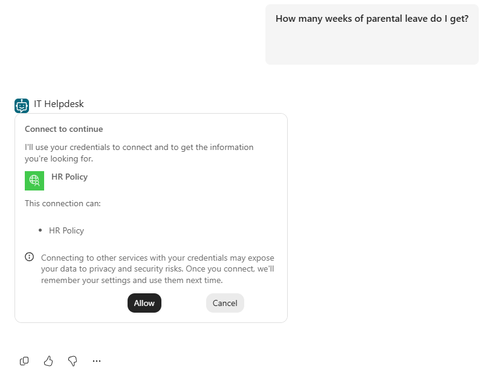{: .shadow w="560" }
_The in-conversation consent card. There's no connection manager page._

Selecting **Allow** created the user's connection, and the agent answered with the called agent's reply. Later questions used the same connection without another card.

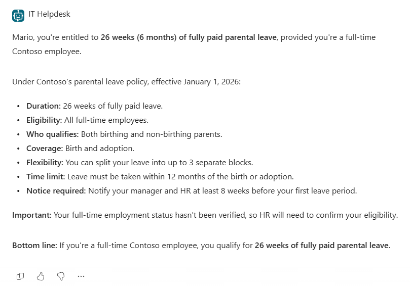{: .shadow w="560" }
_The answer after **Allow**. The details come from the called agent's HR handbook._

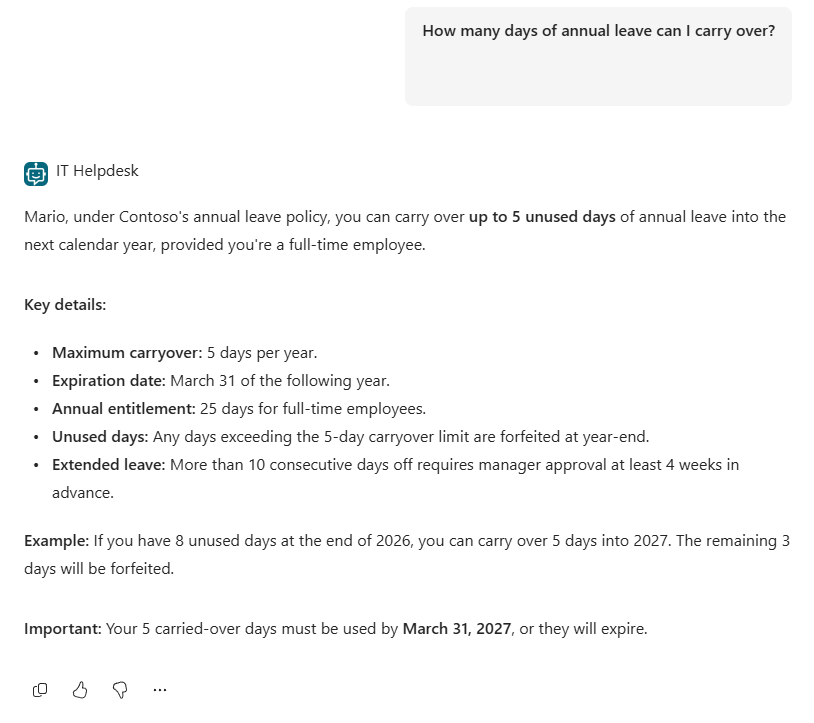{: .shadow w="560" }
_A follow-up question. No consent card this time._

> If you leave the connector on the generic OAuth settings, the tool still works, but each user gets *"Let's get you connected first… Open connection manager"*. They connect on the **Manage your connections** page, which they have to open themselves, then go back and select **Retry**.
{: .prompt-info }

## Scenario 2: Microsoft Copilot harness agents across environments (A2A)

Another team owns the agent you need, in their own environment. Instead of copying it, you call their published agent. MCP would reach it across environments too, as Scenario 1 shows. This scenario uses A2A because the calling agent is a Microsoft Copilot harness agent, which can add it as a connected agent from its agent card. In my test, the caller was in the default environment and the called agent was in an Early environment.

### 1. Prepare the app registration

Add the delegated permission **`MCS.InvokeAsA2A`**. You can reuse the same registration and secret from Scenario 1, but users consent to A2A separately.

### 2. Add the A2A agent to the calling agent

1. In the calling agent, go to **Connected agents → + Add → Add A2A agent**, as described in [Add an Agent2Agent (A2A) agent as a connected agent](https://learn.microsoft.com/en-us/microsoft-copilot-studio/agents-experience/add-agent-to-agent).
2. Paste the called agent's **agent card URL**.
3. Under **Get the name and description from**, keep **The agent's full details (Recommended)**. Those details are read after you connect, so the form doesn't ask for a name or description yet.
4. Choose **OAuth 2.0**. Copilot Studio usually fills in the **Authorization URL**, **Token URL**, **Refresh token URL** and **Scopes** from the card. If they're empty, enter the same Entra URLs as in Scenario 1.
5. Enter the client ID and secret.
6. Check **Scopes**. The value from the card has `MCS.InvokeAsA2A` but not `offline_access`. Add `offline_access`, as in Scenario 1, so the connection can refresh its token. The full value is:

   ```text
   https://api.powerplatform.com/copilotstudio-a2a/MCS.InvokeAsA2A offline_access
   ```

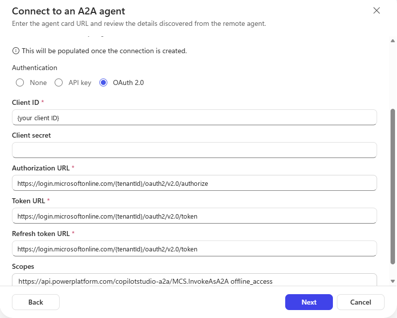{: .shadow w="650" }
_The A2A form with `offline_access` added to the scope. IDs are replaced with placeholders here._

### 3. Register the redirect URI and create the connection

1. Select **Next**. Copilot Studio creates the connector and shows its redirect URL, which starts with `https://global.consent.azure-apim.net/redirect/`.
2. Add it to the app registration as a **Web** redirect URI, as in Scenario 1.
3. Back in Copilot Studio, open the **Connection** list, select **Create new connection**, then **Create**, and sign in. The sign-in request asks for `MCS.InvokeAsA2A offline_access`.

### 4. Check the description

Select **Next** to reach **Review and add**, where the name and description come in from the agent. Read the description before you add it: it's what the calling agent routes on. Even with **The agent's full details**, my HR Policy agent came through as just *"Microsoft Copilot Studio agent 'HR Policy'."*, which says nothing about when to use it. (**The public agent card** gives the same kind of generic text, and the skills you added aren't on the public card at all.)

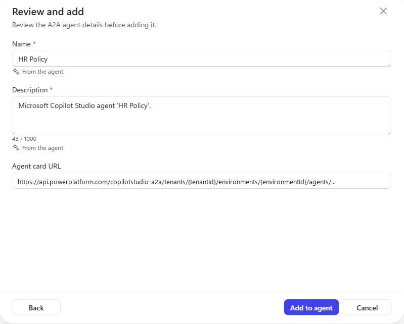{: .shadow w="650" }
_The description that came from the agent. Replace it before you select **Add to agent**._

Copilot Studio [routes to an A2A agent](https://learn.microsoft.com/en-us/microsoft-copilot-studio/agents-experience/add-agent-to-agent#how-the-orchestrator-routes-to-the-a2a-agent) based on its name and description, the user's message and conversation context, and the calling agent's instructions. So replace the description with one that says when to use the agent, for example:

```text
HR policy agent owned by the People team. Answers questions about leave,
travel, expenses and other HR policies. Use it for any HR policy question.
```

With that description and no instructions in the calling agent, "How many weeks of parental leave do I get?" went to HR Policy. If the calling agent has its own instructions or overlapping tools, add a line that points HR policy questions to the connected agent, in the same way as the MCP example above.

### 5. Test it

Select **Add to agent**, save, and ask the calling agent something only the called agent knows. You can test in **Preview** before you publish the calling agent; the called agent must already be published. The trace shows **Used tool: {your A2A agent}** with the input and output, and my first answer came back in about 17 seconds.

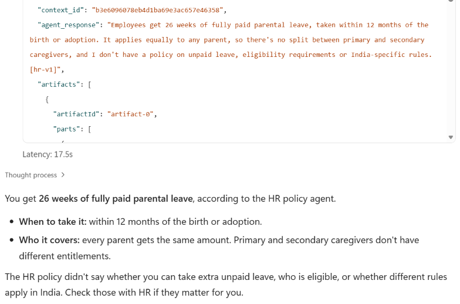{: .shadow w="650" }
_The output part of the calling agent's trace: the context ID and the called agent's reply, followed by the calling agent's answer._

> The A2A tool's built-in guidance tells the model to pass both `context_id` and `task_id` back on follow-ups. Passing `task_id` fails with error `-32004` ("Task is in a terminal state"), because every reply is a completed task. Follow-ups work with `context_id` alone. In both of my tests, the calling agent's model retried without `task_id` by itself and the follow-up kept its context, so if you see that error in the trace, that's what happened.
{: .prompt-warning }

If the two agents are both Microsoft Copilot harness agents in the **same environment**, you don't need either channel: [connected agents](https://learn.microsoft.com/en-us/microsoft-copilot-studio/agents-experience/authoring-add-other-agents) lists them directly, with no URL, app registration or OAuth.

## How the two channels differ

Both channels invoke the **same published agent**. Its capabilities and answers don't change with the channel. Cross-environment access, calling an agent another team owns, delegated identity, hooks and billing work the same way for both, and credits are consumed in the called agent's environment. What changes is how the caller discovers the agent, calls it, and receives the reply:

| | MCP | A2A |
|---|---|---|
| Copilot Studio callers | Standard and Microsoft Copilot harness agents | Microsoft Copilot harness agents |
| Protocol version | MCP `2025-06-18` | A2A **1.0** only |
| Reply | Completed reply from `send-message` | Streaming supported |
| Discovery metadata | One tool, described by agent name | Agent card with skills |
| Follow-ups | `conversationId` | `context_id` |

A few of these deserve a sentence each:

- **Standard agents can't use A2A here.** The standard harness's Agent2Agent form expects the A2A 0.x card format, and Copilot Studio serves 1.0 cards. In my test, the form loaded the card but never created the connector. MCP is the only route from a standard agent today.
- **Client compatibility matters more than features.** The A2A channel accepts A2A 1.0 clients only. Copilot Studio's Microsoft Copilot harness speaks 1.0, but check any other A2A client before you count on it.
- **Streaming is a channel capability.** The A2A channel streams replies through `SendStreamingMessage`, while MCP's `send-message` returns the completed reply. That matters most to custom clients; the [CATBOT post]() shows both.
- **Discovery isn't routing.** The agent card and its skills are metadata that A2A clients use to discover the agent. Copilot Studio's routing uses the connected agent's name and description, the conversation, and the calling agent's instructions. That's why step 4 of Scenario 2 matters even if you've written good skills.

> [Agent hooks](https://learn.microsoft.com/en-us/microsoft-copilot-studio/agents-experience/hooks-overview) on the called agent fire for both channels. `metadata.channel` is `mcs-agent-as-mcp` or `mcs-agent-as-a2a`, and `userAadObjectId` is the signed-in caller, so a hook can treat agent callers differently from people chatting directly. If you haven't used hooks yet, start with [Hooks in Copilot Studio]().
{: .prompt-tip }

## Key takeaways

- A **standard** agent can use a Microsoft Copilot harness agent today as an **MCP tool**, without being rebuilt.
- A **Microsoft Copilot harness** agent can call another team's agent in a **different environment** as an **A2A connected agent**, without copying it.
- Both need an Early environment for the called agent, an app registration with a client secret, and a Web redirect URI per connector. MCP also needs **Manual** OAuth.
- In my MCP tests, routing worked with a specific or a generic Server description. Use clear names and descriptions, and add a line to the calling agent's instructions when web search or other tools overlap.
- Switch the MCP connector to **on-behalf-of** sign-in, so other users select **Allow** once in the conversation instead of using the connection manager.
- The channels differ in who can call, protocol version, streaming and discovery metadata, not in what the called agent can do.

Which of your production agents would you connect to a Microsoft Copilot harness agent first? Let me know in the comments.
