Microsoft offers a growing range of AI tools, and it can take a little time to get familiar with their names. Some refer to products you use every day, while others describe the interfaces, developer tools, and technology that bring them to life. This glossary brings the related terms together to help you find your way around.

The terminology here reflects what's in use as of November 16, 2026.

## Microsoft Copilot-sounding names

### Microsoft Copilot
{: #microsoft-365-copilot }

Microsoft Copilot is a product: Microsoft's AI experience for work across Microsoft 365 applications, organizational information, and agents. You can access it through the web, including its dedicated web app, Microsoft Teams, and mobile apps, with capabilities depending on licensing and configuration.

The [chat experience](#copilot-chat) is part of the product, while the [Copilot app](#copilot-app) is an interface through which you access it.

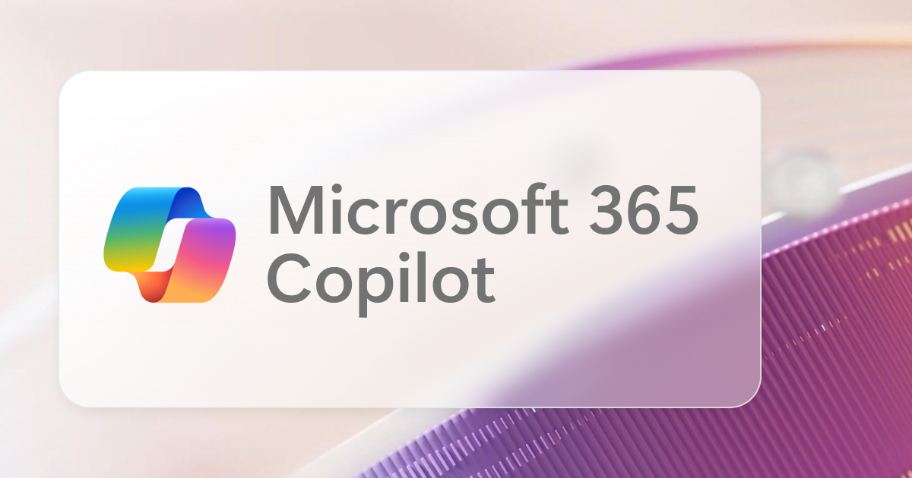{: .shadow w="1200" h="630" }
*Microsoft Copilot*

### Microsoft Copilot Chat
{: #copilot-chat }

"Microsoft Copilot Chat" often refers informally to the conversational experience inside Microsoft Copilot: the actual chat, rather than the whole product. Although we tend to also use this name sometimes, my advice in general conversation is to say **the chat in Microsoft Copilot** when that is what you mean, avoiding the ambiguity associated with names such as the superseded "Business Chat" naming.

[Microsoft Copilot](#microsoft-365-copilot) is the whole product, including chat; the [Copilot Chat harness](#copilot-chat-harness) is a completely different concept, and it is the execution technology behind a particular agent experience (usually associated with Copilot Studio).

### Microsoft Copilot app
{: #copilot-app }

The Microsoft Copilot app is the application name used for the productivity hub that brings together Copilot and work experiences. Current documentation calls it the **Microsoft Copilot app**, although older names can remain in documentation and interfaces.

The app is an access surface for [Microsoft Copilot](#microsoft-365-copilot), not a separate name for the entire product and its licensing.

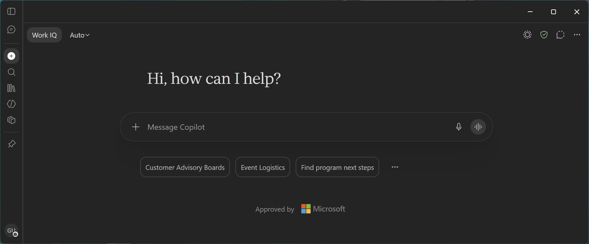{: .shadow w="1818" h="754" }
*Microsoft Copilot app*

### BizChat / Business Chat

BizChat and Business Chat are former internal and now superseded names associated with the work-grounded conversational Copilot experience (the paid one). They remain useful when reading older material, but I recommend saying **the chat in Microsoft Copilot** rather than carrying these names into new explanations.

### Copilot Code
{: #copilot-code }

Copilot Code is **Code in Microsoft Copilot**, a tab within the overall product. It provides coding capabilities for creating and editing code-based artifacts, such as interactive dashboards, apps, and other purpose-built solutions.

It shares underlying technology with [GitHub Copilot](#github-copilot), but is a capability inside Microsoft Copilot (that doesn't require separate GitHub accounts) rather than the GitHub development product.

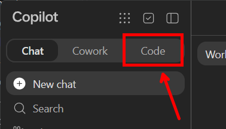{: .shadow w="378" h="217" }
*Code in Microsoft Copilot*

### Agent Builder
{: #agent-builder }

Copilot Agent Builder is an agent-creation experience **within Microsoft Copilot**. It lets you configure instructions, knowledge, and supported capabilities without implementing the agent's underlying engine.

Unlike a [custom engine agent](#custom-engine-agent), an agent created this way relies on the same orchestration used by [Microsoft Copilot](#microsoft-365-copilot).

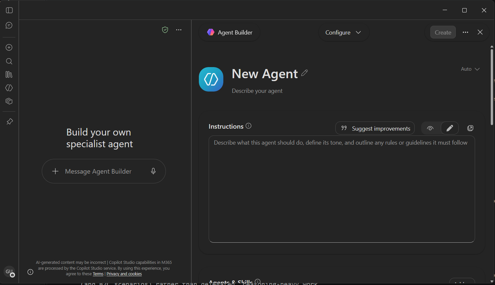{: .shadow w="1516" h="875" }
*Agent Builder in Microsoft Copilot*

### Copilot+ PC

A Copilot+ PC is a Windows hardware category designed to support particular AI experiences, including on-device capabilities. It is not a Copilot subscription and does not automatically unlock every cloud-based Copilot feature.

## Cowork-sounding names

### Microsoft Copilot Cowork / Copilot Cowork / Cowork
{: #cowork }

These names refer to Copilot's delegated-work experience. Instead of asking only for an answer, you assign a task that can involve multiple steps, tools, files, and a finished deliverable.

Unlike the [chat experience](#copilot-chat), which emphasizes conversation, Cowork emphasizes work you delegate and then review.

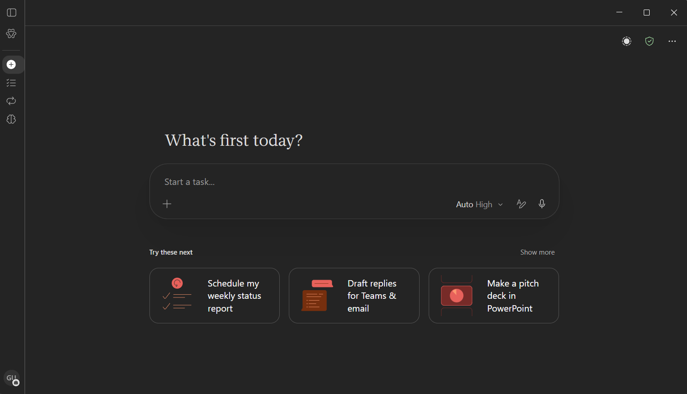{: .shadow w="1508" h="865" }
*Microsoft Copilot Cowork*

### Cowork agents / Cowork harness

These are informal and incorrect expressions people sometimes use for the agentic behavior or execution technology associated with Cowork. They should not be read as independently established official agent categories or selectable harness names and my advice is to avoid using them.

If you are referring to a specific Copilot Studio harness, see [Copilot Studio harness](#harness-sounding-names).

### Cowork plugin
{: #cowork-plugin }

A Cowork plugin packages specialized capabilities, such as skills and integrations, for use in Cowork. It extends what Cowork can do rather than necessarily creating a separate agent (on a different product, since as stated above, you can't use Cowork to "create an agent").

The broader phrase [Copilot plugins](#copilot-plugins) can refer to different extension models across products and generations of documentation.

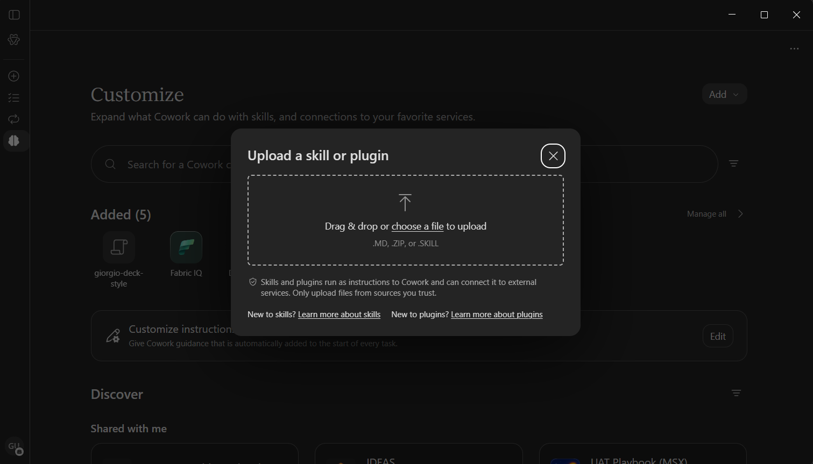{: .shadow w="1511" h="863" }
*Plugins in Cowork*

## Autopilot, Scout, and agent identities

### Autopilot

**Autopilot** is the new name for the experience previously called **Microsoft Scout**. These names refer to the same experience, not a category and an example within it.

### Microsoft Scout

**Microsoft Scout** is the former name of **Autopilot**. You may still encounter it in older material.

### Agent identities

**Agent identities** is the current term for what was previously described as "autopilots." In Copilot Studio, an agent identity setting gives an agent a **Microsoft Entra ID identity**. With the required configuration and permissions, the agent can send email and be added to Microsoft Teams.

An agent identity determines how an agent is identified and granted access; it is separate from the **Autopilot** experience formerly called Scout.

## GitHub Copilot-sounding names

### GitHub Copilot
{: #github-copilot }

GitHub Copilot is GitHub's AI development service, available through supported development tools and agent experiences. The name describes the broader offering, not one particular application of it.

It is separate from the [GitHub Copilot SDK](#github-copilot-sdk), which lets developers embed agent capabilities into their own applications (even without GitHub licenses!), and from the [GitHub Copilot CLI](#github-copilot-cli)/[GitHub Copilot App](#github-copilot-app), which provide interfaces for using GitHub Copilot (with or without the GitHub subscription).

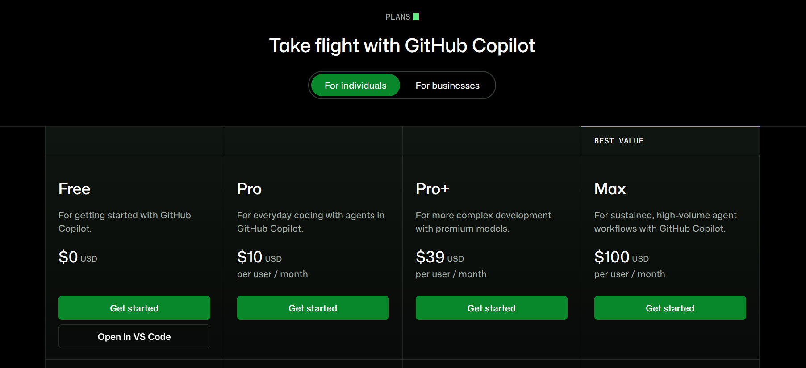{: .shadow w="1805" h="826" }
*GitHub Copilot*

### GitHub Copilot App / GitHub Copilot Desktop App
{: #github-copilot-app }

These names identify the desktop application for working with GitHub Copilot development and agent workflows. It is a graphical interface to capabilities, not the subscription or service itself: indeed, it can also be used in BYOM (Bring Your Own Model) scenarios.

The [CLI](#github-copilot-cli) provides a terminal interface as opposed to the UI provided by the desktop application, while the [SDK](#github-copilot-sdk) is the underlying "engine" (or "harness") that lets developers embed agent capabilities in software and also powers those capabilities.

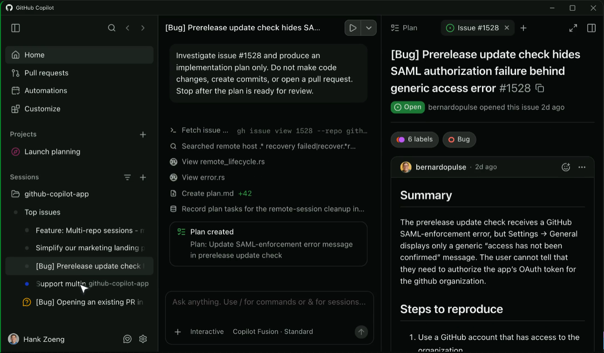{: .shadow w="1297" h="758" }
*GitHub Copilot desktop app*

### GitHub Copilot CLI
{: #github-copilot-cli }

GitHub Copilot CLI brings Copilot's coding-agent experience to the terminal. It lets you work through commands and conversation without requiring the desktop application.

The [SDK](#github-copilot-sdk) exposes the agent runtime used by the CLI, for integration into other applications.

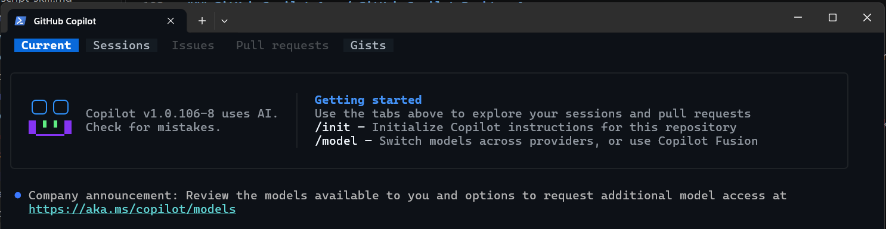{: .shadow w="1486" h="386" }
*GitHub Copilot CLI*

### GitHub Copilot SDK
{: #github-copilot-sdk }

GitHub Copilot SDK provides pro-code developer libraries for embedding the agent runtime used by GitHub Copilot CLI and Desktop apps into your own applications and services. Supported authentication paths include GitHub Copilot direct access (via subscription) and direct-provider BYOM configurations, with different billing arrangements.

Unlike the [CLI](#github-copilot-cli), it is a building block for software rather than primarily an interface people use directly.

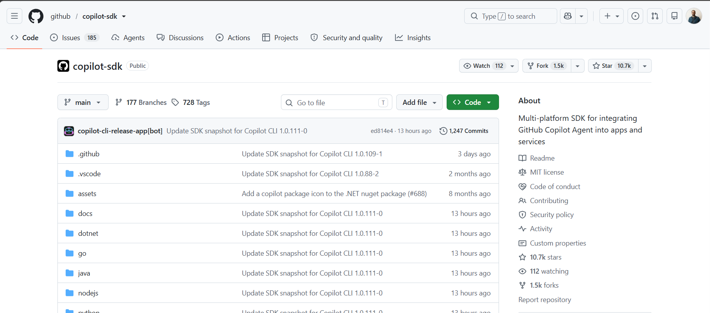{: .shadow w="1817" h="803" }
*GitHub Copilot SDK*

## Harness-sounding names
{: #harness-sounding-names }

### Microsoft Copilot harness / former GitHub Copilot harness
{: #microsoft-copilot-harness }

Microsoft Copilot harness is the Copilot Studio harness for reasoning-heavy, multistep agents and workflows. Microsoft renamed it from GitHub Copilot harness on October 28, 2026, so the previous name remains visible in older material.

It is neither the [GitHub Copilot service](#github-copilot) which is a subscription-based service for developers, nor the [GitHub Copilot SDK](#github-copilot-sdk) which is just the "engine" that powers this experience, nor the [Copilot Chat harness](#copilot-chat-harness) which is a different harness, precisely the one reusing the same orchestration as [Microsoft Copilot](#microsoft-365-copilot).

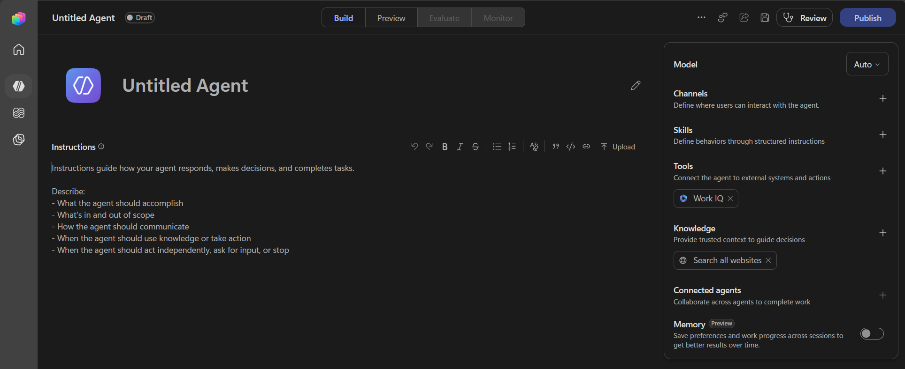{: .shadow w="1928" h="788" }
*Microsoft Copilot harness in Copilot Studio*

### Copilot Chat harness
{: #copilot-chat-harness }

Copilot Chat harness supports agents that extend Microsoft Copilot relying on its hosted models and orchestration. These are the agents historically described, and still documented, as [declarative agents](#declarative-agent).

Despite the near-identical wording, it is distinct from the [Microsoft Copilot Chat](#copilot-chat) which instead only identifies the chat interface within Microsoft Copilot, without the extensibility options.

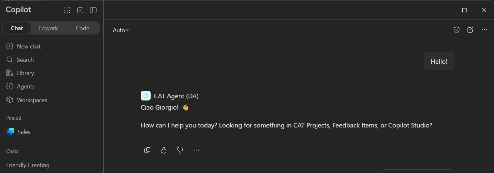{: .shadow w="1512" h="532" }
*Copilot Chat harness in Copilot Studio*

### Customer Conversation harness
{: #customer-conversation-harness }

Customer Conversation harness supports customer-facing chat and voice experiences in Copilot Studio. It is designed for service conversations, including scenarios that need escalation to a human representative.

Unlike the [Microsoft Copilot harness](#microsoft-copilot-harness), its defining focus is customer conversation (and B2C scenarios) rather than delegated, reasoning-heavy work.

### Standard harness
{: #standard-harness }

Standard harness supports rule-based agents and structured, repeatable conversations or agent flows in Copilot Studio. It emphasizes the topics, rules, and paths the maker defines.

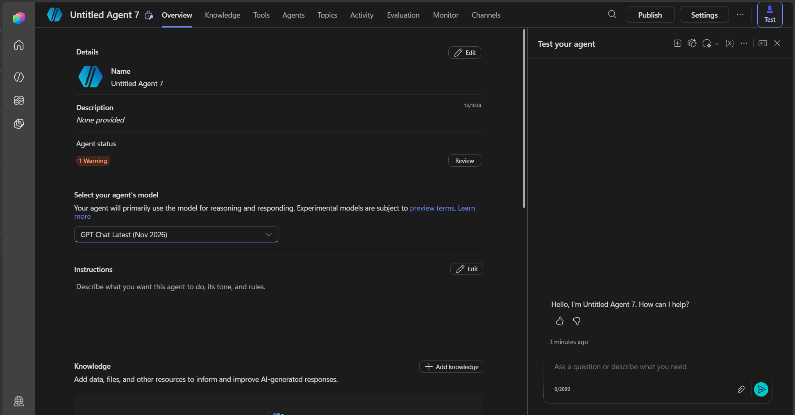{: .shadow w="1940" h="1013" }
*Standard harness in Copilot Studio*

### Harness Agent / Microsoft Agent Framework Harness
{: #agent-framework-harness }

Harness Agent refers to an agent custom-assembled pro-code by a developer using the **Microsoft Agent Framework Harness**: ready-made scaffolding for planning, tool calls, context management, and other agent capabilities. These names describe the agent "engine" within Microsoft Agent Framework, not separate competing products.

This is a developer building block, completely separated from Copilot Studio and its [selectable harnesses](#harness-sounding-names).

## Managed Apps and Managed Runtime-sounding names

### Managed Apps
{: #managed-apps }

Managed Apps are applications hosted and governed through [Microsoft Copilot Managed Runtime](#managed-runtime). You can create them through Cowork, Copilot Studio, or the Copilot Managed Runtime SDK.

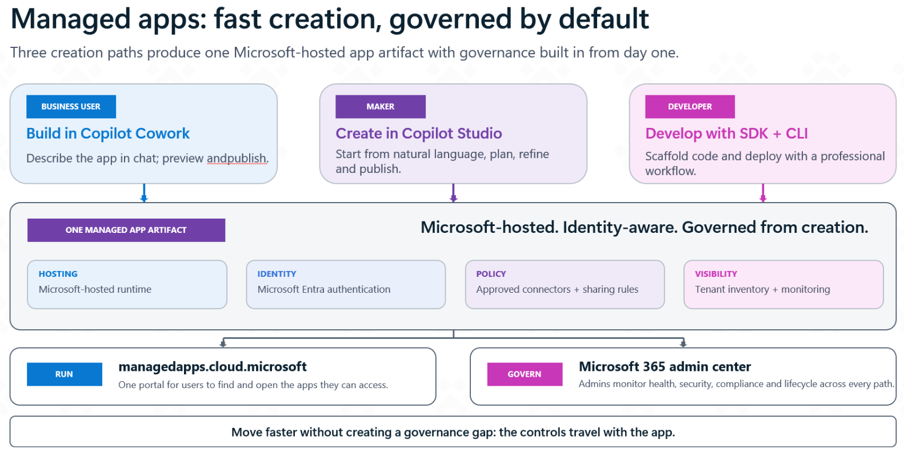{: .shadow w="1582" h="792" }
*Introduction to Managed Apps*

### Microsoft Copilot Managed Runtime
{: #managed-runtime }

Microsoft Copilot Managed Runtime is the hosting infrastructure behind Managed Apps. It provides somewhere for application code to run with enterprise authentication, governed connections, and administrative controls.

[Managed Apps](#managed-apps) are what people use; Managed Runtime is where those applications run.

### Apps in Cowork
{: #apps-in-cowork }

Apps in Cowork are managed applications created through Cowork as part of delegated work and iterative solution-building. Cowork provides the creation experience, while supported published apps run on Microsoft Copilot Managed Runtime.

This is one way to create [Managed Apps](#managed-apps), alongside [Copilot Studio](#apps-in-studio) and the [SDK](#managed-runtime-sdk).

### Apps in Copilot Studio
{: #apps-in-studio }

Apps in Copilot Studio is an experience for creating, editing, previewing, and publishing applications with natural-language assistance. It creates applications, which is different from creating conversational agents in the same broader platform.

It is another route to [Managed Apps](#managed-apps), rather than a separate name for their [hosting runtime](#managed-runtime).

### Copilot Managed Runtime SDK
{: #managed-runtime-sdk }

The preview Copilot Managed Runtime SDK gives developers a code-first way to build applications for Microsoft Copilot Managed Runtime. It supports capabilities such as built-in authentication and governed data connections.

It is the developer route to [Managed Apps](#managed-apps), whereas [Cowork](#apps-in-cowork) and [Copilot Studio](#apps-in-studio) provide assisted creation experiences.

## Agent-sounding names

### Researcher agent & Analyst agent

Researcher helps investigate questions and synthesize findings with sources. Analyst helps explore and analyze data, so these are two specialized 1st-party agents made by Microsoft rather than two names for other competing assistants.

### Declarative agent
{: #declarative-agent }

A declarative agent is defined through instructions, knowledge, and supported capabilities while relying on Copilot's hosted models and orchestration. For this glossary's architectural explanations, I'd replace that label with **an agent powered by the [Copilot Chat harness](#copilot-chat-harness)**, while noting that our documentation still uses "declarative agent" sometimes.

The agent is the configured assistant; the harness is what runs it, so this is a clearer architectural description rather than a claim that the two terms name the same layer.

### Custom engine agent
{: #custom-engine-agent }

Custom engine agent is a broad term for an agent available in Microsoft Copilot that does not use Copilot's out-of-the-box orchestrator. Its developer supplies the agent engine and orchestration instead.

I recommend avoiding this catch-all label when you can name the actual framework, harness, or hosting arrangement, because it says little about how the agent works. For example, a [Microsoft Copilot harness](#microsoft-copilot-harness) published in Microsoft Copilot would represent a custom engine agent, while a [Copilot Chat harness](#copilot-chat-harness) would not.

## Microsoft 365 Agents and Agent 365-sounding names

### Microsoft 365 Agents SDK
{: #microsoft-365-agents-sdk }

Microsoft 365 Agents SDK helps developers build conversational agents with channel connectivity, authentication, and conversation-state support. It does not itself provide the language model or a complete reasoning engine.
With this SDK, developers can manage conversation state, handle authentication, and connect their agents to various channels, while focusing on the agent's reasoning and dialogue logic. 

This framework also exposes a Copilot Studio Client that is particularly useful for integrating with Copilot Studio in within pro-dev experiences: e.g., showing it in a custom web app.

Despite the similar name, [Agent 365 SDK](#agent-365-sdk) is a completely different product, that adds enterprise integration to [Agent 365](#agent-365) (the control plane) to an existing pro-code agent.

### Microsoft 365 Agents Toolkit / Teams Toolkit

Microsoft 365 Agents Toolkit is the developer-tooling name that succeeds Teams Toolkit. It helps with tasks such as project creation, configuration, debugging, and deployment of pro-code [Chat harnesses](#copilot-chat-harness) agents and Teams Apps.

### Microsoft Agent 365 / Agent 365
{: #agent-365 }

Microsoft Agent 365 is a control plane for discovering, governing, and securing agents across supported sources. It helps organizations oversee agents rather than implementing their reasoning.

It is a governance-focused platform, providing oversight, policy enforcement, and security controls for agents within an organization rather than implementing their reasoning.

### Agent 365 SDK
{: #agent-365-sdk }

Agent 365 SDK connects an existing agent (e.g., built outside of the Microsoft world) to capabilities such as agent identity, governed tools, and notifications that [Agent 365](#agent-365) provides. It does not build, host, or orchestrate that agent.

It can work alongside the [Microsoft 365 Agents SDK](#microsoft-365-agents-sdk) to onboard an agent build by that SDK into Agent 365, but the two SDKs solve different problems.

## Plugin, connector, and gallery-sounding names

### Copilot plugins
{: #copilot-plugins }

Copilot plugins extend what a Copilot experience can do. The phrase covers different extension models across products and documentation generations, so its exact meaning needs context and my general advice is to avoid using it loosely.

A [Cowork plugin](#cowork-plugin) identifies a particular supported experience, while a [connector](#copilot-connector) connects information or services rather than necessarily packaging a complete set of capabilities.

### Copilot Connector
{: #copilot-connector }

A Copilot connector makes information from an external system available to supported Microsoft Copilot grounding and discovery experiences.

It is not automatically an action-oriented [plugin](#copilot-plugins) or a Power Platform connector, but rather a integration layer for making external information accessible to Microsoft Copilot experiences.

### Plugin registry

The plugin registry is an [Agent 365](#agent-365) concept that describes a catalog for discovering, publishing, approving, and governing supported [Copilot plugins](#copilot-plugins). It controls which extensions are available rather than executing them.

### CAT Skill and Plugin Gallery
{: #cat-skill-gallery }

The CAT Skill & Plugin Gallery accessible at [https://aka.ms/catagentskills](https://aka.ms/catagentskills) provides downloadable skills, plugins, and automations from Microsoft and the community. It is a resource for finding reusable capabilities, not a runtime or a guarantee that every submission works in every Copilot experience.

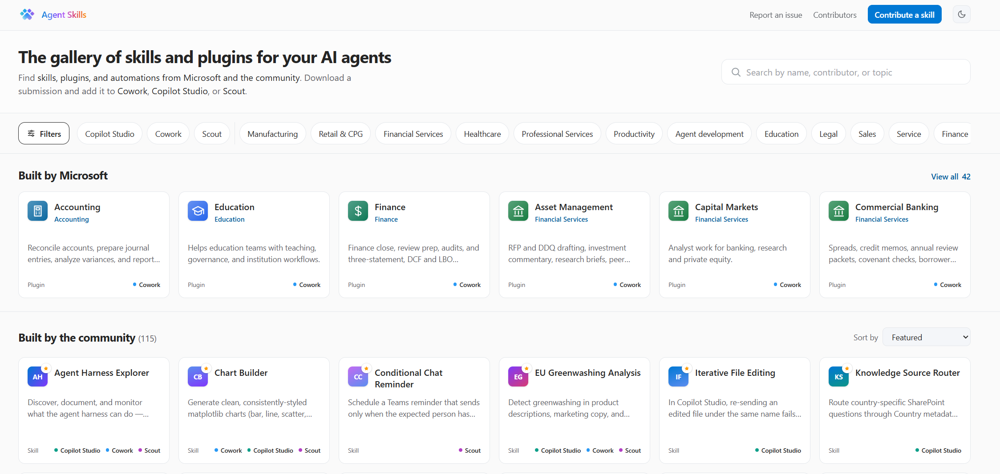{: .shadow w="2247" h="1067" }
*CAT Skill & Plugin Gallery*

## Flow and workflow-sounding names

### Power Automate flows
{: #power-automate-flows }

Power Automate flows automate tasks across applications and services in the Power Automate platform. The broader family includes cloud flows and desktop flows, supporting different kinds of automation.

### Agent flows
{: #agent-flows }

Agent flows are the evolution of Power Automate flows, thought for the Agent era. They provide a structured way to create AI-enabled automations often used in conjunction with Copilot Studio's standard-harness experience. They follow authored triggers, actions, and branches to perform repeatable tasks and can be called by agents.

They are distinct from the newer [Workflows experience](#workflows), which runs on the Microsoft Copilot harness and provides a more powerful and AI-native model for defining and executing automations.

### Workflows
{: #workflows }

In Copilot Studio, Workflows is an automation experience, with a visual canvas, AI actions, and agent handoffs. Workflows follow defined steps and can start manually, on a schedule, through events, or when called by an agent, but they support full-AI processing via agent nodes that call Copilot Studio, Microsoft 365, Cowork, and many more AI experiences directly in within the workflow itself.

## Credit-sounding names

### GitHub AI Credits

GitHub AI Credits are usage units associated with eligible metered AI capabilities in GitHub's offerings. They belong to GitHub's billing system and require an active GitHub account with billing enabled to be used.

They are not interchangeable with [Copilot Credits](#copilot-credits), which belong to Microsoft's separate consumption model.

### Copilot Credits
{: #copilot-credits }

Copilot Credits measure consumption for supported Microsoft Copilot and agent capabilities. The amount consumed depends on the operation and billing arrangement and can be used for a variety of Microsoft AI experiences like Microsoft Copilot, Copilot Studio, Cowork, and more.

## Foundry-sounding names

### Microsoft Foundry
{: #microsoft-foundry }

Microsoft Foundry is Microsoft's platform for developing, evaluating, deploying, and operating AI applications and agents. It succeeds Azure AI Foundry branding and covers more than any individual service within it. Foundry can also provide models as a service for use outside of its ecosystem.

### Foundry Agent Service
{: #foundry-agent-service }

Foundry Agent Service is the service within Microsoft Foundry for creating and operating agents with supported models and tools. It is one part of the platform, specifically the one that lets you create agents (rather than providing model APIs for example).

## IQ-sounding names

### Microsoft IQ
{: #microsoft-iq }

Microsoft IQ is Microsoft's umbrella intelligence platform for connecting enterprise work, business data, and knowledge to AI experiences. It is not one model or one database.

[Work IQ](#work-iq), [Fabric IQ](#fabric-iq), and [Foundry IQ](#foundry-iq) describe complementary kinds of context within that broader picture.

### Work IQ
{: #work-iq }

Work IQ connects organizational work context, including people, content, collaboration, and workflows. It helps supported Copilot and agent experiences understand the work around a request.

### Fabric IQ
{: #fabric-iq }

Fabric IQ focuses on business meaning, entities, relationships, rules, and operational context associated with enterprise data. It helps AI interpret what that data represents.

### Foundry IQ
{: #foundry-iq }

Foundry IQ grounds AI applications and agents built in Foundry in curated enterprise knowledge through knowledge bases and retrieval. It helps supply relevant information rather than operating the agent itself.

## Selected references

- [Microsoft Copilot overview](https://learn.microsoft.com/en-us/copilot/plan/copilot-overview)
- [Introducing Copilot Home, Code, and Autopilot](https://blogs.microsoft.com/blog/2026/09/25/introducing-the-new-copilot-with-home-code-and-autopilot/)
- [Copilot Control System announcement at Ignite 2024](https://www.microsoft.com/en-us/copilot/blog/2024/11/19/introducing-copilot-actions-new-agents-and-tools-to-empower-it-teams/)
- [Copilot Studio harnesses and component models](https://microsoft.github.io/mcs-labs/modules/harnesses-and-component-models-latest/)
- [Microsoft Agent Framework Harness](https://learn.microsoft.com/en-us/agent-framework/concepts/harness)
- [Microsoft Copilot Managed Runtime SDK](https://learn.microsoft.com/en-us/microsoft-365/copilot-managed-runtime/developer/apps/)
- [Declarative and custom engine agents](https://learn.microsoft.com/en-us/microsoft-365/copilot/extensibility/agents-overview)
- [Agent flows overview](https://learn.microsoft.com/en-us/microsoft-copilot-studio/flows-overview)
- [Workflows overview](https://learn.microsoft.com/en-us/microsoft-copilot-studio/workflows-experience/flows-overview)
- [Agent 365 SDK](https://learn.microsoft.com/en-us/microsoft-agent-365/developer/agent-365-sdk)
- [GitHub Copilot SDK](https://github.com/github/copilot-sdk)
- [Microsoft IQ](https://learn.microsoft.com/en-us/microsoft-iq/)
- [CAT Skill Gallery](https://microsoft.github.io/cat-agent-skills/)
- [Changes to Mico and other Copilot features](https://support.microsoft.com/en-us/microsoft-365-copilot/frequently-asked-questions-about-retired-copilot-features)