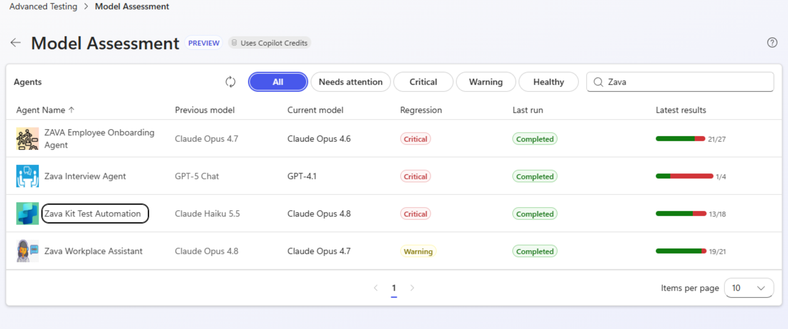
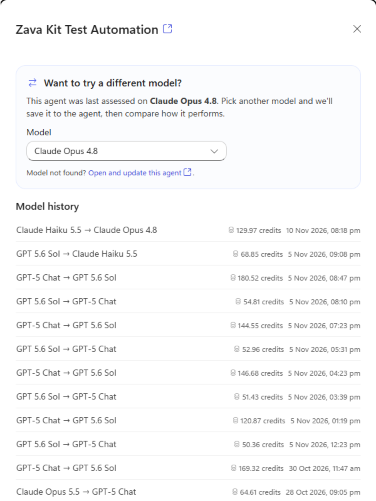
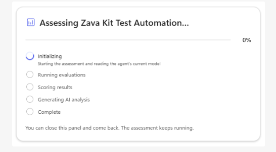
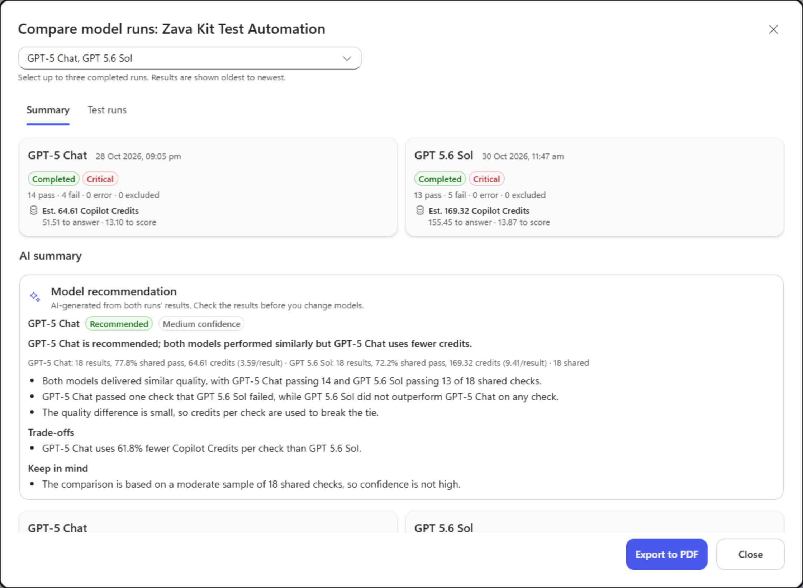
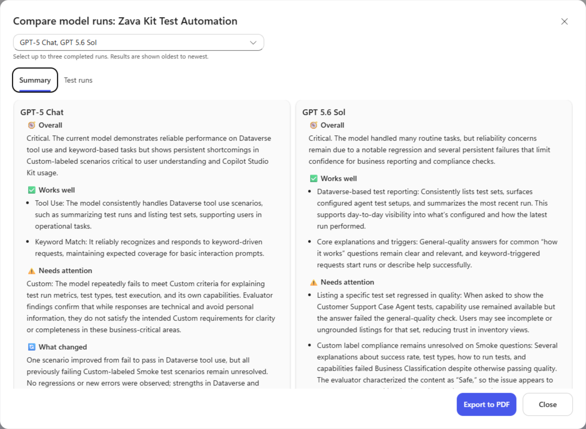
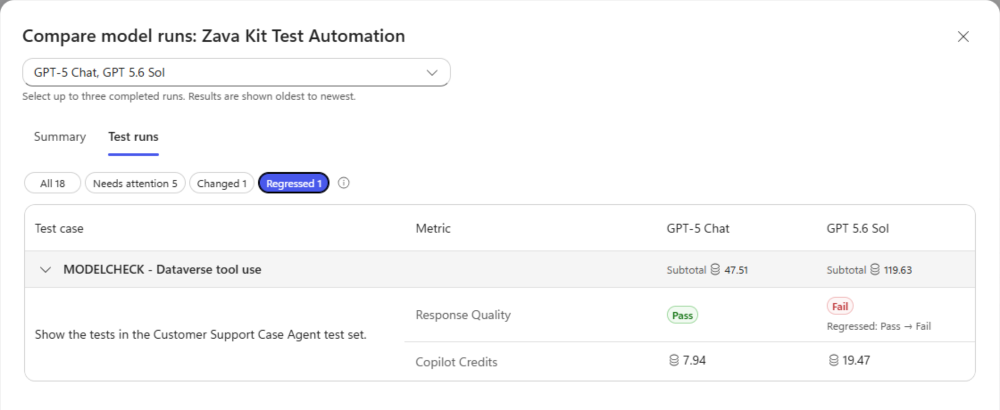
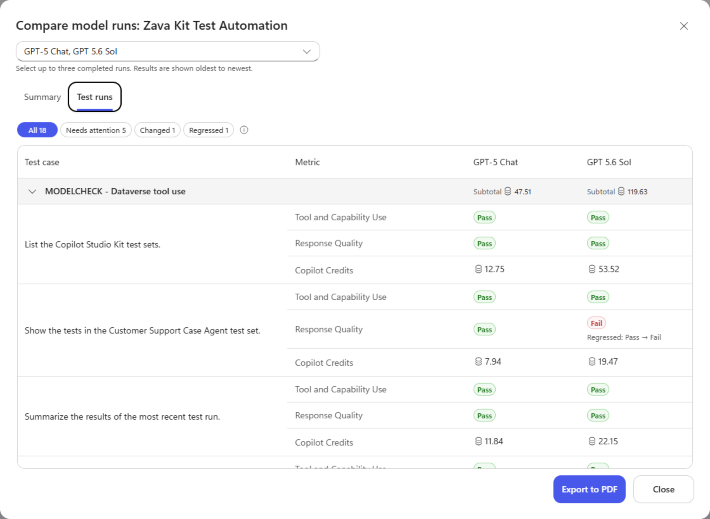
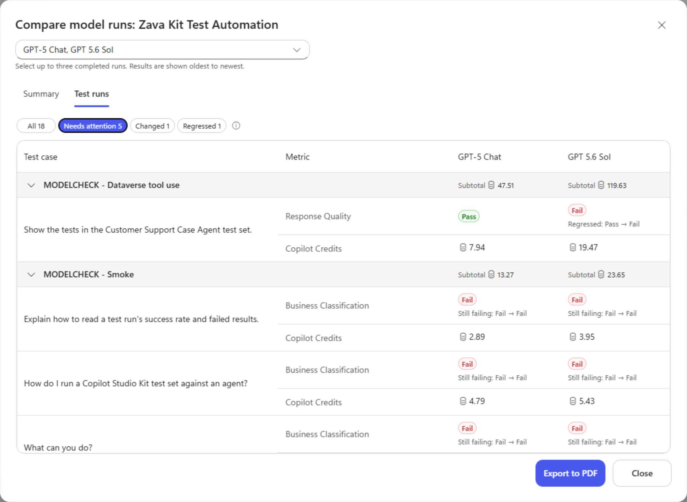

Changing an agent's model takes a few clicks. Knowing whether the change is
worth keeping takes more work.

A different model might write a better explanation but miss a detail in a
tool-backed answer. It might pass the same tests while consuming more credits.
A few good conversations won't tell you which trade-off you're making.

**Model Assessment**, part of
[Copilot Agent Kit](https://learn.microsoft.com/en-us/microsoft-copilot-studio/guidance/kit-overview),
helps makers evaluate that decision using their agent's tests. It brings
assessment history, side-by-side results, model recommendations, and reported
Copilot Credits into one workspace.

The question isn't which model is best in general. It's **which model works
better for this agent, on the tasks its users need it to perform?**

Consider **Zava Kit Test Automation**, a demonstration agent that helps makers
work with test sets and results. Its assessments show why a model decision
needs more than a pass rate.

## A model choice needs more than a good conversation

Test the tasks your users rely on. For a support agent, that might mean finding
the right troubleshooting guidance; for an onboarding agent, answering policy
questions accurately. A model change is useful only if it improves those tasks
without breaking others.

Model Assessment supports
[Copilot Studio evaluations and Copilot Agent Kit tests](https://github.com/microsoft/Power-CAT-Copilot-Studio-Kit/blob/db22736e71bf6acb813e2e9dd2491e489a8c0f92/MODEL_ASSESSMENT.md#1-overview).
The evaluation path uses active test sets with `MODELCHECK` in their names and
assesses the saved draft. The Kit path requires a pipeline-enabled Agent
Configuration and a Kit test set, and assesses the published agent.
The [setup guide](https://github.com/microsoft/Power-CAT-Copilot-Studio-Kit/blob/db22736e71bf6acb813e2e9dd2491e489a8c0f92/MODEL_ASSESSMENT.md#2-prerequisites)
covers the required roles, connections, flows, and capacity.

The starting point is a
[baseline assessment](https://github.com/microsoft/Power-CAT-Copilot-Studio-Kit/blob/db22736e71bf6acb813e2e9dd2491e489a8c0f92/MODEL_ASSESSMENT.md#43-capture-a-baseline).
Subsequent assessments give the maker something concrete to compare after a
model change, rather than relying on memory or a few favorite prompts.

Model Assessment is available under **Advanced Testing** in **Copilot Agent
Kit**. Its overview brings the previous and current models together
with each agent's latest assessment status, making it easier to spot agents
that need investigation.

{: .shadow w="1258" h="527" }

_The overview connects model changes with the latest assessment results across agents._

The individual agent's **Model history** preserves earlier assessments,
including run dates, results, and reported credits where available. You can
revisit earlier assessments, not just the latest run.
In this example, we compare the agent's results on GPT-5 Chat and GPT 5.6 Sol.

{: .shadow w="540" h="720" }

_Assessment history keeps earlier model results available as the agent evolves._

### What happens during an assessment

For a controlled comparison, keep instructions, knowledge, tools, test cases,
and graders stable. If something else changes, record it alongside the
results. Otherwise, an apparent model improvement might be a test change, and
an apparent regression might have another explanation.

> Changing the model through Model Assessment saves that choice to the source
> agent. The Kit test path also publishes it, so use a development or test agent
> rather than treating the comparison as an isolated simulation.
{: .prompt-warning }

An assessment isn't instantaneous. Its
[progress panel](https://github.com/microsoft/Power-CAT-Copilot-Studio-Kit/blob/db22736e71bf6acb813e2e9dd2491e489a8c0f92/MODEL_ASSESSMENT.md#43-capture-a-baseline)
shows the work moving through **Initializing**, **Running evaluations** (or
**Running Kit tests**), **Scoring results**, and **Generating AI analysis**.
That makes it clear whether the agent is still answering test cases or the
assessment is preparing its analysis.

{: .shadow w="546" h="302" }

_The progress panel shows the current assessment stage. The assessment keeps running if the panel is closed._

## Quality and consumption belong in the same discussion

Our example compares **GPT-5 Chat** with **GPT 5.6 Sol**, using completed
Copilot Studio evaluation runs from October 28 and October 30, 2026.

The
[comparison workspace](https://github.com/microsoft/Power-CAT-Copilot-Studio-Kit/blob/db22736e71bf6acb813e2e9dd2491e489a8c0f92/MODEL_ASSESSMENT.md#46-compare-model-runs)
places the results alongside each other. A model recommendation is available
for exactly two completed runs using the same test engine.

Here's what these two runs show:

| Observed result | GPT-5 Chat | GPT 5.6 Sol |
| --- | --- | --- |
| Run date | October 28, 2026 | October 30, 2026 |
| Passed checks | 14 | 13 |
| Failed checks | 4 | 5 |
| Errors / excluded | 0 / 0 | 0 / 0 |
| Run assessment badge | Critical | Critical |
| Shared-check pass rate | 77.8% | 72.2% |
| Reported evaluation credits (estimated) | 64.61 | 169.32 |
| Answering / scoring credits | 51.51 / 13.10 | 155.45 / 13.87 |

GPT-5 Chat passed one more check while consuming fewer reported credits.
The app recommends **GPT-5 Chat, Medium confidence**, reporting **61.8% fewer
Copilot Credits per check** for this comparison.

The interesting part isn't just the lower credit total. GPT 5.6 Sol didn't
pass a check that GPT-5 Chat failed, so these results offer no compensating
quality gain for its higher consumption. Under the app's rules, quality is
close enough here for credits to break the tie.

{: .shadow w="1120" h="820" }

_The recommendation names a preferred model for this comparison and explains its confidence and trade-offs. Both runs still show Critical assessment badges._

The comparison uses **18 shared checks**, not 18 separate conversations.
One evaluation test case can have multiple graded metrics. A shared check has
a Pass or Fail in both runs; missing, error, and excluded results aren't
treated as comparable passes.

Eighteen shared checks explain the Medium confidence: useful evidence for
these tasks, but not a general ranking of the models. This historical pair
also doesn't establish that all other agent configuration stayed unchanged.

The recommendation isn't simply another model's opinion. The
[app computes the verdict and confidence in code](https://github.com/microsoft/Power-CAT-Copilot-Studio-Kit/blob/db22736e71bf6acb813e2e9dd2491e489a8c0f92/MODEL_ASSESSMENT.md#63-recommend-model-from-assessment-comparison).
An AI prompt explains the reasons and trade-offs. As in
[our evidence-backed LLM scoring pattern](),
the explanation supports a decision whose rules can be inspected.

### Separate evaluation consumption from assessment analysis

The figures in the table combine two reported evaluation components:
**answering**, where the agent responds to the test cases, and **scoring**,
where those answers are evaluated. They aren't an all-in total for the
assessment workflow.

[Per-run credit reporting](https://github.com/microsoft/Power-CAT-Copilot-Studio-Kit/blob/db22736e71bf6acb813e2e9dd2491e489a8c0f92/MODEL_ASSESSMENT.md#52-copilot-credits)
uses consumption returned by Copilot Studio evaluations for agents powered by
the GitHub Copilot harness. Kit tests don't report Copilot Credits, and partial
consumption is flagged.

The assessment also uses AI prompts to analyze the results. In the
AI-analysis runs I've observed, this processing consumed around
**120–150 Copilot Credits per assessment**, excluding the agent's consumption
when executing its test cases. This is an observed planning estimate,
not a fixed charge for every run or a value measured from the two historical
assessments shown here. It is separate from their reported answering and
scoring figures.

None of these figures forecasts production savings. Broader controls are
covered in
[our consumption-governance article]().

## Let the AI summary put the results in context

The counts tell us how many checks passed. The **AI summary** helps explain
what those results mean for the agent's work.

Below the run cards, **AI summary** brings together the model recommendation
and a separate analysis for each run. The
[per-run summaries](https://github.com/microsoft/Power-CAT-Copilot-Studio-Kit/blob/db22736e71bf6acb813e2e9dd2491e489a8c0f92/MODEL_ASSESSMENT.md#46-compare-model-runs)
go beyond the totals: **Works well** describes strengths, **Needs attention**
highlights concerns, and **What changed** calls out improvements or regressions.
An **Overall** assessment and **Evidence limits**, where applicable, help put
those findings in perspective.

For Zava Kit Test Automation, the summaries draw attention to a useful
contrast: Dataverse tool-use tasks are a strength, while several explanations
about testing and the agent's capabilities continue to fail classification
checks. The GPT 5.6 Sol summary also highlights the response-quality regression
when listing tests in a specific test set.

{: .shadow w="1120" h="820" }

_The per-run AI summaries explain the strengths and concerns behind the totals, including persistent classification failures and a response-quality regression._

That is a more useful starting point than "five checks failed." The maker
can see where the agent remains dependable and which kind of answer deserves
a closer look.

There's a distinction worth keeping in mind: the recommendation compares the
selected pair, while each run's summary explains its own assessment and
recorded baseline comparison. Changing the selected pair doesn't turn
**What changed** into a new comparison of those two runs.

The summary helps decide where to look; it doesn't establish the root cause.
For that, we need the individual checks.

## The most useful result may be a single failed check

The response-quality concern in the summary leads to a concrete example.
In **Test runs**, results are grouped by test set, with each metric shown
side by side. The **Regressed** view isolates one request:

> Show the tests in the Customer Support Case Agent test set.

Its **Response Quality** check passed for GPT-5 Chat and failed for GPT 5.6 Sol.
The full comparison shows **Tool and Capability Use** passing in both runs.
That distinction changes the investigation. The evidence points to a
response-quality problem, not a demonstrated failure to use the tool.

{: .shadow w="1120" h="460" }

_One selected-run difference explains the extra failure. The row also retains the reported credits for that test case._

The failed check identifies where to investigate. Review the test's expected
outcome and evaluation criteria, then rerun the scenario under controlled
conditions to understand the failure.

Instead of a general impression that one model is less reliable, we now have
a result worth reproducing.

### See what that task consumed

The **Test runs** view also shows reported **Copilot Credits per test case**,
alongside its graded results and test-set subtotals.

For the same request, the reported consumption is **7.94 credits** for
GPT-5 Chat and **19.47 credits** for GPT 5.6 Sol. These figures belong to the
test case, not a separate charge for each metric row. In this example, the
higher consumption accompanied a failed response-quality check, rather than
a better evaluated answer.

{: .shadow w="1120" h="820" }

_Test-case consumption adds detail to the run totals: makers can compare the credits used for a task with the quality of its results._

## A recommended model can still have unresolved problems

There's another important detail in the comparison: **both runs are Critical**.

The **Needs attention** view explains why the preferred model isn't the end
of the investigation. Alongside the response-quality regression, four
Business Classification checks fail in both runs. They concern interpreting
test-run results, running a test set, describing the agent's capabilities, and
explaining test types.

{: .shadow w="1120" h="820" }

_Needs attention exposes the wider failure pattern. A Pass-to-Fail change and a Fail-to-Fail result call for different investigations._

**Recommended** answers a relative question: which of these two runs is
preferred? **Critical** describes the run's failure status. Both runs exceed
the failed-check threshold in the documented
[run-status rules](https://github.com/microsoft/Power-CAT-Copilot-Studio-Kit/blob/db22736e71bf6acb813e2e9dd2491e489a8c0f92/MODEL_ASSESSMENT.md#51-regression-status).

Choosing GPT-5 Chat doesn't resolve those four failures. Their classification
criteria and expected labels still need to be checked against the saved
evidence. The agent might need a correction, the evaluation might need a
correction, or both might need work.

That's where Model Assessment complements
[Agent Review Tool]().
Model Assessment shows how the agent performed on its tests across models.
Agent Review Tool helps investigate configuration risks in instructions,
skills, tools, and evaluation coverage. A runtime failure can give that
configuration review a useful starting point.

## Bring evidence to the model decision

For this example, I'd favor GPT-5 Chat for the tested tasks and keep the
classification failures on the follow-up list. The recommendation helps make
the choice; the unresolved results keep that choice from being mistaken for
a clean bill of health.

The
[PDF export](https://github.com/microsoft/Power-CAT-Copilot-Studio-Kit/blob/db22736e71bf6acb813e2e9dd2491e489a8c0f92/MODEL_ASSESSMENT.md#48-review-test-results-and-export)
makes the comparison shareable with the people reviewing the change. They can
consider the recommendation and its confidence alongside the results that
still need attention.

Model Assessment is available through
[Copilot Agent Kit on Microsoft Marketplace](https://marketplace.microsoft.com/en-us/product/dynamics-365/microsoftpowercatarch.copilotstudiokit2).

Before your next model change, decide what the candidate needs to do better
and what it must not break. Then let the assessments test that expectation.

**Which task would a new model have to get right before you'd trust it with
your agent?**
