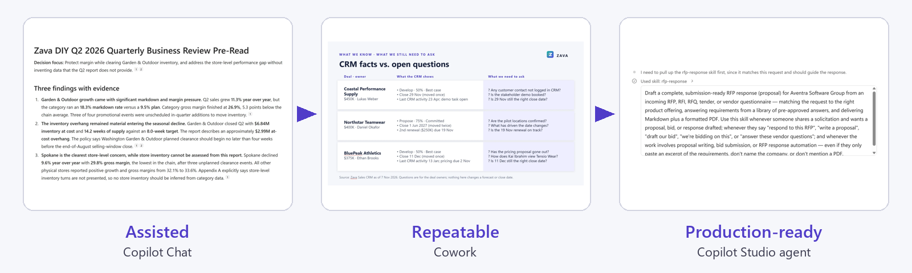
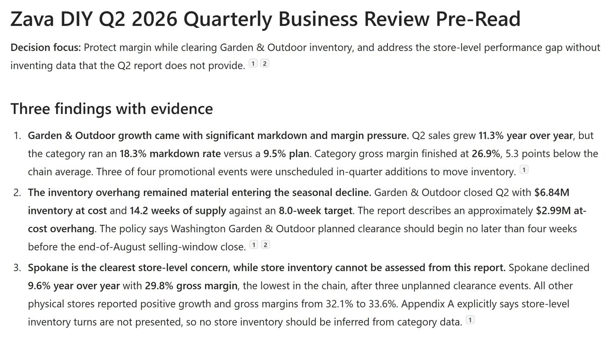
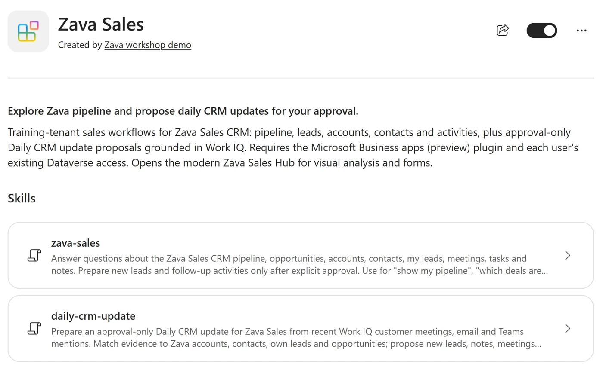
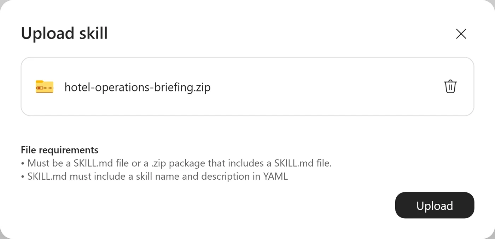
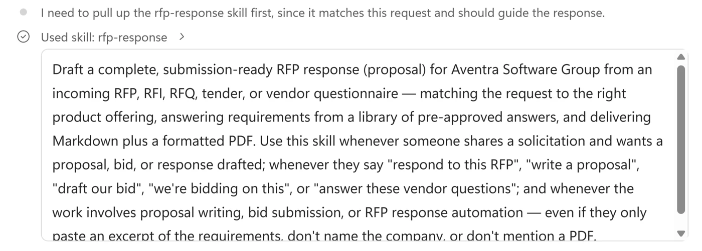
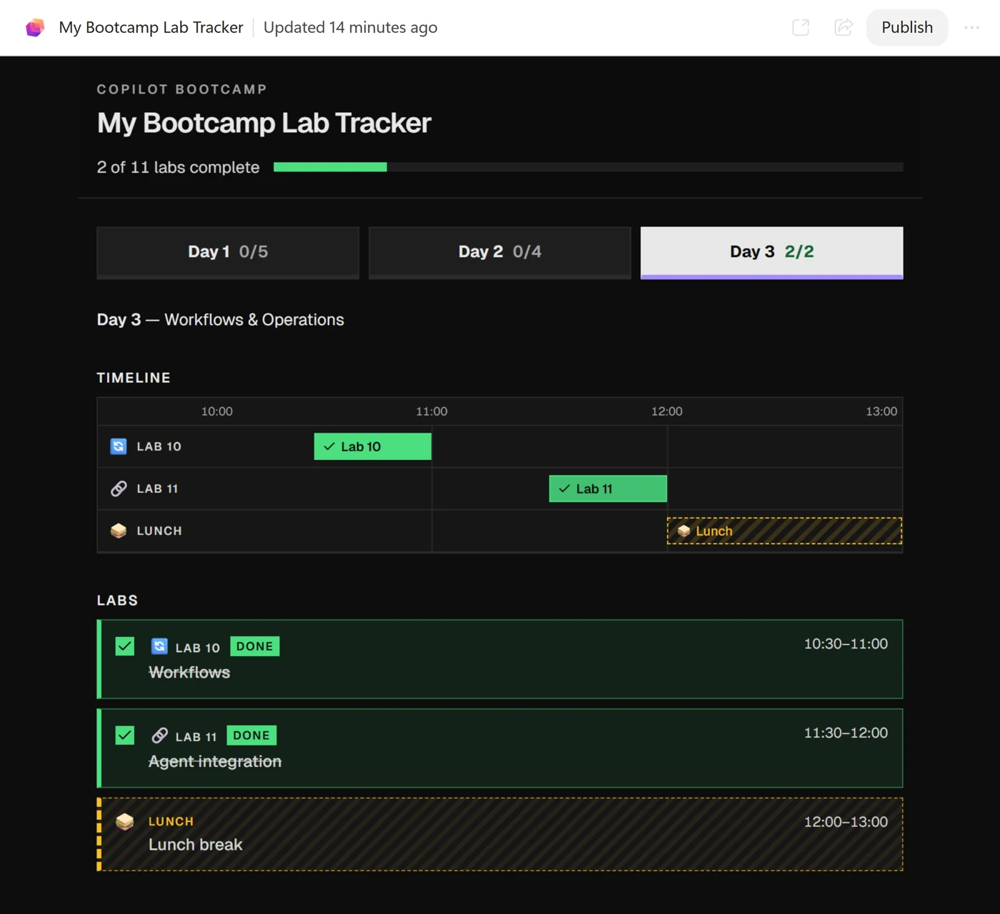
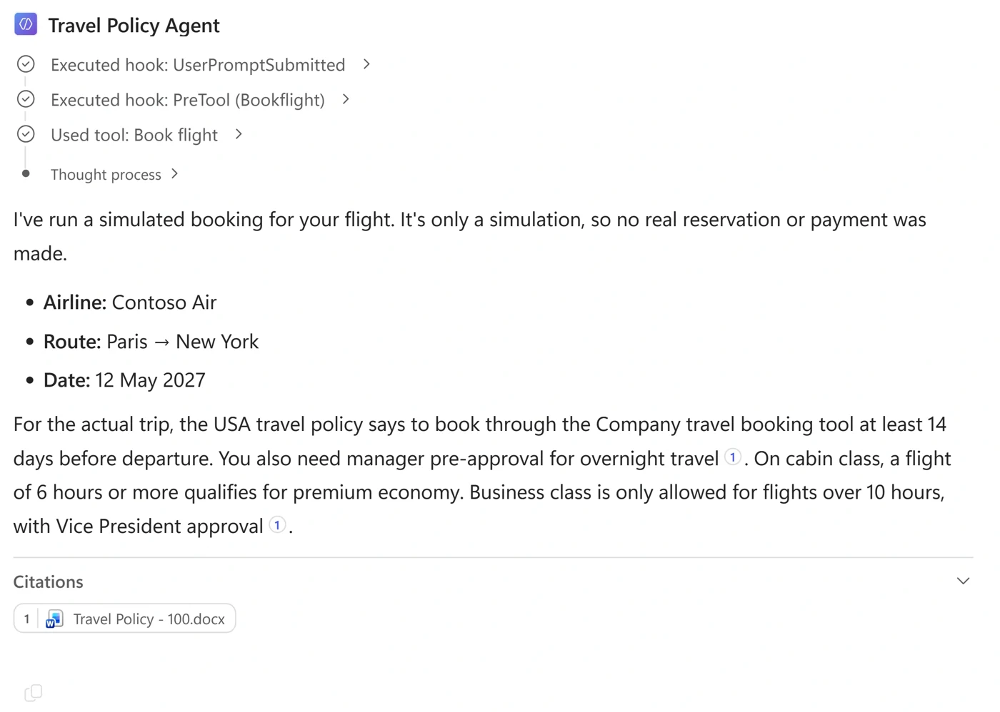
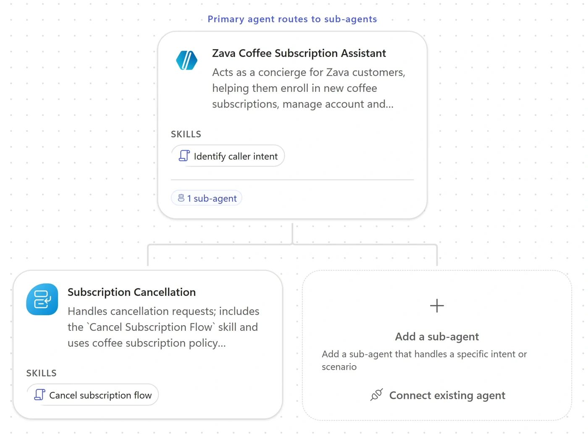
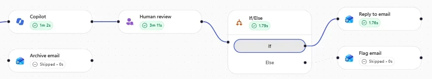
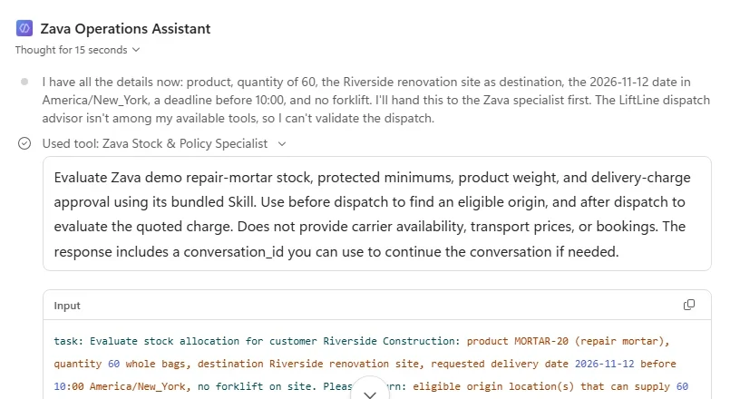

People often ask us some version of the same question: "Our people are working in Copilot Chat, Cowork, and agents. A few people are sharing prompts and skills, and a few makers are building agents. How do we help more people in the organization understand the breadth of capabilities in the Copilot ecosystem and make it something the whole organization can rely on?"

That question shaped the [Copilot & Agents Bootcamp](https://microsoft.github.io/mcs-labs/events/architecture-bootcamp/) I helped present in Atlanta last week, November 10-12, along with fellow AI Architects from the Copilot Acceleration Team (CAT) and colleagues from the Copilot Agents and Platform Ecosystem (CAPE) team. Three days, 17 modules, 11 hands-on labs, and a lot of great discussions!

You don't need a plane ticket to get the content. Every module, slide deck, and lab is online, so you can work through it at your own pace or use it to deliver sessions inside your own organization. This post walks through what has changed recently, the story the bootcamp tells, the full agenda, and how to get CAT involved if you want help applying the learnings.

## From Architecture Bootcamp to Copilot & Agents Bootcamp

If you've attended a CAT bootcamp before, you'll remember this as the **Copilot Studio Architecture Bootcamp**. The new name **Copilot & Agents Bootcamp** reflects a broader scope. Copilot Studio is still at the center, but your users don't start there. They start in Copilot Chat, they increasingly run multi-step work in Copilot Cowork, and some of them are building apps with Copilot Code. Architects need to understand that whole landscape to make good decisions about where an agent belongs.

So the refreshed bootcamp now includes sessions and labs on:

- **Copilot Chat and Work IQ:** grounding in the web and in work context, response modes, Researcher, and Analyst
- **Copilot Cowork:** skills, plugins, and code for multi-step work
- **Copilot Code:** building and publishing a simple web app
- **Harnesses:** the Microsoft Copilot harness (formerly the GitHub Copilot, or GHCP, harness), the Copilot Chat harness (declarative agents), the Standard harness, the Customer Conversation harness, and apps on Microsoft Copilot Managed Runtime
- **FinOps and governance:** credit consumption planning, agent identity, ALM, evaluations, and the Copilot Agent Kit

We refreshed every existing session and lab for Atlanta, so screenshots, steps, and guidance match the current product.

## The narrative: assisted, repeatable, production-ready

The idea we kept returning to over three days is *progression*. Most organizations already have people at each stage. The goal is to recognize which stage a piece of work belongs in and to move it forward deliberately.

{: .shadow w="1600" h="480" }
_The same progression in the labs: Copilot Chat for a grounded summary, Cowork for repeatable output, and a Copilot Studio agent for production deliverables_

**Assisted work in Copilot Chat.** A user asks a question, Copilot grounds the answer in the web and in their work context through Work IQ, and they get a summary they can act on. It's fast and personal, but it depends on the person asking the right question each time. If you want to understand how that work context is retrieved and controlled, read [Work IQ: How It's Used, Licensed, and Controlled]().

**Repeatable work in Copilot Cowork.** When the same multi-step task keeps coming up, such as preparing an account brief or turning sales insights into follow-up actions, Cowork lets you package the procedure as a skill or plugin. Now the work runs the same way every time, and you can potentially share the skill or plugin to enable others to complete that same work.

**Production-ready work in Copilot Studio.** When the output needs to be production quality, used by a whole team, versioned, updated once for everyone, and governed, then it's time for an agent. Copilot Studio gives you instructions, skills, knowledge, tools, hooks, evaluations, workflows, lifecycle management, monitoring, and governance. With an agent, everyone gets consistent, grounded behavior from one place instead of from a dozen personal prompts.

### The labs follow that narrative

Here's how the first day and a half progresses.

**Lab 1** prepares a business summary with Copilot Chat and Work IQ, grounded in an uploaded report and company policy.

{: .shadow w="700" h="390" }
_Lab 1: a cited business review pre-read from Copilot Chat_

**Lab 2** compares Copilot Chat, a sales agent, and Cowork for common sales tasks, so you practice choosing the right tool. Along the way you use Cowork plugins that bundle skills for a specific team.

{: .shadow w="700" h="434" }
_Lab 2: a Cowork plugin that packages sales skills so the work runs the same way every time_

**Lab 4** takes a Cowork skill and uploads it into a Copilot Chat harness agent (declarative agent), which is the bridge from repeatable to shared.

{: .shadow w="600" h="290" }
_Lab 4: reusing a Cowork skill in a declarative agent_

**Lab 6** builds a Microsoft Copilot harness agent that responds to requests for proposals, using instructions and skills together.

{: .shadow w="700" h="251" }
_Lab 6: the agent picks up the rfp-response skill because it matches the request_

If skills are new to you, [Agents Have Skills Now]() is a good primer before Day 2.

## The full three-day agenda

Each module links to its page, which includes the slide deck. Levels run from 100 (introductory) to 300 (advanced).

### Day 1: Framing, on-ramp, and harnesses

Day 1 sets the scene and gets everyone hands-on quickly across the Copilot ecosystem.

| Session | Level |
|---------|-------|
| Introduction to the hands-on labs (lab environment and tenant setup) | |
| [Module 1: Microsoft Copilot agent ecosystem](https://microsoft.github.io/mcs-labs/modules/agents-workflows-making-them-real-latest/?event=architecture-bootcamp) | 100 |
| [Module 2: Copilot Chat and Work IQ](https://microsoft.github.io/mcs-labs/modules/m365-copilot-latest/?event=architecture-bootcamp) + [Lab 1](https://microsoft.github.io/mcs-labs/labs/copilot-chat-workiq/?event=architecture-bootcamp) | 100 |
| [Module 3: Cowork: skills, plugins, and code](https://microsoft.github.io/mcs-labs/modules/cowork-latest/?event=architecture-bootcamp) + [Lab 2: from insights to action](https://microsoft.github.io/mcs-labs/labs/cowork-zava-sales/?event=architecture-bootcamp) | 100–200 |
| [Lab 3: Copilot Code: build a simple web app](https://microsoft.github.io/mcs-labs/labs/copilot-code-web-app/?event=architecture-bootcamp) | 100 |
| [Module 4: Copilot Chat harness: declarative agents](https://microsoft.github.io/mcs-labs/modules/copilot-harness-latest/?event=architecture-bootcamp) + [Lab 4: reuse a Cowork skill](https://microsoft.github.io/mcs-labs/labs/declarative-agent-skill-reuse/?event=architecture-bootcamp) | 200 |
| [Module 5: Standard harness: component model](https://microsoft.github.io/mcs-labs/modules/standard-harness/?event=architecture-bootcamp) + [Lab 5](https://microsoft.github.io/mcs-labs/labs/standard-harness-components/?event=architecture-bootcamp) | 200 |

Lab 3 is a crowd favorite: attendees use Copilot Code to build and publish their own tracker for the bootcamp labs, then iterate on it with follow-up prompts.

{: .shadow w="700" h="640" }
_Lab 3: a bootcamp lab tracker built and published with Copilot Code_

### Day 2: Knowledge, tools, and the dedicated harnesses

Day 2 goes deep on how Copilot Studio agents are composed and when to use each harness. For background on the newer Microsoft Copilot harness capabilities, see [New Harness, New Rules? CAT's Got You]().

| Session | Level |
|---------|-------|
| [Module 6: Harnesses, orchestration, and component models](https://microsoft.github.io/mcs-labs/modules/harnesses-and-component-models-latest/?event=architecture-bootcamp) | 200 |
| [Module 7: Deep dive: instructions and skills](https://microsoft.github.io/mcs-labs/modules/instructions-and-skills/?event=architecture-bootcamp) + [Lab 6](https://microsoft.github.io/mcs-labs/labs/instructions-skills-authoring/?event=architecture-bootcamp) | 300 |
| [Module 8: Deep dive: knowledge, tools, and hooks](https://microsoft.github.io/mcs-labs/modules/knowledge-and-tools-deep-dive/?event=architecture-bootcamp) + [Lab 7: travel policy agent](https://microsoft.github.io/mcs-labs/labs/hooks-knowledge-travel-policy/?event=architecture-bootcamp) | 200–300 |
| [Module 9: Customer Conversation harness](https://microsoft.github.io/mcs-labs/modules/customer-conversation-harness/?event=architecture-bootcamp) + [Lab 8](https://microsoft.github.io/mcs-labs/labs/customer-assist-agent/?event=architecture-bootcamp) | 200 |
| [Module 10: Apps on Microsoft Copilot Managed Runtime](https://microsoft.github.io/mcs-labs/modules/managed-apps/?event=architecture-bootcamp) + [Lab 9](https://microsoft.github.io/mcs-labs/labs/managed-apps-build/?event=architecture-bootcamp) | 200 |

Lab 7 uses a session-start hook to tailor answers to the user's location, and an optional extension adds a pre-tool hook that checks bookings against approved airlines. If that sparks ideas, [Hooks in Copilot Studio]() goes further.

{: .shadow w="700" h="499" }
_Lab 7: hooks run before the booking tool, and the answer cites the right travel policy_

Lab 8 shifts to customer-facing scenarios, with a primary agent that hands specific requests to a specialist sub-agent and can be tested in both chat and voice.

{: .shadow w="700" h="517" }
_Lab 8: a Customer Conversation agent routing cancellations to a sub-agent_

### Day 3: Workflows and operations

Day 3 moves from building agents to running them: automation, integration, and everything you need to operate agents responsibly.

| Session | Level |
|---------|-------|
| [Module 11: Workflows](https://microsoft.github.io/mcs-labs/modules/workflows-latest/?event=architecture-bootcamp) + [Lab 10](https://microsoft.github.io/mcs-labs/labs/workflows-autonomous/?event=architecture-bootcamp) | 300 |
| [Module 12: Agent integration (including A2A)](https://microsoft.github.io/mcs-labs/modules/agent-integration/?event=architecture-bootcamp) + [Lab 11](https://microsoft.github.io/mcs-labs/labs/agent-integration-team/?event=architecture-bootcamp) | 200 |
| [Module 13: ALM, analytics, and evaluations](https://microsoft.github.io/mcs-labs/modules/alm-and-analytics/?event=architecture-bootcamp) | 300 |
| [Module 14: Coding agents: plugins, migration, and creation](https://microsoft.github.io/mcs-labs/modules/coding-agents/?event=architecture-bootcamp) | 300 |
| [Module 15: AI FinOps](https://microsoft.github.io/mcs-labs/modules/ai-finops/?event=architecture-bootcamp) | 200 |
| [Module 16: Agent identity](https://microsoft.github.io/mcs-labs/modules/agent-identity/?event=architecture-bootcamp) | 200 |
| [Module 17: Copilot Agent Kit](https://microsoft.github.io/mcs-labs/modules/copilot-agent-kit/?event=architecture-bootcamp) | 200 |

In Lab 10, a workflow classifies incoming email, drafts a reply, and waits for human review before anything is sent.

{: .shadow w="875" h="160" }
_Lab 10: a successful workflow run with a human review step_

Lab 11 connects an operations agent to a specialist agent and shows exactly what was delegated.

{: .shadow w="700" h="383" }
_Lab 11: delegating a stock request to a specialist agent_

The operations modules pair well with a few recent posts: [Call Microsoft Copilot Harness Agents from Other Copilot Studio Agents with MCP and A2A]() for integration, and [Assess your Copilot Studio agent with Model Assessment]() for the Copilot Agent Kit.

## Running the bootcamp in your own organization

The content is designed to be reused. A few suggestions from delivering it:

- **Set up the lab environments first.** Each lab lists its prerequisites. Make sure your tenant, licenses, and environments are ready before the session so attendees spend their time building.
- **Emphasize the narrative.** The assisted, repeatable, production-ready story gives attendees a mental model for deciding where each new idea should live. It's worth repeating at the start of each day.
- **Leave room for Q&A.** Some of our best conversations in Atlanta happened in the Q&A blocks. Suggested Q&A blocks are in the published agenda.
- **Tell us what's broken.** If a lab step doesn't match what you see, [report an issue](https://github.com/microsoft/mcs-labs/issues) so we can fix it for everyone.

> The product moves quickly, so we update the bootcamp frequently, especially after major events like the Power Platform Community Conference (PPCC), Microsoft Ignite, and Microsoft Build. The bootcamp page shows when it was last updated, so check that date before you deliver a session and refresh your slides from the published decks.
{: .prompt-info }

## Who is CAT?

The [Copilot Acceleration Team (CAT)](https://aka.ms/WhoIsCAT) is part of the Copilot engineering team at Microsoft. Our mission is to accelerate the adoption and success of Microsoft 365 Copilot and Copilot Studio. We do that with resources, tools, programs, and guidance developed from real customer experience, including:

- **Tools:** the [Copilot Agent Kit](https://aka.ms/copilotagentkit), [Skills for Copilot Studio](https://github.com/microsoft/skills-for-copilot-studio), and the [Agent Skills & Plugins Gallery](https://aka.ms/catagentskills)
- **Programs:** the Copilot & Agents Bootcamp, [Agent In A Day](https://aka.ms/agiad), and [Microsoft Copilot Agents Labs](https://microsoft.github.io/mcs-labs/)
- **Guidance:** the [Power Platform Architecture Center](https://aka.ms/powerarchitecture), [Copilot Studio guidance](https://aka.ms/copilotstudioguidance), and [Copilot Studio Samples](https://microsoft.github.io/CopilotStudioSamples/)
- **Insights:** this blog, [The Custom Engine](https://aka.ms/catblog)

## How CAT works with your Microsoft account team

CAT complements your Microsoft account team. It doesn't replace them. Your account team knows your organization, your priorities, and your broader relationship with Microsoft. CAT brings deep product and architecture expertise from working closely with the Copilot engineering team and with customers solving similar problems.

In practice, that means your account team stays your primary point of contact, while CAT can help with architecture and design reviews, adoption and enablement, and getting product feedback back to engineering.

## How to get CAT assistance

If you're planning a Copilot Chat, Cowork, or Copilot Studio project and want CAT involved, talk to your Microsoft account team, or [request CAT assistance](https://aka.ms/GetCAT) directly. Tell us about the scenario, where you are on the assisted, repeatable, production-ready journey, and what's blocking you.

## Key takeaways

- The **Copilot Studio Architecture Bootcamp** is now the **Copilot & Agents Bootcamp**, with new content on Copilot Chat, Copilot Cowork, Copilot Code, the newest agent harnesses, FinOps, and governance.
- All 17 modules and 11 labs are [online](https://microsoft.github.io/mcs-labs/events/architecture-bootcamp/) for self-paced learning or internal delivery.
- The core narrative moves work from **assisted** (Copilot Chat) to **repeatable** (Copilot Cowork) to **production-ready** (a Copilot Studio agent).
- CAT works alongside your account team, and you can [request our help](https://aka.ms/GetCAT) on your project.

Which stage are most of your users in today, and what's stopping that work from moving to the next stage? Let us know in the comments.
