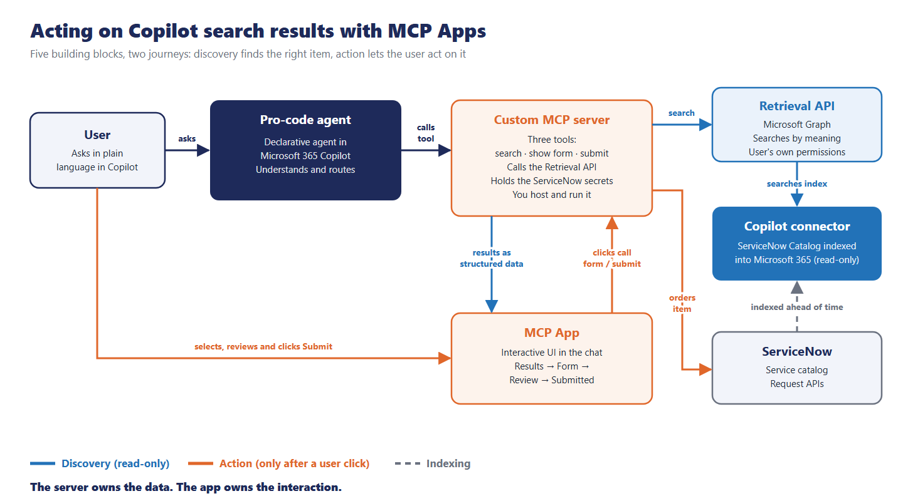

---
layout: post
title: "From Search to Action Inside Copilot: Building Interactive Experiences with Copilot UX Components"
date: 2026-11-26
categories: [copilot-studio, channels]
agent_edition: declarative-agent
tags: [servicenow, microsoft-365-copilot, declarative-agents, copilot-ux-components, agent-builder, entra-id, connectors, authentication]
description: "An architecture pattern that turns ServiceNow catalog search results in Microsoft 365 Copilot into an interactive grid and request form, submitted as the signed-in user with Copilot UX components, the Retrieval API, and Entra ID."
author: suparna-banerjee23
image:
  path: /assets/posts/copilot-ux-components-servicenow/header.png
  alt: "From search to action: a catalog search, a results grid, a request form, and a submitted request inside Microsoft 365 Copilot chat"
  no_bg: true
---

Copilot connectors bring content from systems such as ServiceNow into Microsoft 365 Copilot, so users get grounded answers with citations. Ask *"What video editing software can I get?"* and Copilot finds the right catalog items, even if the user never names a product. But the answer is where the help stops. To actually request the software, the user still has to leave Copilot and go to the ServiceNow portal.

This post describes an architecture pattern that closes that gap with an **interactive UI inside the chat**. Search results become a grid the user can act on, and the item's real request form opens and submits in the same conversation. The pattern combines a Copilot connector, the Microsoft 365 Copilot Retrieval API, a pro-code declarative agent, and [Copilot UX components](https://learn.microsoft.com/sharepoint/dev/spfx/copilot/overview-copilot-apps), which became generally available with SharePoint Framework (SPFx) 1.24. It's written for architects and developers and focuses on the architecture. The full code is in a companion sample.

> Everything in this post is accurate as of November 2026. Copilot UX components, Copilot connectors, and the related APIs are evolving quickly, so check the linked Microsoft Learn pages for the latest capabilities, limitations, and licensing.
{: .prompt-info }

## What we set out to build

The goal was an interactive UI inside Copilot where **the answer becomes the action**. Three requirements shaped the design:

- **The form comes from the source system.** Each catalog item has its own fields, so the UI must build the form from ServiceNow's definition, not from hard-coded screens.
- **The request runs as the real user.** ServiceNow should see who's asking, apply that person's access, and record them as the requester.
- **Nothing extra to host.** No web server, no gateway, and no stored ServiceNow password.

## The user journey: requesting video editing software

A project manager needs to edit a short product video for a client demo. She doesn't know which tool the company provides, so she asks the agent: *"Find me a list of available software for editing video."*

1. **Search.** Instead of a text answer, a grid opens in the chat with the best matches (Camtasia, Adobe Creative Cloud, Snagit), each with a **Select** button. Nothing has changed in ServiceNow yet.
2. **Select.** She selects Camtasia, and the item's request form appears with the same fields as in the ServiceNow portal.
3. **Complete.** She fills in the form. Required fields are checked before **Submit** is allowed.
4. **Submit.** She clicks **Submit** and gets a request number with a link to the request in ServiceNow. The request is recorded with her as the requester.
5. **Search again.** The search bar stays in the UI, so she can look for something else without starting over.

Here's the whole journey end to end:



Copilot handles the question, and the interactive UI handles the steps that must be exact. She never leaves the conversation.

## How we solved it

The solution uses five building blocks:

- **Copilot connector (synced):** indexes the ServiceNow catalog into Microsoft 365, so items can be found by meaning. More details: [ServiceNow Catalog connector](https://learn.microsoft.com/microsoft-365/copilot/connectors/servicenow-catalog-overview).
- **Pro-code declarative agent:** Microsoft 365 Copilot configured for one job through instructions, knowledge, and actions. Here it's defined in code inside the SPFx project, rather than in the low-code Agent Builder, because the UI it calls must ship in the same package. Its instructions tell it to open the catalog UI for "what is available" questions instead of answering in text. More details: [Declarative agents for Microsoft 365 Copilot](https://learn.microsoft.com/microsoft-365-copilot/extensibility/overview-declarative-agent). If you're new to extending declarative agents, [this walkthrough on custom APIs and MCP in declarative agents]() is a good primer.
- **Copilot UX component:** the interactive UI. It's an SPFx component that Copilot renders inside the conversation and that exposes a tool the agent can call. SharePoint hosts its code, so there's no web server to run, and it gets the user's sign-in for Microsoft Graph and Entra ID-protected APIs without any authentication code. More details: [Overview of Copilot UX components](https://learn.microsoft.com/sharepoint/dev/spfx/copilot/overview-copilot-apps).
- **Microsoft 365 Copilot Retrieval API:** searches the same index Copilot uses, by meaning, and returns structured results (text extracts, the item URL, and the metadata you request), so the component knows exactly which catalog item each result is. More details: [Retrieval API overview](https://learn.microsoft.com/microsoft-365/copilot/extensibility/api/ai-services/retrieval/overview).
- **Microsoft Entra ID trusted by ServiceNow:** the component calls ServiceNow with the user's Entra ID token, and ServiceNow is configured to accept it and map it to the user. More details: [Connect to Entra ID-secured APIs in SPFx](https://learn.microsoft.com/sharepoint/dev/spfx/use-aadhttpclient), and the sample's [ServiceNow configuration steps](https://github.com/microsoft/CopilotStudioSamples/tree/main/extensibility/copilot-ux-components/servicenow-catalog-copilot-sample#3-configure-servicenow).

## The architecture

Here's how those building blocks fit together. Follow the colors: the blue discovery path goes through Microsoft Graph, while the orange action path (loading the form and submitting the request) goes straight to ServiceNow, and only after the user clicks.

{: .shadow w="1440" h="800" }
_The architecture: discovery through the connector, action directly against ServiceNow with the user's token._

The building blocks form two paths:

- **Discovery** is read-only. The agent calls the component's tool, and the component queries the Retrieval API, limited to the ServiceNow connector.
- **Action** starts only after a user click. The component calls the ServiceNow Service Catalog API directly with the user's token, first to read the item's form definition and then to submit the request.

## Get the code

The full solution is available as a sample in the Copilot Studio Samples repository: [ServiceNow catalog in Microsoft 365 Copilot](https://github.com/microsoft/CopilotStudioSamples/tree/main/extensibility/copilot-ux-components/servicenow-catalog-copilot-sample). It includes the SPFx project with the Copilot UX component and the declarative agent, and PowerShell scripts that register the Entra ID app and configure ServiceNow to trust it. The README walks through prerequisites, setup, and deployment, including the ServiceNow OIDC and CORS configuration.

> The sample is for learning and demos. Review security, error handling, and support requirements before you use it in production.
{: .prompt-warning }

## Design decisions

**Use the connector to find, and the UI to act.** A synced connector makes the catalog findable, not actionable. A [federated connector](https://learn.microsoft.com/microsoft-365/copilot/connectors/prerequisites) queries the source live instead of indexing it, but the answer is still text in the chat: there's no grid to choose from and no item form to complete. That interactive step is what Copilot UX components add.

**Retrieve in the component, not from citations.** The agent can already search the connector, so the obvious shortcut is to pass Copilot's answer to the component. It doesn't work: a tool only receives the parameters the model writes, and citations aren't structured data. So the component runs its own retrieval and gets each catalog item's identity as data. Copilot owns the conversation, and the component owns the data and the interaction.

**Let the source system define the form.** The form is generated from the item's ServiceNow variables: dropdowns, radio buttons, checkboxes, and reference fields. A new catalog item works without a code change, and the form always matches what ServiceNow expects.

**Carry the user's identity all the way.** The browser calls ServiceNow with a short-lived user token, never a password, so ServiceNow applies the user's own access and records the real requester.

**Tell Copilot what the user sees.** The component shares a short description of its current state (the results, the selected item, the request number) with Copilot, as described in [Provide Copilot with context from your component](https://learn.microsoft.com/sharepoint/dev/spfx/copilot/provide-context-to-copilot). Follow-up questions such as *"compare these options"* then work in the same conversation.

## Guardrails

- **A person confirms every write.** The agent can only open the UI. Submitting happens only when the user clicks **Submit**. If you're designing human approval into other kinds of agent actions, [this human-in-the-loop pattern]() covers the Copilot Studio side.
- **The system of record enforces access.** ServiceNow validates every call against the user's token and permissions, so hiding a button is never the only control.
- **Search follows the connector's permissions.** Our demo connector is visible to everyone. In production, set it to **Only people with access to this data source** so users only see items they're entitled to.

> **Permissions are tenant-wide.** API permissions approved for an SPFx solution (here, `ExternalItem.Read.All` for the Retrieval API and the ServiceNow scope) apply to every SPFx solution in the tenant, so review them with your security team.
{: .prompt-warning }

## Prerequisites and licensing

| Area | What you need |
|---|---|
| Licenses | A Microsoft 365 Copilot license for every user, developer, and tester, including for testing in the Copilot Workbench. Copilot UX components have no consumption-based charges, the Retrieval API is included for Copilot-licensed users, and synced connector indexing has no extra cost. See [Copilot UX components availability](https://learn.microsoft.com/sharepoint/dev/spfx/copilot/overview-copilot-apps) and [connector prerequisites](https://learn.microsoft.com/microsoft-365/copilot/connectors/prerequisites). |
| Clients | Copilot in a supported browser or desktop client. iOS and Android, including Teams mobile, aren't supported at general availability. |
| Microsoft 365 admin | An admin who can deploy the package to the SharePoint App Catalog and approve its API permissions, an AI Administrator to deploy the connector, and an admin to make the agent available to users. |
| Entra ID | An app registration that exposes a scope for ServiceNow. |
| ServiceNow | Admin access to configure ServiceNow to trust Entra ID tokens (OIDC) and to add CORS rules for the component's origin. Each user's Entra ID identity must map to their ServiceNow user; in our setup, we matched on email. |
| Azure | None. |

If your users already have Microsoft 365 Copilot and ServiceNow, the pattern adds no infrastructure to run. The investment is development and configuration time.

## Other options

The same interactive experience can be built in two other ways.

### Call ServiceNow through an API gateway

Instead of calling the ServiceNow API directly from the component, you can put an API gateway such as [Azure API Management](https://learn.microsoft.com/azure/api-management/api-management-key-concepts) in between. The component calls the gateway with the user's Entra ID token, and the gateway calls ServiceNow. That's where we started, before ServiceNow trusted Entra ID tokens.

Choose the gateway when:

- **ServiceNow can't trust Entra ID tokens** in your environment, so something has to broker the call, typically with a service account.
- **You need central control**: rate limits, request logging, payload validation, or one place to apply policies across several backends.

The trade-off is another service to run and pay for, and if the gateway uses a service account, ServiceNow sees the service account instead of the real user unless you pass the user's identity through.

### Build the UI with MCP Apps

You can also deliver the same interactive grid and form with [MCP Apps in Microsoft 365 Copilot](https://learn.microsoft.com/microsoft-365-copilot/extensibility/plugin-mcp-apps). An MCP server exposes the tools (search, show form, submit) and returns UI widgets that Copilot renders in the chat, and the declarative agent connects to it as an [MCP server-based plugin](https://learn.microsoft.com/microsoft-365-copilot/extensibility/build-mcp-plugins).

The main difference is hosting. With Copilot UX components, SharePoint hosts the code. With MCP Apps, **you host and run the MCP server yourself**, and it typically holds the ServiceNow credentials. In return, MCP Apps is an open standard, so the same UI can work in other MCP Apps hosts, including [Copilot Studio](https://learn.microsoft.com/microsoft-copilot-studio/agents-experience/mcp-apps). Copilot UX components render only in Microsoft 365 Copilot, although the same UI code can be reused in SharePoint and Teams through other SPFx component types. For a wider look at MCP trade-offs, see [this comparison of MCP servers and connectors]().

See the MCP Apps version of the architecture

<em>The MCP Apps alternative: the same two journeys, with a self-hosted MCP server in the middle.</em>

## One pattern for any business system

ServiceNow is only the example. The same pattern fits HR, facilities, finance, and access requests: anywhere people can describe what they need more easily than they can find it. Bring that system's connector, let it define the form, and let it trust the user's Entra ID sign-in.

## Resources

- [Build your first Copilot UX component](https://learn.microsoft.com/sharepoint/dev/spfx/copilot/get-started/build-your-first-copilot-app)
- [Access data from a Copilot UX component](https://learn.microsoft.com/sharepoint/dev/spfx/copilot/access-data)
- [Provide Copilot with context from your component](https://learn.microsoft.com/sharepoint/dev/spfx/copilot/provide-context-to-copilot)
- [Connect to Entra ID-secured APIs in SPFx](https://learn.microsoft.com/sharepoint/dev/spfx/use-aadhttpclient)
- [Copilot connector prerequisites and licensing](https://learn.microsoft.com/microsoft-365/copilot/connectors/prerequisites)

Which business process would you bring into Copilot chat first? Let us know in the comments.
